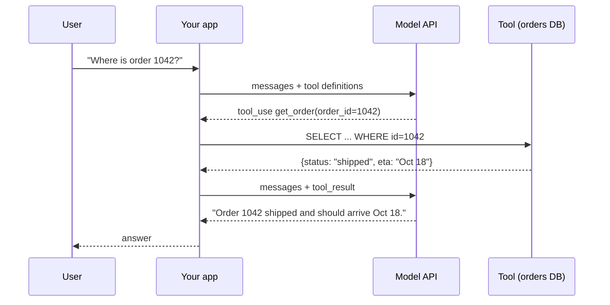
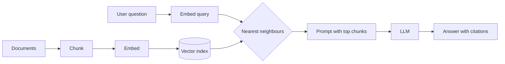

Skip this lesson if you can already explain what happens, byte by byte, when your app sends a tool-calling request. Everyone else: this is the vocabulary the rest of the course assumes.

## A model call is a pure function over text

An LLM API call takes a list of messages and returns a new message. The model has no memory between calls. Anything it should "know" about this conversation must be in the request: the system prompt, the earlier turns, the tool definitions, retrieved documents. This is the single most important fact in AI system design, because it means **you own the state**. The model is stateless compute; your system decides what goes into each call.

```python
import os
import anthropic

client = anthropic.Anthropic()  # reads ANTHROPIC_API_KEY
MODEL = os.environ.get("RELAY_MODEL", "claude-opus-5-5")

resp = client.messages.create(
    model=MODEL,
    max_tokens=1024,
    system="You are Relay, the support assistant for Northwind Outfitters.",
    messages=[{"role": "user", "content": "What is your return window for tents?"}],
)
print(resp.content[0].text)
print(resp.usage)  # input_tokens, output_tokens, cache_read_input_tokens, ...
```

## Tokens are the unit of everything

Models read and write tokens, which are word pieces. In English, one token is roughly four characters or three quarters of a word. Tokens matter for three reasons:

- **Cost.** You pay per input token and per output token. Output is usually 4 to 5 times more expensive.
- **Latency.** Input tokens are processed in parallel and are fast. Output tokens are generated one at a time, so latency is dominated by how many tokens the model writes.
- **Limits.** The context window is the maximum number of tokens in one request plus response. Current frontier models accept up to 1 million tokens, but more context is slower, costlier, and can reduce accuracy.

> [!numbers] A request with 20,000 input tokens and 400 output tokens. Prefill (reading input) on a hosted model runs at thousands of tokens per second, so roughly 0.3 to 1 s before the first output token. Generation at 60 to 120 tokens per second takes 3 to 7 s for 400 tokens. **Output length, not input length, usually dominates latency.** Ask for shorter answers and you get faster ones.

Two latency numbers you will see everywhere:

- **TTFT** (time to first token): how long the user waits before anything appears. Streaming hides generation time behind TTFT.
- **TPOT** (time per output token) or its inverse, output tokens per second.

## Tool calling

Tool calling lets the model ask your code to do something. You describe tools with a name, a description, and a JSON Schema for the input. The model replies either with text or with one or more `tool_use` blocks. Your code runs the tool and sends back a `tool_result`. The model never executes anything itself.



```python
tools = [{
    "name": "get_order",
    "description": "Look up one order by its numeric ID. Returns status, items, and ETA.",
    "input_schema": {
        "type": "object",
        "properties": {"order_id": {"type": "integer"}},
        "required": ["order_id"],
        "additionalProperties": False,
    },
    "strict": True,  # the model's input is guaranteed to match the schema
}]
```

That loop, call the model, run requested tools, append results, call again, is an **agent loop**. Week 1 builds one properly.

## Embeddings and vector search

An embedding model turns text into a fixed-length vector (for example 1,024 floats) so that texts with similar meaning land close together. Retrieval-augmented generation (RAG) embeds your documents once, stores the vectors in an index, then at question time embeds the query, finds the nearest chunks, and puts them in the prompt.



Vector search finds meaning but misses exact terms like SKUs and error codes. Keyword search (BM25) finds exact terms but misses paraphrases. Production systems usually run both. Week 2 covers this in depth.

## Where the money goes

A rough model of LLM application cost:

`cost per request = (input tokens × input price) + (output tokens × output price) + retrieval + compute`

Agents multiply this, because each loop iteration resends the whole conversation. A 6-step agent run with a 5,000-token prompt that grows by 800 tokens per step sends 5,000 + 5,800 + 6,600 + 7,400 + 8,200 + 9,000 = **42,000** input tokens, not 5,000. Prompt caching (Week 5) is how you stop paying full price for the repeated prefix.

## Structured output

When code needs to read the model's answer, ask for JSON that matches a schema. Modern APIs can constrain output to a schema, so you do not parse free text with regexes. Use this for classifiers, extractors, routers, and LLM judges.

```python
from pydantic import BaseModel

class Intent(BaseModel):
    intent: str  # "order_status" | "return" | "product_question" | "other"
    confidence: float

parsed = client.messages.parse(
    model=MODEL,
    max_tokens=256,
    messages=[{"role": "user", "content": "my tent arrived with a broken pole"}],
    output_format=Intent,
)
print(parsed.parsed_output)
```

## What to build before Week 1

If any of this is new, spend an evening on a tiny project: a command-line script that answers questions about three Markdown files using embeddings, then add one tool (for example a calculator). It will make Week 1 far easier.

## Further reading

- [Intro to Large Language Models](https://www.youtube.com/watch?v=zjkBMFhNj_g), Andrej Karpathy's one-hour talk. The clearest overview of what a model is.
- [Tool use overview](https://platform.claude.com/docs/en/agents-and-tools/tool-use/overview), Claude Platform docs.
- [Retrieval-Augmented Generation for Knowledge-Intensive NLP Tasks](https://arxiv.org/abs/2005.11401), the original RAG paper.
- [Hugging Face Agents Course](https://huggingface.co/learn/agents-course), free and hands-on.
- [LLM Course](https://github.com/mlabonne/llm-course) by Maxime Labonne, a free roadmap if you want ML depth.

```quiz
[
  {"q": "A user says the agent \"forgot\" what they said three messages ago. Where is the bug most likely to be?", "options": ["The model's weights", "Your code did not include those earlier turns in the request", "The embedding model", "The API rate limit"], "answer": 1, "why": "Models are stateless. If earlier turns are missing from the request, the model cannot see them. Your system owns conversation state."},
  {"q": "Which change most reduces end-to-end latency for a typical chat answer?", "options": ["Shortening the system prompt by 10%", "Asking for answers half as long", "Using a bigger context window", "Adding more tools"], "answer": 1, "why": "Generation is sequential, so output length dominates latency. Input is processed in parallel and is comparatively cheap in time."},
  {"q": "Why do agent loops cost more than a single call with the same prompt?", "options": ["Tool calls are billed separately at a premium", "Each iteration resends the whole growing conversation as input", "Agents always use larger models", "Streaming doubles the price"], "answer": 1, "why": "Every step resends system prompt, tools, history, and tool results. Input tokens grow roughly quadratically with the number of steps unless you cache or compact."},
  {"q": "Why combine keyword (BM25) search with vector search?", "options": ["Vectors cannot be stored in Postgres", "Keyword search finds exact identifiers that embeddings blur; vectors find paraphrases that keywords miss", "BM25 is always more accurate", "It halves storage"], "answer": 1, "why": "Each method fails differently. Hybrid retrieval covers both exact-match and semantic queries."}
]
```
