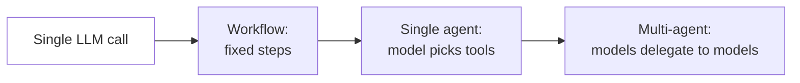
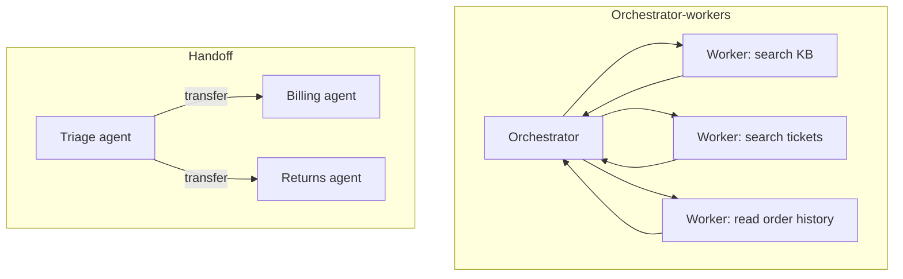

## Start with the least autonomy that works

"Agent" is used loosely. For design purposes, separate two things:

- A **workflow** is a fixed path through LLM calls and code that you wrote. The model fills in steps, but your code decides the order.
- An **agent** is a loop where the model decides the next step: which tool to call, whether to call another, when it is done.

Autonomy is a cost. Every decision you hand to the model adds latency, spend, and a new way to fail. So the first design question is never "which agent framework?" It is "how much of this path can I fix in code?"



Move right only when the step to the left cannot do the job. A good test from practice: if you can draw the flowchart of the task before you see the input, write a workflow. If the path depends on what the model discovers along the way (debugging, research, open-ended support conversations), you need an agent.

> [!rule] Pick the simplest tier that meets the requirement, then earn each step up with an eval result that shows the simpler tier failing.

## The five workflow patterns

Most production "agents" are really one of these patterns, sometimes nested. Anthropic's [Building effective agents](https://www.anthropic.com/engineering/building-effective-agents) named them, and the names have stuck.

| Pattern | Shape | Use when | Relay example |
|---|---|---|---|
| Prompt chaining | A → B → C, with code checks between steps | The task splits into fixed subtasks and each step is easier than the whole | Draft reply → check tone and policy → send |
| Routing | Classify, then send to a specialised handler | Inputs fall into distinct categories that need different prompts, tools, or models | Order status → cheap model with order tools; legal complaint → human queue |
| Parallelization | Run N calls at once, then combine | Independent subtasks, or you want several opinions (voting) | Check a reply for PII, policy, and tone simultaneously |
| Orchestrator-workers | One model plans subtasks, workers execute, orchestrator merges | Subtasks are not known in advance | "Compare return policies across our five brands" |
| Evaluator-optimizer | Generate, critique, revise in a loop | Clear quality criteria and iterating measurably helps | Rewrite a refund denial until it passes the policy rubric |

Routing deserves special attention because it is the cheapest big win. A classifier on a small model costs a fraction of a cent and lets you send 70% of traffic (order status, store hours) to a small model with two tools, and only the hard 30% to a large model with the full toolset.

> [!numbers] Relay gets 50,000 conversations a day, averaging 4 model calls of 8,000 input and 400 output tokens. All on Opus 5.5 ($4 / $20 per million): 50,000 × 4 × (8,000 × 4 + 400 × 20) / 1e6 = **$8,000/day**. Route 70% to Haiku 5.5 ($0.10 / $0.50) with a smaller 3,000-token prompt: 35,000 × 4 × (3,000 × 0.10 + 400 × 0.50) / 1e6 = $70, plus 15,000 × 4 × 40,000 / 1e6 = $2,400 for the rest. About **$2,470/day**, a 69% saving, before caching.

```viz
caption: Routing the easy 70% of traffic to a small model cuts the daily bill by 69%. Almost all of what remains is the hard 30%.
<div class="vz-cols">
  <div class="vz-panel sk"><h5>Everything on the large model</h5>
    <div class="vz-bars"><span>all traffic</span><span class="bar sk"><i class="sk w" style="--w:100%"></i></span><b>$8,000</b></div>
  </div>
  <div class="vz-panel sk g"><h5>Routed</h5>
    <div class="vz-bars"><span>hard 30%, large</span><span class="bar sk"><i class="sk w" style="--w:30%"></i></span><b>$2,400</b><span>easy 70%, small</span><span class="bar sk"><i class="sk g" style="--w:1%"></i></span><b>$70</b></div>
    <p class="big g">-69%</p>
  </div>
</div>
<div class="vz-src">Dollars per day from the worked example above, at <a href="https://platform.claude.com/docs/en/about-claude/pricing">Anthropic list prices</a> (Opus 5.5 $4 / $20, Haiku 5.5 $0.10 / $0.50 per million tokens).</div>
```

The lever is not specific to one vendor. Every major provider sells a small tier at a fraction of its large tier's price, and open-weights models add a third option: a small model on hardware you already pay for.

| Family | Large tier (input / output per M tokens) | Small tier | Input price gap |
|---|---|---|---|
| Anthropic | Claude Opus 5.5: $4 / $20 | Claude Haiku 5.5: $0.10 / $0.50 | 40x |
| OpenAI | GPT-5: $1.25 / $10 | GPT-5 nano: $0.05 / $0.40 | 25x |
| Google | Gemini 2.5 Pro: $1.25 / $10 | Gemini 2.5 Flash-Lite: $0.10 / $0.40 | 12.5x |
| Open weights (Qwen, Llama, Mistral, DeepSeek) | served by a host or router | an 8B-class model on Ollama or vLLM | no per-token fee |

Prices from the [Anthropic](https://platform.claude.com/docs/en/about-claude/pricing), [OpenAI](https://developers.openai.com/api/docs/pricing) and [Gemini](https://ai.google.dev/gemini-api/docs/pricing) pricing pages, standard tier, October 2026 (Gemini 2.5 Pro for prompts up to 200K tokens). The cheapest model that passes your router evals wins; which family it comes from matters less than the gap.

## The single-agent loop

When you do need an agent, start with one. A single agent is a model, a system prompt, a set of tools, and a loop. Here it is written against Anthropic's Messages API; the table after it shows the same checks on OpenAI-style APIs.

```python
def run_agent(messages: list, tools: list, max_steps: int = 10) -> list:
    for step in range(max_steps):
        resp = client.messages.create(
            model=MODEL, max_tokens=4096, system=SYSTEM, tools=tools, messages=messages
        )
        messages.append({"role": "assistant", "content": resp.content})
        if resp.stop_reason == "end_turn":
            return messages  # model produced a final answer
        if resp.stop_reason in ("max_tokens", "model_context_window_exceeded", "refusal"):
            raise AgentStopped(resp.stop_reason, messages)  # truncated or declined: do not run tools
        if resp.stop_reason != "tool_use":
            return messages  # e.g. stop_sequence
        results = []
        for block in resp.content:
            if block.type == "tool_use":
                results.append(execute_tool(block))  # returns a tool_result dict
        messages.append({"role": "user", "content": results})  # all results in ONE message
    raise StepLimitExceeded(messages)
```

| What the model means | Anthropic `stop_reason` | Chat Completions `finish_reason` (OpenAI, Gemini, Ollama, vLLM, routers) |
|---|---|---|
| Final answer | `end_turn` | `stop` |
| Run the tools I asked for | `tool_use` | `tool_calls` |
| Cut off at the token limit | `max_tokens`, `model_context_window_exceeded` | `length` |
| Declined or filtered | `refusal` | `content_filter` |

Sources: Anthropic [handling stop reasons](https://platform.claude.com/docs/en/build-with-claude/handling-stop-reasons); OpenAI [Chat Completions reference](https://developers.openai.com/api/docs/api-reference/chat). Some OpenAI-compatible servers report `stop` even when the reply contains tool calls, so the course's reference code checks for tool calls directly rather than trusting the label. Write your loop against one internal format and translate at the edge; then switching providers is a configuration change, not a rewrite.

Everything else in this course hangs off this loop: what goes into `SYSTEM` and `messages` (context engineering), what persists between runs (memory), what `execute_tool` is allowed to do (security), how you know it worked (evals), and how you watch it run (tracing).

Design decisions inside the loop that matter in production:

- **Check why the model stopped.** Done, run tools, cut off, and declined are four different situations (table above). A cut-off reply may hold an incomplete tool call, so never run it. Handle each explicitly rather than treating everything that is not a tool call as a final answer.
- **Step limit.** Always cap steps. An agent that loops forever is a billing incident. Return a graceful message, log the trace, and alert if the rate of hitting the cap rises.
- **Parallel tool calls.** Models can request several tools at once. Run them concurrently and return every result together, straight after the assistant turn that asked. On Anthropic that means all `tool_result` blocks in one user message; its [docs warn](https://platform.claude.com/docs/en/agents-and-tools/tool-use/parallel-tool-use) that separate messages "teach" Claude to avoid parallel calls. On Chat Completions each result is its own `role: "tool"` message with its `tool_call_id`, appended back to back. OpenAI also lets you turn parallel calls off with [`parallel_tool_calls: false`](https://developers.openai.com/api/docs/guides/function-calling) when order matters.
- **Tool errors are data.** If a tool fails, return a tool result that says so (Anthropic has an `is_error: true` flag; on Chat Completions, say it plainly in the content) with a message the model can act on ("order 1042 not found; ask the customer to confirm the number"). Do not crash the loop and do not hide the error.
- **Timeouts per tool and per run.** A slow inventory API should not hold a user for 90 seconds.

## Designing tools is designing the agent

The tool set is the agent's interface to the world, and it shapes behaviour more than the prompt does. Good tools:

- **Match how a person would do the task**, not how your microservices are split. `get_order_summary(order_id)` beats making the model call `get_order`, `get_shipment`, and `get_payment` and join them.
- **Return what the model needs, compactly.** A 4,000-token JSON blob with 80 fields wastes context and attention. Return the ten fields that matter, as readable text or small JSON.
- **Have unambiguous names and descriptions.** Descriptions are prompts. Say when to use the tool, when not to, and what the arguments mean, with an example.
- **Fail helpfully.** Error strings tell the model what to try next.
- **Separate read tools from write tools.** This makes permission tiers, approvals, and evals easier (Week 3).

Anthropic's [Writing effective tools for agents](https://www.anthropic.com/engineering/writing-tools-for-agents) and OpenAI's [function calling guide](https://developers.openai.com/api/docs/guides/function-calling) are good free references; the advice holds for any model, including open-weights ones, which are usually less forgiving of vague tool descriptions.

## When multiple agents pay off

A multi-agent system has several model contexts that communicate: an orchestrator that spawns sub-agents, a pipeline of specialists, or peers handing off a conversation. It sounds more capable. Often it is just more expensive and harder to debug.

Multiple agents help in three situations:

1. **Context isolation.** A sub-agent can read 200,000 tokens of search results and return a 1,000-token summary. The orchestrator's context stays clean. This is the main reason research agents use sub-agents.
2. **Breadth-first parallel work.** When a task splits into independent threads (search five sources, analyse ten files), parallel sub-agents finish in the wall-clock time of the slowest one.
3. **Different permissions or models per role.** A sub-agent that reads untrusted web content can run with no write tools at all. That is a security boundary, not just an organisational one.

They hurt when:

- **Subtasks share a lot of state.** Agents each make decisions with partial context, and their outputs conflict. Cognition's [Don't build multi-agents](https://cognition.ai/blog/dont-build-multi-agents) makes this argument well: for tightly coupled work like coding, one agent with full context beats several with fragments.
- **Latency matters.** Each hop adds a full model round trip.
- **Cost matters.** Anthropic's [multi-agent research system](https://www.anthropic.com/engineering/multi-agent-research-system) write-up reports that single agents use about 4 times the tokens of a chat interaction, and multi-agent systems about 15 times. It was worth it for open-ended research. It would not be worth it for order status.

```viz
caption: Each step up in autonomy multiplies token spend. A multi-agent system burns about 15 times the tokens of a chat, so it has to buy something a single agent cannot.
<div class="vz-bars"><span>chat</span><span class="bar sk"><i class="sk w" style="--w:7%"></i></span><b>1x</b><span>single agent</span><span class="bar sk"><i class="sk w" style="--w:27%"></i></span><b>about 4x</b><span>multi-agent</span><span class="bar sk"><i class="sk w" style="--w:100%"></i></span><b>about 15x</b></div>
<div class="vz-cols">
  <div class="vz-panel sk g"><h5>Worth it</h5><p>open-ended research, huge reads, separate trust levels</p></div>
  <div class="vz-panel sk b"><h5>Not worth it</h5><p>order status, tightly coupled edits, tight latency budgets</p></div>
</div>
<div class="vz-src">Token multiples from Anthropic, <a href="https://www.anthropic.com/engineering/multi-agent-research-system">How we built our multi-agent research system</a> (2025), measured on its research product.</div>
```

> [!rule] Split into multiple agents along boundaries where little information needs to cross: independent subtasks, different trust levels, or a context that would otherwise overflow.

### Common multi-agent topologies



- **Orchestrator-workers (supervisor).** The orchestrator plans, spawns workers with narrow instructions, and synthesises. Workers return condensed results, not raw transcripts. Most robust general shape.
- **Handoff (swarm).** One agent owns the conversation at a time and transfers control to another, passing a summary. Good for support flows with clear departments. The risk is lost context at each transfer.
- **Pipeline.** Fixed sequence of specialised agents. This is really a workflow with agentic steps, and it is often the right answer.

### How multi-agent systems fail

The most systematic study so far, [Why Do Multi-Agent LLM Systems Fail?](https://arxiv.org/abs/2503.13657), annotated more than 1,600 traces from 7 popular multi-agent frameworks and grouped what went wrong into a taxonomy (MAST) of 14 failure modes in 3 categories:

- **System design issues**: unclear role or task specifications, agents ignoring their constraints, losing conversation history, not knowing when to stop.
- **Inter-agent misalignment**: agents withholding information, ignoring each other's input, drifting off task, or acting on assumptions instead of asking.
- **Task verification**: stopping too early, checking results superficially or not at all.

Human annotators agreed on the labels with a kappa of 0.88, so these are recognisable, repeatable failures, not noise. Most of them are design problems you can fix with better specifications, clearer handoffs, and explicit verification steps, rather than with a stronger model. Use the taxonomy as a checklist when you read multi-agent traces.

### Writing the delegation

Most multi-agent failures are bad delegation, not bad models. When the orchestrator spawns a worker, the task description must include: the objective, the output format, which tools to use, what is out of scope, and how much effort to spend. "Research return policies" produces sprawling duplicate work. "Find the return window and restocking fee for tents in the 2026 returns policy; return a two-line answer with the document ID; do not search order data" does not.

## Agents talking to other agents: A2A

MCP connects an agent to tools and data. The [Agent2Agent protocol (A2A)](https://a2a-protocol.org/latest/) connects an agent to *other agents*, which may be built by other teams or vendors on other frameworks, without either side exposing its internal memory, tools, or prompts. In the protocol's own words, "MCP is for agent-to-tool communication" and "A2A is for agent-to-agent communication". Google started it and donated it to the Linux Foundation, where a steering committee with members from AWS, Microsoft, Salesforce, SAP, and others maintains it.

You need A2A when an agent must delegate to an agent you do not control, for example your support agent asking a carrier's agent about a lost parcel. Inside one codebase, plain function calls or sub-agents are simpler. Everything in Week 3 still applies: another organisation's agent is untrusted input, so treat its replies like a third-party tool result.

## Choosing a framework (or not)

You can build everything in this course with the raw SDK and about 300 lines of Python. Frameworks such as LangGraph, Pydantic AI, the OpenAI Agents SDK, Google ADK, and the Claude Agent SDK add state graphs, checkpointing, built-in tools, and integrations. They are worth it when you need durable execution or complex branching. They cost you an abstraction layer between you and the actual prompts.

The labs use the raw provider SDKs behind a thin adapter of your own, so that you see every token and can switch providers with one setting. After the course, pick a framework knowingly. The [12-factor agents](https://github.com/humanlayer/12-factor-agents) essay makes a strong case for owning your prompts, context, and control flow regardless of what you choose.

## Design review questions

> [!interview] Why is this an agent rather than a workflow? Show me an input where a fixed path would fail.

> [!interview] What stops the loop? What happens when it hits the step limit, and who finds out?

> [!interview] If you use several agents, what information crosses between them, and what is lost at each boundary?

> [!interview] What does one conversation cost at p50 and p95, and what is the plan if traffic triples?

## Further reading

- [Building effective agents](https://www.anthropic.com/engineering/building-effective-agents), Anthropic. The workflow patterns in one page.
- [How we built our multi-agent research system](https://www.anthropic.com/engineering/multi-agent-research-system), Anthropic. Real numbers on when multi-agent works.
- [Don't build multi-agents](https://cognition.ai/blog/dont-build-multi-agents), Cognition. The counter-argument.
- [LLM Powered Autonomous Agents](https://lilianweng.github.io/posts/2023-06-23-agent/), Lilian Weng. Planning, memory, and tool use in one survey.
- [ReAct: Synergizing Reasoning and Acting](https://arxiv.org/abs/2210.03629), the paper behind the think-act-observe loop.
- [AI Agents for Beginners](https://github.com/microsoft/ai-agents-for-beginners), Microsoft. Free lessons with code.
- [Why Do Multi-Agent LLM Systems Fail?](https://arxiv.org/abs/2503.13657), the MAST failure taxonomy.
- [A2A protocol](https://a2a-protocol.org/latest/), for agent-to-agent interoperability.

```quiz
[
  {"q": "A product team wants an \"agent\" that takes an uploaded invoice, extracts fields, validates totals, and writes a row to the database. What should you build first?", "options": ["A multi-agent system with an extractor and a validator agent", "A single agent with database tools", "A workflow: extraction call with a schema, code validation, then a write", "A fine-tuned model"], "answer": 2, "why": "The path is known before seeing the input. A fixed workflow is cheaper, faster, and easier to test. Add autonomy only where the evals show the workflow failing."},
  {"q": "Which situation most justifies splitting work across sub-agents?", "options": ["Each step needs the full conversation history", "A task needs reading hundreds of thousands of tokens of search results, of which only a summary matters", "You want lower latency on a simple FAQ", "You want to reduce token spend"], "answer": 1, "why": "Context isolation is the strongest reason. Sub-agents absorb large, noisy inputs and pass back condensed results so the orchestrator's context stays focused."},
  {"q": "The model requests three tools in one turn. How should you return the results?", "options": ["Only the first result now; send the others in later turns", "All three together, straight after the assistant turn that asked: one user message on Anthropic, three back-to-back tool messages on OpenAI-style APIs", "Only the first result; the model will ask again", "Concatenate them into a text block"], "answer": 1, "why": "Every result answers a call ID and belongs right after the turn that made the calls. On Anthropic, splitting results across messages also teaches the model to stop calling tools in parallel."},
  {"q": "A tool call fails because the order ID does not exist. What is the best behaviour?", "options": ["Raise an exception and end the run", "Return a tool result marked as an error (is_error on Anthropic) with a message the model can act on", "Silently return an empty object", "Retry the same call five times"], "answer": 1, "why": "Errors are information. A clear error result lets the model recover, for example by asking the customer to confirm the order number."},
  {"q": "According to the MAST study of multi-agent failures, where do most failures come from?", "options": ["Weak base models", "System design, misalignment between agents, and missing verification, which are mostly fixable by design", "Network errors", "Tokenizer bugs"], "answer": 1, "why": "The 14 failure modes cluster into specification and design issues, inter-agent misalignment, and task verification. Better specifications, handoffs, and checks address most of them."},
  {"q": "In the routing example, what produced most of the cost saving?", "options": ["Shorter answers", "Sending the easy majority of traffic to a much cheaper model with a smaller prompt", "Removing tools", "Streaming"], "answer": 1, "why": "70% of traffic moved from $4/$20 to $0.10/$0.50 per million tokens with a smaller prompt. Routing is usually the largest single cost lever in a product with mixed difficulty."}
]
```
