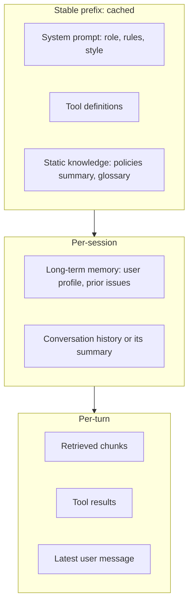

## The context is the program

Because the model is stateless, every turn is a fresh read of whatever you put in the request. **Context engineering** is the discipline of deciding, on every call, which tokens go in, in what order, and in what form. Prompt engineering is one part of it: the instructions. The rest is everything else the model sees: tool definitions, retrieved documents, conversation history, tool results, memory, and the state of the task.

A useful frame: the context window is working memory with three properties.

1. **It is finite.** Even a 1M-token window fills up on a long agent run.
2. **It is not uniform.** Models attend less reliably to information buried in the middle of long contexts. See [Lost in the Middle](https://arxiv.org/abs/2307.03172) and Chroma's [Context Rot](https://research.trychroma.com/context-rot) study, which found accuracy degrading as input length grows even on simple tasks.
3. **It is paid for on every turn.** Every token you add is re-billed each loop iteration unless cached.

> [!rule] Give the model the smallest set of high-signal tokens that lets it do the next step well. More context is not more help.

## Anatomy of an agent's context



Order matters for two reasons. First, **prompt caching works on prefixes**: anything that changes invalidates the cache for everything after it. So put stable content first and volatile content last. Second, models tend to weigh the start and end of the context most, so put durable instructions at the start and the immediate task at the end.

### The system prompt

Write the system prompt like a brief for a capable new colleague, not a list of capitalised commands. Include:

- **Role and goal.** Who the assistant is and what success looks like.
- **Context the model cannot infer.** Business rules, who the users are, what the tools connect to.
- **Decision rules with reasons.** "Refunds over $200 need human approval because our fraud rate on high-value refunds is 3x higher" works better than "NEVER refund over $200". Reasons let the model generalise to cases you did not list.
- **Output format.** Length, tone, citation style.
- **What to do when unsure.** Ask a clarifying question, hand off to a human, or say it does not know.

Avoid contradictions (they are common in prompts edited by many people), stale examples, and walls of edge cases. If a rule only applies to one tool, put it in that tool's description.

Use clear sections. XML-style tags or Markdown headers both work. They help the model and they help the next engineer.

```text
<role>
You are Relay, the support assistant for Northwind Outfitters, an outdoor gear retailer.
You help customers with orders, returns, and product questions over chat.
</role>

<policies>
- Return window: 60 days for unused items, 30 days for used tents and sleeping bags.
- Refunds up to $200 you may issue directly with issue_refund.
  Above $200, call request_refund_approval; a human reviews within 4 business hours.
  (High-value refunds have a higher fraud rate, so they need a second pair of eyes.)
</policies>

<style>
Short, warm, plain English. Two to four sentences unless the customer asks for detail.
Cite the policy document ID in brackets when you state a policy, like [POL-RETURNS-2026].
</style>

<when_unsure>
If the customer's request is ambiguous, ask one clarifying question.
If they are upset about safety (injury, fire, gas leak), call escalate_to_human immediately.
</when_unsure>
```

## Load up front or retrieve just in time?

You have two ways to get knowledge into context:

- **Up front.** Put it in the system prompt or retrieve it before the first call. Fast and predictable. Wastes tokens when most of it is irrelevant.
- **Just in time.** Give the agent tools (`search_kb`, `get_order`, `read_file`) and let it pull what it needs. Precise and scalable. Costs extra turns, and the agent might not look.

Most good systems mix the two. Load a small, always-relevant core (key policies, the user's profile) and expose the rest through tools. Coding agents are the extreme case: they load almost nothing and explore with `grep` and `ls`, keeping only lightweight references (file paths) in context until they need contents.

> [!numbers] Relay's full policy corpus is 180 documents, about 400,000 tokens. Loading it every turn on Haiku 5.5 costs 400,000 × $0.10 / 1e6 = **$0.04 per call** before output and takes over a second of prefill. A one-page policy summary (2,000 tokens) plus a `search_kb` tool costs $0.0002 per call, and the agent fetches details only on the 20% of turns that need them.

## Keeping long runs healthy

An agent that runs for 40 steps accumulates tool results, many of which are stale. Left alone, the context grows until the run is slow, expensive, and confused. Four techniques, from simplest to most involved:

### 1. Trim tool results at the source

The cheapest token is one you never add. Make tools return compact results, paginate large lists, and truncate long fields with a note ("showing 20 of 312 orders; call with page=2 for more").

### 2. Clear old tool results

Once the agent has used a tool result, the raw output is rarely needed again. Replace it with a stub such as `[result of get_order(1042) cleared; status was shipped]`. Some APIs offer this as a server-side feature (context editing). Doing it yourself is a few lines.

### 3. Compact the history

When the context passes a threshold (say 70% of your budget), summarise older turns into a structured note and continue from the summary. Good compaction keeps decisions, open questions, user preferences, and identifiers (order numbers, file paths), and drops chatter and raw tool output. Bad compaction loses the one detail that mattered, so test it with evals that run long conversations.

```python
COMPACT_PROMPT = """Summarise this support conversation for a colleague taking over.
Keep: customer identity, order IDs, what was already tried, promises made, open questions.
Drop: greetings, raw tool output, repeated text. Use short bullet points."""

def maybe_compact(messages, budget_tokens=60_000, keep_last=6):
    if count_tokens(messages) < budget_tokens * 0.7:
        return messages
    old, recent = messages[:-keep_last], messages[-keep_last:]
    summary = summarise(old, COMPACT_PROMPT)  # one cheap model call
    return [{"role": "user", "content": f"<conversation_summary>\n{summary}\n</conversation_summary>"}] + recent
```

> [!warn] When you cut history, cut at a turn boundary. A `tool_result` without the `tool_use` that requested it is an invalid request on most APIs, and an orphaned assistant turn confuses the model.

### 4. Structured notes and sub-agents

For very long tasks, have the agent maintain an explicit scratchpad (a `notes` or `todo` tool, or a file) with its plan and progress. After compaction it reads its notes and continues. Sub-agents are the other escape valve: delegate a reading-heavy subtask so its tokens never enter the main context.

## Context and caching are one design

Prompt caching gives a large discount (often 90%) on input tokens that match a previously seen prefix. It only works if the prefix is byte-identical. Common ways teams accidentally break it:

- Putting a timestamp, request ID, or user name in the system prompt.
- Serialising tool definitions in a different order each time (unsorted dicts).
- Adding or removing tools per request.
- Editing earlier messages (for example re-summarising every turn instead of appending).

Design the context so the first several thousand tokens never change between users, the next block changes per session, and only the tail changes per turn. Week 5 covers caching economics in detail. See the [prompt caching docs](https://platform.claude.com/docs/en/build-with-claude/prompt-caching) for the mechanics.

## A context budget for Relay

Write budgets down. They make trade-offs explicit and give you something to alert on.

| Block | Budget (tokens) | Changes | Notes |
|---|---|---|---|
| System prompt | 1,500 | Per deploy | Versioned in Git |
| Tool definitions (8 tools) | 2,000 | Per deploy | Sorted, stable |
| Policy summary | 2,000 | Weekly | Regenerated by ingestion job |
| User memory | 500 | Per session | Top facts only |
| History or summary | ≤ 20,000 | Per turn | Compact at 70% |
| Retrieved chunks | ≤ 4,000 | Per turn | Top 5 after reranking |
| Tool results | ≤ 8,000 | Per turn | Truncate long fields |
| **Total ceiling** | **≈ 38,000** | | Alert if p95 exceeds |

## Design review questions

> [!interview] Walk me through every block in your context on turn 15. Which ones are stale?

> [!interview] What is your cache hit rate, and what would break it?

> [!interview] How do you know compaction did not drop something important? Show me the eval.

> [!interview] Why is this knowledge in the prompt instead of behind a tool (or the reverse)?

## Further reading

- [Effective context engineering for AI agents](https://www.anthropic.com/engineering/effective-context-engineering-for-ai-agents), Anthropic.
- [Context Engineering for Agents](https://rlancemartin.github.io/2025/06/23/context_engineering/), Lance Martin. A taxonomy: write, select, compress, isolate.
- [The New Skill in AI is Context Engineering](https://www.philschmid.de/context-engineering), Philipp Schmid.
- [Context Rot](https://research.trychroma.com/context-rot), Chroma research on long-context degradation.
- [Lost in the Middle](https://arxiv.org/abs/2307.03172), the paper on position effects in long contexts.
- [12-factor agents](https://github.com/humanlayer/12-factor-agents), especially "own your context window".

```quiz
[
  {"q": "Your cache hit rate dropped to zero after a deploy. Which change is the most likely cause?", "options": ["You added a new tool result format", "Someone added the current date and time to the top of the system prompt", "Users started asking longer questions", "You lowered max_tokens"], "answer": 1, "why": "Caching matches exact prefixes. A value that changes every request at the start of the prompt invalidates the cache for everything after it."},
  {"q": "Where should a rule that only applies to the issue_refund tool live?", "options": ["At the top of the system prompt in capitals", "In the issue_refund tool description, with the reason", "In every user message", "In a separate fine-tune"], "answer": 1, "why": "Put tool-specific guidance where the model reads it when deciding to use that tool. It keeps the system prompt short and the rule close to the action."},
  {"q": "What must compaction preserve above all?", "options": ["Greetings and tone", "Raw tool output for auditability", "Decisions, identifiers, promises made, and open questions", "The exact wording of every message"], "answer": 2, "why": "A summary is useful if the next turn can act on it. Identifiers and commitments are the details that cause real failures when lost."},
  {"q": "Why prefer a compact policy summary plus a search tool over loading all 180 policy documents?", "options": ["Long contexts are not allowed", "It cuts cost and latency by orders of magnitude and keeps attention on relevant text", "Search tools are always more accurate", "Policies cannot be cached"], "answer": 1, "why": "Loading everything costs about 200x more per call and dilutes attention. The agent retrieves details on the minority of turns that need them."}
]
```
