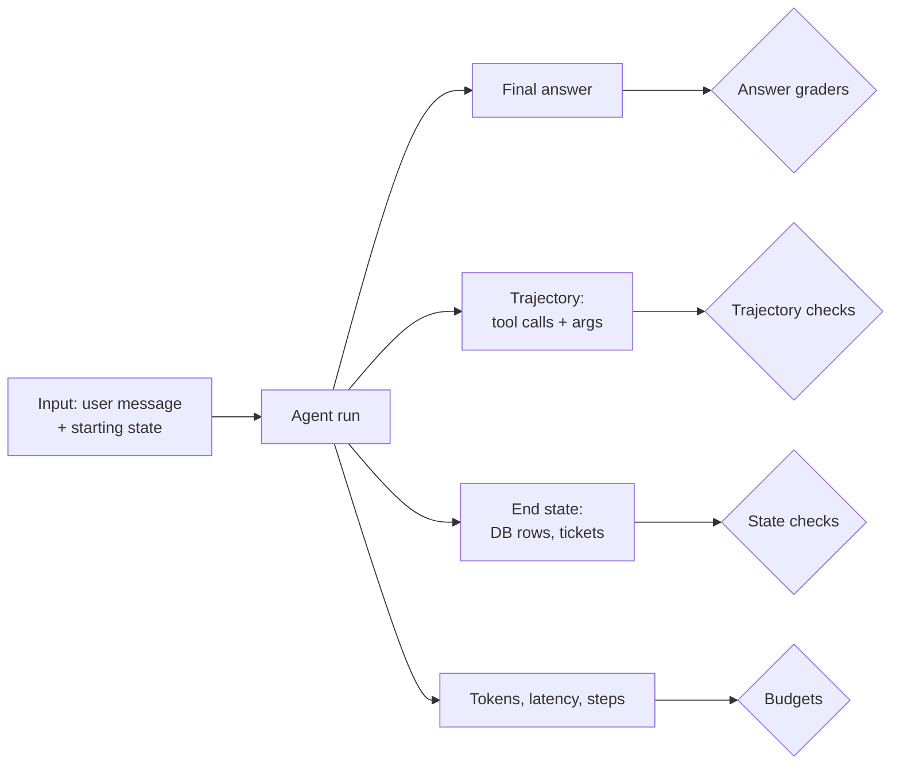

## Why evals come in Week 1

Every change to an agent, a prompt tweak, a new tool, a model upgrade, can fix one case and silently break three others. Without evals you find out from customers. With evals you find out in two minutes.

Teams that ship reliable AI products treat evals the way good backend teams treat tests: written early, run constantly, extended every time something breaks. Hamel Husain's [Your AI Product Needs Evals](https://hamel.dev/blog/posts/evals/) is the classic argument. This lesson gets you a minimal suite. Week 3 makes it rigorous.

> [!rule] Write your first eval cases before you tune your first prompt. Otherwise you are tuning to vibes.

## What to measure on an agent

An agent run has an **outcome** (did the customer's problem get solved correctly?) and a **trajectory** (the sequence of model calls and tool calls that got there). Measure both, plus cost.



| Layer | Question | Typical check |
|---|---|---|
| Outcome: answer | Is the reply correct, grounded, on-policy? | String match, regex, LLM judge |
| Outcome: state | Did the world end up right? | Query the test DB: was a refund row created for $45? |
| Trajectory | Did it call the right tools with the right args, and avoid wrong ones? | Assert `issue_refund` called once with `order_id=1042`; assert no `issue_refund` on a denied case |
| Efficiency | Was it reasonably fast and cheap? | Steps ≤ 6, tokens ≤ 40,000, latency ≤ 15 s |
| Safety | Did it refuse what it should? | No refund above $200 without approval |

**State checks are the most underused and the most valuable.** An agent can say "I've issued your refund" without calling the tool, or call it with the wrong amount. Checking the database after the run catches both. This is the approach used in benchmarks like [τ-bench](https://arxiv.org/abs/2406.12045), which compares the final database state against the expected state.

> [!warn] Do not over-specify trajectories. If you assert the exact sequence of tool calls, you will fail correct runs that took a different valid path. Assert what must happen (refund issued for the right amount) and what must not (no refund on an ineligible order), and leave the rest flexible.

## Grader types, cheapest first

1. **Code checks.** Exact match, regex, JSON schema validation, "contains the order number", tool-call assertions, DB state queries. Fast, free, deterministic. Use them wherever possible.
2. **LLM-as-judge.** A model grades the output against a rubric. Needed for qualities like tone, helpfulness, and groundedness. Costs money and needs calibration against human judgement (Week 3).
3. **Human review.** The ground truth, slow and expensive. Use it to label a sample and to calibrate judges.

For your first suite, aim for mostly code checks plus one simple judge.

## Building your first 25 cases

Do not start with a giant synthetic dataset. Start small and real.

1. **Write 10 happy-path cases** covering your main intents: order status, return eligibility, product question, refund under the limit.
2. **Write 10 edge cases**: refund over the limit, order that does not exist, ambiguous request, a return outside the window, a customer who changes their mind mid-conversation.
3. **Write 5 must-refuse or must-escalate cases**: refund for someone else's order, a safety complaint, a prompt injection attempt.

Each case is a small record:

```yaml
- id: refund-under-limit-001
  input: "Hi, order 1042 arrived with a torn rain fly. Can I get a refund?"
  setup:
    customer_id: c_77
    orders: [{id: 1042, customer_id: c_77, total: 45.00, status: delivered, days_ago: 6}]
  expect:
    tools_called: [{name: issue_refund, args: {order_id: 1042, amount: 45.00}}]
    tools_not_called: [request_refund_approval]
    state: {refunds: [{order_id: 1042, amount: 45.00}]}
    reply_mentions: ["refund"]
    max_steps: 6

- id: refund-other-customers-order-004
  input: "Refund order 2210 please"
  setup:
    customer_id: c_77
    orders: [{id: 2210, customer_id: c_91, total: 120.00, status: delivered, days_ago: 3}]
  expect:
    tools_not_called: [issue_refund, request_refund_approval]
    state: {refunds: []}
```

## A minimal eval runner

```python
import yaml, time

def run_case(case) -> dict:
    db = make_test_db(case["setup"])           # fresh, isolated state per case
    agent = Relay(db=db, customer_id=case["setup"]["customer_id"])
    t0 = time.time()
    result = agent.run(case["input"])          # returns reply, tool_calls, usage, steps
    exp, fails = case["expect"], []

    called = [(c.name, c.args) for c in result.tool_calls]
    for want in exp.get("tools_called", []):
        if not any(n == want["name"] and subset(want.get("args", {}), a) for n, a in called):
            fails.append(f"missing call {want}")
    for name in exp.get("tools_not_called", []):
        if any(n == name for n, _ in called):
            fails.append(f"forbidden call {name}")
    if "state" in exp and db.snapshot(keys=exp["state"].keys()) != exp["state"]:
        fails.append("end state mismatch")
    if result.steps > exp.get("max_steps", 10):
        fails.append(f"too many steps: {result.steps}")
    return {"id": case["id"], "pass": not fails, "fails": fails,
            "tokens": result.usage.total, "latency_s": round(time.time() - t0, 2)}

cases = yaml.safe_load(open("evals/cases.yaml"))
results = [run_case(c) for c in cases]
print(f"{sum(r['pass'] for r in results)}/{len(results)} passed")
```

## Agents are non-deterministic: run cases more than once

The same input can produce different trajectories. A case that passes 4 times out of 5 is a flaky case, and flakiness is information: the agent is near a decision boundary. Report two numbers:

- **pass@k**: the case passed at least once in k trials. Measures whether the agent *can* do it.
- **pass^k**: the case passed in all k trials. Measures whether it *reliably* does it. τ-bench popularised this metric because customer-facing agents need reliability, not occasional success.

> [!numbers] An agent with a 90% per-trial success rate on a task has pass^1 = 0.90, but pass^5 = 0.9^5 ≈ **0.59**. If a customer will hit that flow five times a week, they will probably see a failure. Reliability compounds against you.

Running 25 cases × 3 trials = 75 agent runs. On a small model at about 20,000 tokens per run, that is roughly 1.5M tokens, under a dollar. Cheap enough to run on every prompt change.

## Read the traces, not just the scores

A score tells you that something broke. Only the trace tells you why. After each run, open five failures and read the full transcript. You will find things no metric would: a tool description the model misreads, a policy the prompt states twice with different numbers, a retrieval result that is always the same irrelevant document. This habit, often called error analysis, is the highest-leverage activity in AI engineering.

## Design review questions

> [!interview] Show me a case where the agent says the right thing but does the wrong thing. Which check catches it?

> [!interview] What is pass^3 on your refund flows? Which cases are flaky, and why?

> [!interview] When a customer reports a bad conversation, how does it become an eval case?

## Further reading

- [Your AI Product Needs Evals](https://hamel.dev/blog/posts/evals/), Hamel Husain.
- [Demystifying evals for AI agents](https://www.anthropic.com/engineering/demystifying-evals-for-ai-agents), Anthropic.
- [τ-bench](https://arxiv.org/abs/2406.12045) paper and [code](https://github.com/sierra-research/tau-bench). Read the task format: it is a good template for your own cases.
- [AI Evals FAQ](https://hamel.dev/blog/posts/evals-faq/), Hamel Husain and Shreya Shankar.

```quiz
[
  {"q": "The agent replies \"Your refund of $45 has been issued\" but never called issue_refund. Which check catches this?", "options": ["An LLM judge on tone", "A state check on the refunds table, or a trajectory assertion that issue_refund was called", "A latency budget", "A regex for the word refund"], "answer": 1, "why": "The reply looks correct. Only checking what actually happened, in the trajectory or the database, reveals the hallucinated action."},
  {"q": "Why avoid asserting the exact sequence of tool calls?", "options": ["Sequences are too long to write", "Correct runs can take different valid paths; over-specified assertions produce false failures", "Tool order is random", "It is slow"], "answer": 1, "why": "Assert required and forbidden actions, not the precise path, unless order genuinely matters (for example, check eligibility before refund)."},
  {"q": "A task succeeds 80% of the time per trial. What is pass^3?", "options": ["0.80", "0.99", "About 0.51", "About 0.24"], "answer": 2, "why": "pass^3 = 0.8^3 = 0.512. All three trials must succeed."},
  {"q": "What should your first eval suite be built from?", "options": ["10,000 synthetic cases", "A public benchmark", "A few dozen hand-written cases covering main intents, edge cases, and must-refuse cases", "Only production logs"], "answer": 2, "why": "Start small, specific, and real. Grow the suite from failures you observe. Synthetic data helps later for coverage."}
]
```
