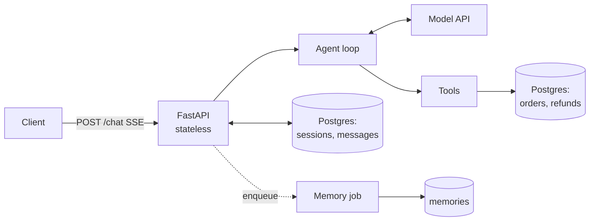

## What you will build

Relay v1 is a FastAPI service that runs a tool-using support agent. It is small, but it is shaped like a production system from the first commit: stateless API instances, state in Postgres, async I/O, bounded loops, and an eval suite.



**Acceptance criteria**

1. `POST /chat` streams the reply as server-sent events and persists every message.
2. A second request with the same `session_id` continues the conversation, even after restarting the server.
3. The agent has at least five tools, including one write tool (`issue_refund`) with a server-side limit.
4. The loop has a step limit and per-tool timeouts. Tools run concurrently when the model requests several.
5. After a session goes idle, a background task extracts memories, and the next session for that customer sees them.
6. `uv run python -m evals.run` executes at least 25 cases, 3 trials each, and prints pass rate, pass^3, tokens, and p95 latency.

> [!tip] A tested reference implementation of this lab is in the course repository under [`relay/` at tag `lab1`](https://github.com/Rachneet/ai-system-design-course/tree/lab1/relay). Try the lab yourself first, then compare. Its 29 tests run without an API key or Docker. The current version on `main` also runs on any provider; see [Choose any model provider](https://github.com/Rachneet/ai-system-design-course/tree/main/relay#choose-any-model-provider).

**Use any model provider.** Relay picks its model from `RELAY_MODEL`, written as `provider:model`: for example `openai:gpt-5`, `gemini:gemini-2.5-flash`, `anthropic:claude-haiku-5-5`, `openrouter:qwen/qwen3-235b-a22b`, `huggingface:meta-llama/Llama-3.3-70B-Instruct`, or `ollama:qwen3:8b` for a free local model. The background memory job and the eval judge have their own settings (`RELAY_MEMORY_MODEL`, `RELAY_JUDGE_MODEL`), so you can mix providers. Model IDs change often; check each provider's list. Whatever you pick, the acceptance criteria are the same, and your eval suite tells you whether the model is good enough at tool calling.

```viz
caption: Your loop speaks one message format. A thin adapter per API translates at the edge, so switching provider is a setting, not a rewrite.
<div class="vz-row"><span class="ch sk c">agent loop</span><span class="arr sk"></span><span class="ch sk m">one message format</span><span class="arr sk"></span><span class="ch sk">adapter</span></div>
<div class="vz-cols">
  <div class="vz-panel sk"><h5>Native adapter</h5><div class="vz-row"><span class="ch sk">Anthropic Messages</span></div></div>
  <div class="vz-panel sk"><h5>OpenAI-compatible adapter</h5><div class="vz-row"><span class="ch sk">OpenAI</span><span class="ch sk">Gemini</span><span class="ch sk">OpenRouter</span><span class="ch sk">Hugging Face</span><span class="ch sk">Ollama</span><span class="ch sk">vLLM</span><span class="ch sk">LiteLLM proxy</span></div></div>
</div>
<div class="vz-row"><span class="ch wide sk m">sessions, evals and judges never see the difference</span></div>
```

## Step 1: project skeleton

```bash
uv init relay && cd relay
uv add openai anthropic fastapi "uvicorn[standard]" "psycopg[binary,pool]" pydantic-settings pyyaml
uv add --dev pytest ruff
mkdir -p app evals
```

The `openai` SDK reaches OpenAI and every OpenAI-compatible endpoint (Gemini, OpenRouter, Hugging Face, Ollama, vLLM, LiteLLM); `anthropic` talks to Claude natively. Install only the one you need if you prefer.

`docker-compose.yml` for local Postgres with pgvector (you will need vectors in Week 2):

```yaml
services:
  db:
    image: pgvector/pgvector:pg16
    environment:
      POSTGRES_PASSWORD: relay
      POSTGRES_DB: relay
    ports: ["5432:5432"]
    volumes: ["pgdata:/var/lib/postgresql/data"]
volumes:
  pgdata:
```

`app/schema.sql`. Seed a few customers and orders yourself (write a `scripts/seed.py`).

```sql
CREATE TABLE IF NOT EXISTS customers (id text PRIMARY KEY, name text, email text);
CREATE TABLE IF NOT EXISTS orders (
  id int PRIMARY KEY, customer_id text REFERENCES customers(id),
  status text, total numeric(10,2), items jsonb, delivered_at timestamptz
);
CREATE TABLE IF NOT EXISTS refunds (
  id serial PRIMARY KEY, order_id int REFERENCES orders(id),
  amount numeric(10,2), reason text, created_at timestamptz DEFAULT now(),
  UNIQUE (order_id)                       -- one refund per order: idempotency at the DB layer
);
CREATE TABLE IF NOT EXISTS sessions (
  id uuid PRIMARY KEY, customer_id text, summary text,
  state jsonb DEFAULT '{}', updated_at timestamptz DEFAULT now()
);
CREATE TABLE IF NOT EXISTS messages (
  session_id uuid REFERENCES sessions(id), seq int, role text, content jsonb,
  created_at timestamptz DEFAULT now(), PRIMARY KEY (session_id, seq)
);
CREATE TABLE IF NOT EXISTS memories (
  id serial PRIMARY KEY, customer_id text, fact text, category text,
  source_session uuid, updated_at timestamptz DEFAULT now()
);
```

## Step 2: tools with a registry

Tools are plain async functions plus a schema. Keep a registry so the loop, evals, and later the permission layer all see the same list.

```python
# app/tools.py
import asyncio
from dataclasses import dataclass
from typing import Awaitable, Callable

@dataclass
class Tool:
    name: str
    description: str
    schema: dict
    fn: Callable[..., Awaitable[str]]
    writes: bool = False
    timeout_s: float = 5.0

REGISTRY: dict[str, Tool] = {}

def tool(name, description, schema, writes=False, timeout_s=5.0):
    def deco(fn):
        REGISTRY[name] = Tool(name, description, schema, fn, writes, timeout_s)
        return fn
    return deco

REFUND_LIMIT = 200.00

@tool("get_order", "Look up one of the current customer's orders by ID. Returns status, items, total, delivery date.",
      {"type": "object", "properties": {"order_id": {"type": "integer"}}, "required": ["order_id"], "additionalProperties": False})
async def get_order(ctx, order_id: int) -> str:
    row = await ctx.db.fetch_order(order_id, customer_id=ctx.customer_id)  # scoped to the caller
    if row is None:
        raise ToolError(f"No order {order_id} for this customer. Ask them to double-check the number.")
    return format_order(row)

@tool("issue_refund", "Refund an order up to $200. For larger amounts use request_refund_approval. "
      "Only refund delivered orders within the return window.",
      {"type": "object", "properties": {"order_id": {"type": "integer"}, "amount": {"type": "number"},
       "reason": {"type": "string"}}, "required": ["order_id", "amount", "reason"], "additionalProperties": False},
      writes=True)
async def issue_refund(ctx, order_id: int, amount: float, reason: str) -> str:
    order = await ctx.db.fetch_order(order_id, customer_id=ctx.customer_id)
    if order is None:
        raise ToolError("Order not found for this customer.")
    if amount > REFUND_LIMIT or amount > float(order["total"]):   # enforce in code, not only in the prompt
        raise ToolError(f"Amount exceeds limit. Use request_refund_approval.")
    ...  # write the refund row; UNIQUE(order_id) makes retries safe
```

> [!rule] Every limit stated in the prompt must also be enforced in the tool. The prompt is guidance; the code is the guarantee.

Write the remaining tools yourself: `list_orders`, `request_refund_approval`, `search_kb` (return canned text for now; Week 2 makes it real), and `escalate_to_human`.

## Step 3: the agent loop

Write the loop against one internal message format (text, `tool_use` and `tool_result` blocks), and put each provider behind a small adapter with one method. Then sessions, evals and judges never care which API answered.

```python
# app/llm.py: one internal format, one adapter per API
from dataclasses import dataclass, field
import anthropic, openai

@dataclass
class LLMResponse:
    content: list[dict]   # text / tool_use blocks as plain dicts: the format you store and resend
    stop_reason: str      # normalised: end_turn | tool_use | max_tokens | refusal
    usage: dict = field(default_factory=dict)

class AnthropicLLM:
    def __init__(self, model: str):
        self.client, self.model = anthropic.AsyncAnthropic(), model     # reads ANTHROPIC_API_KEY

    async def respond(self, *, system, tools, messages, on_text) -> LLMResponse:
        async with self.client.messages.stream(
            model=self.model, max_tokens=2048, system=system, tools=tools, messages=messages,
        ) as stream:
            async for text in stream.text_stream:
                await on_text(text)
            resp = await stream.get_final_message()
        stop = "max_tokens" if resp.stop_reason == "model_context_window_exceeded" else resp.stop_reason
        return LLMResponse([b.model_dump() for b in resp.content], stop, resp.usage.model_dump())

FINISH = {"stop": "end_turn", "tool_calls": "tool_use", "length": "max_tokens", "content_filter": "refusal"}

class OpenAICompatLLM:
    """OpenAI, Gemini, OpenRouter, Hugging Face, Ollama, vLLM, LiteLLM: one wire format, different base_url."""
    def __init__(self, model: str, base_url: str, api_key: str):
        self.client, self.model = openai.AsyncOpenAI(base_url=base_url, api_key=api_key), model

    async def respond(self, *, system, tools, messages, on_text) -> LLMResponse:
        # Write this yourself (the reference version is about 100 lines):
        # 1. Translate in: the system prompt becomes the first message; tool_use blocks become the
        #    assistant message's tool_calls; each tool_result becomes {"role": "tool", "tool_call_id": ...},
        #    with "ERROR: " in front when is_error is set (Chat Completions has no error flag).
        #    Tools become {"type": "function", "function": {"name", "description", "parameters"}}.
        # 2. Stream with stream=True; forward delta.content to on_text; join tool-call argument
        #    fragments by their index.
        # 3. Translate back to blocks. Map finish_reason with FINISH, and treat any returned tool call
        #    as tool_use: some servers report "stop" even then.
        ...
```

A small `build_model(spec)` splits `RELAY_MODEL` at the first colon and returns the right adapter: `anthropic` gets `AnthropicLLM`; everything else gets `OpenAICompatLLM` with the base URL and key variable from the table in the [primer](#primer). Now the loop:

```python
# app/agent.py
import asyncio, os
from .llm import build_model
from .tools import REGISTRY, ToolError

llm = build_model(os.environ["RELAY_MODEL"])   # e.g. "openai:gpt-5" or "ollama:qwen3:8b"
MAX_STEPS = 8

def tool_specs():
    return [{"name": t.name, "description": t.description, "input_schema": t.schema}
            for t in sorted(REGISTRY.values(), key=lambda t: t.name)]  # stable order keeps the cache warm

async def run_tool(ctx, block):
    t = REGISTRY.get(block["name"])
    try:
        if t is None:
            raise ToolError(f"Unknown tool {block['name']}")
        out = await asyncio.wait_for(t.fn(ctx, **block["input"]), timeout=t.timeout_s)
        return {"type": "tool_result", "tool_use_id": block["id"], "content": out}
    except (ToolError, asyncio.TimeoutError) as e:
        msg = str(e) or f"{block['name']} timed out"
        return {"type": "tool_result", "tool_use_id": block["id"], "content": msg, "is_error": True}

async def run_turn(ctx, messages, on_text):
    """Run the loop until the model stops calling tools. Streams text through on_text."""
    for step in range(MAX_STEPS):
        resp = await llm.respond(system=ctx.system_prompt, tools=tool_specs(),
                                 messages=messages, on_text=on_text)
        messages.append({"role": "assistant", "content": resp.content})
        ctx.usage.add(resp.usage)
        if resp.stop_reason in ("max_tokens", "refusal"):
            await ctx.escalate(resp.stop_reason)   # truncated or declined: never run its tool calls
            return messages
        if resp.stop_reason != "tool_use":
            return messages
        calls = [b for b in resp.content if b["type"] == "tool_use"]
        results = await asyncio.gather(*(run_tool(ctx, b) for b in calls))   # concurrent
        ctx.tool_calls.extend(calls)
        messages.append({"role": "user", "content": list(results)})
    await on_text("\n\nI need a teammate to finish this one. I've passed your conversation along.")
    await ctx.escalate("step_limit")
    return messages
```

```viz
caption: Every turn is bounded. The step cap, per-tool timeouts and stop-reason checks turn each failure into an escalation instead of a hang or a runaway bill.
<div class="vz-row"><span class="ch sk c">call model, stream text</span><span class="arr sk c"></span><span class="ch sk">why did it stop?</span></div>
<div class="vz-cols" style="--k:3">
  <div class="vz-panel sk g"><h5>end_turn</h5><p>save the session, done</p></div>
  <div class="vz-panel sk c"><h5>tool_use</h5><div class="vz-row"><span class="ch sk c">run tools at once</span><span class="ch sk c">5 s timeout each</span></div><p>append results, loop again</p></div>
  <div class="vz-panel sk b"><h5>cut off, refused, or step 8</h5><p>run nothing, escalate to a human</p></div>
</div>
```

Things to notice and keep: one internal format with adapters at the edge, tools sorted for a stable prefix (prefix caching on Anthropic, OpenAI, Gemini and vLLM all depend on it), `asyncio.gather` for parallel calls, errors returned as `is_error` results, and a graceful exit at the step limit.

## Step 4: the API with sessions and streaming

```python
# app/main.py
from uuid import UUID, uuid4
from fastapi import FastAPI, BackgroundTasks
from fastapi.responses import StreamingResponse
from pydantic import BaseModel, Field

app = FastAPI()

class ChatIn(BaseModel):
    session_id: UUID | None = None
    message: str = Field(min_length=1, max_length=4000)

@app.post("/chat")
async def chat(body: ChatIn, bg: BackgroundTasks, customer=Depends(current_customer)):
    session_id = body.session_id or uuid4()
    history = await sessions.load(session_id, customer.id)       # raises 404 if not this customer's
    history.append({"role": "user", "content": body.message})
    ctx = await make_context(customer, session_id)                # loads memories into the system prompt

    async def events():
        queue = asyncio.Queue()
        async def on_text(t): await queue.put(t)
        task = asyncio.create_task(run_turn(ctx, history, on_text))
        while not (task.done() and queue.empty()):
            try:
                chunk = await asyncio.wait_for(queue.get(), timeout=0.1)
                yield f"data: {json.dumps({'text': chunk})}\n\n"
            except asyncio.TimeoutError:
                continue
        messages = task.result()
        await sessions.save(session_id, messages)                 # persist exact content blocks
        yield f"data: {json.dumps({'done': True, 'session_id': str(session_id)})}\n\n"

    bg.add_task(schedule_memory_extraction, session_id, customer.id)
    return StreamingResponse(events(), media_type="text/event-stream")
```

For now `current_customer` can read an `X-Customer-Id` header. Week 4 replaces it with real authentication. Do not let the model choose the customer ID: it comes from the authenticated request and is passed into every tool through `ctx`.

## Step 5: background memory

Implement `schedule_memory_extraction`: wait until the session has been idle for a few minutes (for the lab, run it immediately), extract facts with a small model and structured output (its own setting, `RELAY_MEMORY_MODEL`; a local model such as `ollama:qwen3:8b` is often enough), consolidate against existing memories for that customer, and write them. Then load the top memories into the system prompt in `make_context`, inside a clearly labelled block.

Use FastAPI `BackgroundTasks` this week. Week 4 moves this to a real job queue and explains why.

## Step 6: the eval suite

Create `evals/cases.yaml` with 25 cases using the format from the Basic evals lesson, and `evals/run.py` that:

- builds a fresh test database per case (a transaction you roll back, or a temporary schema),
- runs each case 3 times,
- applies tool-call, forbidden-call, state, and step checks,
- prints per-case pass counts and an overall table:

```text
case                               pass  steps  tokens   p95_s
refund-under-limit-001             3/3   3      14,210   6.1
refund-over-limit-002              2/3   4      18,904   8.4   <- flaky: read traces
refund-other-customers-order-004   3/3   2       9,880   3.0
...
overall: 71/75 trials passed (94.7%), pass^3 = 21/25 cases, p95 latency 9.8 s
```

## Stretch goals

- Add a router: a cheap classification call that sends simple intents to a small model with three tools.
- Add a `/sessions/{id}` endpoint that returns the transcript with tool calls, for debugging.
- Measure tokens per turn across a 20-turn conversation and add compaction when it passes 70% of your budget.
- Run your eval suite on two models from different providers (for example a hosted model and a local open-weights one) and write down the pass rate, pass^3, cost, and latency of each.

## Reflection

Write five sentences in your repo's `DESIGN.md`: why this is an agent and not a workflow, what state lives where, what the loop does at its limits, what your evals do not yet cover, and what it costs per conversation.

## Reference reading

- [FastAPI docs](https://fastapi.tiangolo.com/) for streaming responses and dependencies.
- Tool calling docs: [OpenAI](https://developers.openai.com/api/docs/guides/function-calling), [Anthropic](https://platform.claude.com/docs/en/agents-and-tools/tool-use/overview), [Gemini's OpenAI compatibility](https://ai.google.dev/gemini-api/docs/openai), [Ollama's OpenAI compatibility](https://docs.ollama.com/api/openai-compatibility), and [vLLM tool calling](https://docs.vllm.ai/en/latest/features/tool_calling.html) for self-hosted open-weights models.
- [Writing effective tools for agents](https://www.anthropic.com/engineering/writing-tools-for-agents).
- [pgvector](https://github.com/pgvector/pgvector) setup notes, for next week.
