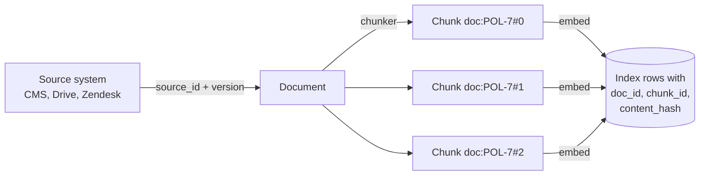
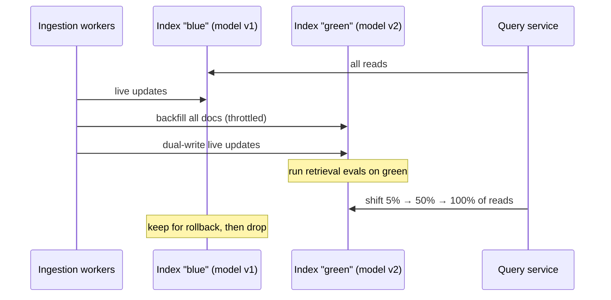

## The problem

A demo RAG app indexes a folder once. A real one indexes a corpus that changes all day: policies get revised, help articles get unpublished, tickets get resolved, product specs change. If you rebuild the whole index on every change, you pay to re-embed everything, you serve stale results during the rebuild, and you cannot scale past a few thousand documents.

The goal is an index that:

1. Reflects an edit within minutes.
2. Re-embeds only what changed.
3. Never serves deleted or permission-revoked content.
4. Can be migrated to a new embedding model without downtime.

## Identity: the foundation of incremental updates

You cannot update what you cannot identify. Give every unit a stable ID derived from the source, not from insertion order.



- **Document ID**: the source's own ID (`zendesk:article:4471`), namespaced by source.
- **Chunk ID**: `doc_id + chunk index`, or better, `doc_id + hash(chunk text)`. Hash-based chunk IDs mean an edit to paragraph 3 only changes the chunks that actually changed.
- **Content hash**: a hash (SHA-256) of the normalised text of each chunk. If the hash is unchanged, skip embedding.
- **Source version or updated_at**: from the source system, to detect changes cheaply without downloading content.

```sql
CREATE TABLE chunks (
  chunk_id      text PRIMARY KEY,          -- 'zendesk:4471#9f2c1a'
  doc_id        text NOT NULL,
  source        text NOT NULL,
  content       text NOT NULL,
  content_hash  text NOT NULL,
  embedding     vector(1024),
  embed_model   text NOT NULL,             -- which model produced this vector
  acl           text[] NOT NULL,           -- who may see it (next lesson)
  doc_version   bigint NOT NULL,
  updated_at    timestamptz NOT NULL DEFAULT now(),
  deleted_at    timestamptz                -- tombstone
);
CREATE INDEX ON chunks (doc_id);
CREATE INDEX ON chunks USING hnsw (embedding vector_cosine_ops) WHERE deleted_at IS NULL;
```

## The sync algorithm

For each changed document:

1. Fetch the new content and chunk it.
2. Compute the set of new chunk IDs and hashes.
3. Compare with the existing chunks for that `doc_id`:
   - **New** chunk IDs: embed and insert.
   - **Unchanged** hashes: do nothing.
   - **Removed** chunk IDs: delete (or tombstone).
4. Do the insert and delete in **one transaction**, so search never sees half a document.

```python
async def sync_document(db, doc):
    new_chunks = {chunk_id(doc.id, c): c for c in chunk(doc.text)}
    existing = await db.fetch_chunk_hashes(doc.id)           # {chunk_id: content_hash}
    to_add = {cid: c for cid, c in new_chunks.items() if cid not in existing}
    to_remove = existing.keys() - new_chunks.keys()
    vectors = await embed_batch([c.text for c in to_add.values()]) if to_add else []
    async with db.transaction():
        await db.delete_chunks(list(to_remove))
        await db.insert_chunks(to_add, vectors, doc_version=doc.version, acl=doc.acl)
        await db.update_doc_metadata(doc.id, version=doc.version, acl=doc.acl)  # ACL change applies to all chunks
```

> [!numbers] A help centre has 5,000 articles averaging 12 chunks. A typical edit changes 1 to 2 paragraphs. Full re-index on every edit: 60,000 embeddings. Hash-based incremental: about 2. With 300 edits a day, that is 18M versus 600 embedding calls daily. The cost difference is real, but the bigger win is freshness: incremental updates land in seconds.

### How do you learn that something changed?

| Method | How | Latency | Catches deletes? |
|---|---|---|---|
| Polling with `updated_since` | Query the source API every N minutes for changed items | Minutes | Only if the API reports deletions |
| Webhooks | Source pushes an event on create, update, delete | Seconds | Usually |
| Change data capture (CDC) | Read the database's change log (e.g. Postgres logical replication, Debezium) | Seconds | Yes |
| Full reconciliation | Periodically list all source IDs and diff against the index | Hours | Yes, the safety net |

Use push (webhooks or CDC) for freshness and a nightly reconciliation job as a safety net. Webhooks get dropped. Reconciliation finds documents that exist in the index but no longer exist at the source and removes them.

## Deletes are the dangerous part

A stale answer is embarrassing. A deleted document that is still retrievable can be a legal or security incident, for example an internal pricing memo that was unpublished, or a customer's data after an erasure request.

- **Hard delete** removes the row. Simple, but some ANN indexes handle heavy deletion poorly (they keep "holes" until rebuilt). In pgvector, deleted rows are cleaned up by `VACUUM`.
- **Tombstone** sets `deleted_at` and filters it out at query time. Fast and reversible, and lets you audit what was removed. Purge tombstones in a background job.

Whichever you choose, the **query must filter**, and it should be tested: write an eval case that deletes a document and asserts it can no longer be retrieved.

## How ANN indexes cope with updates

Approximate nearest neighbour indexes trade exactness for speed. Their update behaviour shapes your design:

| Index | Inserts | Deletes | Notes |
|---|---|---|---|
| HNSW (pgvector, Qdrant, Weaviate, most managed DBs) | Incremental, good | Marked deleted, graph quality degrades slowly with heavy churn | The default choice. Memory-hungry. See the [HNSW paper](https://arxiv.org/abs/1603.09320) and Pinecone's [HNSW explainer](https://www.pinecone.io/learn/series/faiss/hnsw/). |
| IVF (pgvector ivfflat, FAISS) | Assigned to existing clusters; centroids drift as data changes | Fine | Needs periodic retraining (rebuild) when the distribution shifts. |
| Flat (exact) | Trivial | Trivial | Fine below roughly 100k vectors, or after a selective metadata filter. |

For most teams, HNSW with incremental upserts plus an occasional off-peak `REINDEX` (or the managed service's equivalent) is enough.

## Changing the embedding model: blue/green indexes

Vectors from different embedding models are not comparable. When you upgrade the model (or change chunking), you must re-embed everything. Do it without downtime:



1. Create a second index (or a new column, `embedding_v2`) and record `embed_model` on every row.
2. Backfill it with a throttled background job.
3. **Dual-write**: new and changed documents go to both indexes during the migration.
4. Run your retrieval evals against the new index. Only switch if recall holds or improves.
5. Shift query traffic gradually behind a flag. Keep the old index until you are sure.

The query embedding must come from the same model as the index it searches. A version mismatch here produces garbage results with no error, so assert it in code.

## Design review questions

> [!interview] A document is deleted at the source at 10:00. When does it stop being retrievable, and how do you know?

> [!interview] What happens if the ingestion worker crashes halfway through a document?

> [!interview] Walk me through upgrading the embedding model with zero downtime. How do you decide it is safe to switch?

> [!interview] How much does a full re-embed cost, and how long does it take at your rate limit?

## Further reading

- [pgvector README](https://github.com/pgvector/pgvector), especially indexing, filtering, and `hnsw.ef_search`.
- [Hierarchical Navigable Small World graphs](https://www.pinecone.io/learn/series/faiss/hnsw/), Pinecone.
- [Efficient and robust ANN search using HNSW](https://arxiv.org/abs/1603.09320), the original paper.
- [Transactional outbox pattern](https://microservices.io/patterns/data/transactional-outbox.html), useful for reliably emitting change events from your own database.

```quiz
[
  {"q": "Why derive chunk IDs from a hash of the chunk text?", "options": ["Hashes compress the text", "Unchanged chunks keep the same ID across edits, so only changed chunks are re-embedded", "It improves vector similarity", "Databases require hashed keys"], "answer": 1, "why": "Stable, content-derived IDs make diffs cheap: compare old and new ID sets and only touch what changed."},
  {"q": "Why should inserting new chunks and deleting old ones for a document happen in one transaction?", "options": ["It is faster", "Queries must never see a half-updated document with mixed old and new chunks or missing content", "Embeddings require it", "It reduces storage"], "answer": 1, "why": "Atomic replacement means readers see either the old version or the new one, never a mix."},
  {"q": "Webhooks are your main change feed. What else do you need?", "options": ["Nothing", "A periodic full reconciliation to catch dropped events and deletions", "A second webhook", "A cache"], "answer": 1, "why": "Push mechanisms drop events. Reconciliation is the safety net that eventually makes the index match the source."},
  {"q": "You are switching embedding models. Which step prevents silent garbage results?", "options": ["Lowering top-k", "Ensuring query vectors and index vectors come from the same model, and evaluating the new index before switching reads", "Using a bigger HNSW m", "Deleting the old index first"], "answer": 1, "why": "Vectors from different models live in different spaces. Mixing them returns nonsense with no error, so assert model versions and run retrieval evals before cutover."}
]
```
