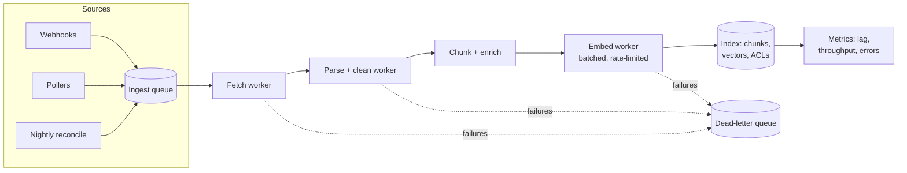

## Why ingestion is a pipeline, not a script

Ingesting a document involves slow, failure-prone steps: download from a source API (rate limited), parse a PDF (CPU-heavy, sometimes crashes), chunk, call an embedding API (rate limited, occasionally down), write to the index. Doing this inside a web request, or in one big script, breaks as soon as volume grows or anything fails.

The production shape is a queue-driven pipeline with independent stages:



Each stage can scale and fail independently. If the embedding API is down for ten minutes, jobs queue up and drain afterwards. Nothing is lost and search keeps serving the previous version.

## Properties every stage needs

**Idempotent.** Jobs will be retried and sometimes delivered twice. Processing the same document version twice must produce the same index state. The hash-based upsert from the previous lesson gives you this almost for free. Key jobs by `(doc_id, version)` and skip if that version is already indexed.

**Retries with backoff and a limit.** Transient errors (429, 503, timeouts) get exponential backoff with jitter. After N attempts, move the job to a **dead-letter queue** (DLQ) with the error, so a poison document (a corrupt PDF) does not block the queue forever. Someone looks at the DLQ daily, or an alert fires when it grows.

**Ordered per document.** If version 5 and version 6 of a document are processed concurrently, version 5 might finish last and overwrite newer content. Guard with a version check in the write: `UPDATE ... WHERE doc_version < $new_version`, or partition the queue by `doc_id`.

**Batched where the API allows.** Embedding APIs accept many inputs per request. Batching 100 chunks per call cuts overhead and keeps you under request-rate limits.

**Observable.** Track queue depth, ingestion lag (time from source change to searchable), throughput, and error rate per stage. Ingestion lag is the user-facing metric: "how stale can an answer be?"

> [!numbers] Initial backfill of 200,000 documents averaging 10 chunks = 2M chunks of about 400 tokens = 800M tokens to embed. With an embedding rate limit of 1M tokens per minute, that is 800 minutes, about **13.3 hours** of embedding. Batch, run it overnight with a throttle, and make sure live updates go through a separate, higher-priority queue so they are not stuck behind the backfill. A self-hosted open model (for example [bge-small-en-v1.5](https://huggingface.co/BAAI/bge-small-en-v1.5) through sentence-transformers or fastembed) has no vendor rate limit; your GPU or CPU throughput becomes the limit instead, so measure it the same way.

## Parsing and chunking choices

Garbage in, garbage retrieved. The parsing and chunking step decides retrieval quality more than the choice of vector database.

**Parsing.** Extract text with structure: headings, lists, tables. Tools such as [Docling](https://github.com/docling-project/docling) and [Unstructured](https://unstructured.io/) turn PDFs and Office files into structured elements. Tables need special care: flattening a table into a line of text destroys it. Keep tables as Markdown or as a row-per-chunk representation with headers repeated.

**Cleaning.** Strip navigation, footers, cookie banners, and repeated boilerplate. They pollute embeddings and waste context.

**Chunking strategies:**

| Strategy | How | Good for | Weakness |
|---|---|---|---|
| Fixed size with overlap | 300 to 800 tokens, 10 to 20% overlap | Uniform prose | Splits mid-thought, ignores structure |
| Structure-aware | Split on headings and sections, then size-limit | Docs, policies, wikis | Uneven chunk sizes |
| Semantic | Split where embedding similarity between sentences drops | Long unstructured text | Slower, more moving parts |
| Parent-child | Index small chunks, return their larger parent section | Precise matching, rich context | More storage, more logic |

```viz
caption: The same policy page, chunked four ways. Following the document's own structure keeps each answer in one piece.
<div class="vz-cols">
  <div class="vz-panel sk b"><h5>Fixed size</h5>
    <div class="vz-row"><span class="ch sk">Returns. Tents: 30 days if</span></div>
    <div class="vz-row"><span class="ch sk b">used. Boots: 60 days</span></div>
    <p>a rule split across chunks</p>
  </div>
  <div class="vz-panel sk g"><h5>Structure-aware</h5>
    <div class="vz-row"><span class="ch sk g">Returns &gt; Tents</span></div>
    <div class="vz-row"><span class="ch sk g">Returns &gt; Boots</span></div>
    <p>one section, one chunk</p>
  </div>
</div>
<div class="vz-cols">
  <div class="vz-panel sk"><h5>Semantic</h5>
    <div class="vz-row"><span class="ch sk">topic A</span><span class="ch sk ghost">split where meaning shifts</span><span class="ch sk">topic B</span></div>
    <p>for text without headings</p>
  </div>
  <div class="vz-panel sk"><h5>Parent-child</h5>
    <div class="vz-row"><span class="ch sk">small chunk matches</span><span class="arr sk"></span><span class="ch sk g">whole section returned</span></div>
    <p>precise match, full context</p>
  </div>
</div>
```

Start with structure-aware chunks of about 400 to 800 tokens. Then measure. A study on [chunking financial reports](https://arxiv.org/abs/2402.05131) found element-based chunking (following document structure) beat fixed-size chunks.

**Enrichment.** Add metadata to every chunk: title, section path ("Returns > Tents > Used items"), source URL, last updated, product IDs mentioned, language. Metadata powers filters, citations, and freshness ranking. **Contextual retrieval**, described in an [engineering post by Anthropic](https://www.anthropic.com/engineering/contextual-retrieval), goes further: prepend a short model-generated sentence situating the chunk in its document ("This section of the 2026 returns policy covers used tents") before you embed and index it. The technique works with any model, embedder and reranker; the study itself measured it with Gemini and Voyage embeddings and Cohere's reranker.

```viz
caption: In Anthropic's study, adding context to chunks cut retrieval failures by a third, and adding keyword search and a reranker cut them by two thirds.
<div class="vz-bars"><span>plain embeddings</span><span class="bar sk"><i class="sk b" style="--w:100%"></i></span><b>5.7%</b><span>+ context</span><span class="bar sk"><i class="sk b" style="--w:65%"></i></span><b>3.7%</b><span>+ contextual BM25</span><span class="bar sk"><i class="sk b" style="--w:51%"></i></span><b>2.9%</b><span>+ reranker</span><span class="bar sk"><i class="sk b" style="--w:33%"></i></span><b>1.9%</b></div>
<p>failure rate: relevant chunk missing from the top 20 (1 minus recall@20)</p>
<div class="vz-src">Source: Anthropic, <a href="https://www.anthropic.com/engineering/contextual-retrieval">Introducing Contextual Retrieval</a> (2024): reductions of 35%, 49% and 67%.</div>
```

The cost is one cheap model call per chunk at ingestion. Every call repeats the whole document, so put the document first and the chunk last, and let prompt caching serve the repeated prefix: OpenAI and Gemini cache long repeated prefixes automatically, Anthropic caches prefixes you mark, and self-hosted vLLM reuses them with [automatic prefix caching](https://docs.vllm.ai/en/latest/features/automatic_prefix_caching.html). Lab 2 shows the call.

## Access control: the part demos skip

In a real company, not everyone may see every document. Support agents can read internal escalation playbooks; customers cannot. HR documents are restricted to HR. In a multi-tenant SaaS, tenant A must never retrieve tenant B's data. RAG systems routinely get this wrong because the model is good at summarising whatever it is given, including things the user should not see.

> [!rule] Enforce access control in the retrieval query, before the model sees anything. Never rely on the model to withhold restricted content it has already been given.

```viz
caption: Filter inside the query and every result is one the user may see. Filter afterwards and you either leak, or keep too few results.
<div class="vz-cols">
  <div class="vz-panel sk g"><h5>Filter in the query</h5>
    <div class="vz-row"><span class="ch sk">principals from auth</span><span class="arr sk"></span><span class="ch sk g">WHERE acl matches</span></div>
    <div class="cells" style="--n:10"><i class="sk g"></i><i class="sk g"></i><i class="sk g"></i><i class="sk g"></i><i class="sk g"></i><i class="sk g"></i><i class="sk g"></i><i class="sk g"></i><i class="sk g"></i><i class="sk g"></i></div>
    <p>top 10: all visible</p>
  </div>
  <div class="vz-panel sk b"><h5>Filter after search</h5>
    <div class="vz-row"><span class="ch sk">top 10 of everything</span><span class="arr sk"></span><span class="ch sk">drop restricted</span></div>
    <div class="cells" style="--n:10"><i class="sk g"></i><i class="sk x"></i><i class="sk x"></i><i class="sk g"></i><i class="sk x"></i><i class="sk x"></i><i class="sk x"></i><i class="sk x"></i><i class="sk x"></i><i class="sk x"></i></div>
    <p>2 left; forget the step and 8 leak</p>
  </div>
</div>
<div class="vz-row"><span class="ch sk b">never: let the model withhold it</span><b>it summarises whatever it is given</b></div>
```

### Pattern 1: ACLs on chunks, filtered at query time

Copy the permissions from the source into each chunk's metadata at ingestion, then filter every search by the caller's principals.

```sql
-- chunks.acl holds principals allowed to read: 'group:support', 'user:c_77', 'tenant:acme', 'public'
SELECT chunk_id, content, 1 - (embedding <=> $1) AS score
FROM chunks
WHERE deleted_at IS NULL
  AND tenant_id = $2                      -- hard tenant boundary
  AND acl && $3::text[]                   -- overlaps caller's principals, e.g. {'public','user:c_77'}
ORDER BY embedding <=> $1
LIMIT 20;
```

The caller's principals come from your **authentication system**, resolved server-side: the user ID, their groups, their tenant. Never from the request body, and never from the model.

### Pattern 2: hard isolation per tenant

For strict B2B isolation, give each tenant its own index, namespace, collection, or schema. Postgres row-level security (RLS) is a strong option: the database itself refuses to return other tenants' rows even if a query forgets the filter.

```sql
ALTER TABLE chunks ENABLE ROW LEVEL SECURITY;
CREATE POLICY tenant_isolation ON chunks
  USING (tenant_id = current_setting('app.tenant_id'));
-- each request: SET LOCAL app.tenant_id = 'acme';
```

| Approach | Isolation strength | Cost at many tenants | Notes |
|---|---|---|---|
| Shared index + metadata filter | Depends on every query being right | Lowest | Use with RLS or a repository layer that always adds the filter |
| Shared table + RLS | Strong, enforced by DB | Low | Good default on Postgres |
| Namespace / collection per tenant | Strong | Medium | Most vector DBs support namespaces |
| Separate database per tenant | Strongest | High | For regulated or very large tenants |

### Pattern 3: post-filter with a permission service

When permissions are complex and change often (Google Drive-style sharing, nested groups), copying ACLs into every chunk becomes a sync nightmare. Instead, retrieve candidates and then check each against an authorization service built on relationship-based access control, such as [OpenFGA](https://openfga.dev/), which is modelled on Google's [Zanzibar](https://research.google/pubs/zanzibar-googles-consistent-global-authorization-system/).

The catch: if you retrieve 20 candidates and the user may see only 2, your results are thin. Over-fetch (retrieve 100, filter, keep 20), or combine with a coarse pre-filter (tenant, department) and a fine post-filter.

### Keeping permissions in sync

Permissions change more often than content. Someone leaves the HR group; a document gets unshared. Treat **permission changes as ingestion events**: when the source reports an ACL change, update the ACL on all chunks of that document (one `UPDATE ... WHERE doc_id = $1`) without re-embedding. Put ACLs at the document level and join or denormalise, so the update is cheap.

> [!warn] Permission revocation must be fast and verified. Write an eval: grant access, retrieve, revoke, retrieve again, assert the document is gone. Run it in CI.

### Access control beyond retrieval

Retrieval is not the only leak path. Also check:

- **Caches.** A semantic cache keyed only on the question will serve one user's answer, built from their private documents, to another user. Include the permission scope in the cache key (Week 5).
- **Memory.** Memories from one user must never be retrieved for another.
- **Tool results.** Tools must run with the end user's permissions, not a superuser service account.
- **Logs and traces.** Traces contain retrieved content. Restrict who can read them.

## Design review questions

> [!interview] Who can see this chunk, where is that decided, and how long after a permission change does retrieval reflect it?

> [!interview] A PDF crashes the parser. What happens to it, and what happens to the 10,000 jobs behind it?

> [!interview] What is your ingestion lag at p95, and what is the alert threshold?

> [!interview] Show me the query path that would leak tenant A's data to tenant B if a developer forgot one line. What stops it?

## Further reading

- [Contextual Retrieval](https://www.anthropic.com/engineering/contextual-retrieval), Anthropic.
- [Docling](https://github.com/docling-project/docling), open-source document parsing.
- [Qdrant filtering docs](https://qdrant.tech/documentation/concepts/filtering/), a clear treatment of filtered vector search.
- [OpenFGA](https://openfga.dev/) and the [Zanzibar paper](https://research.google/pubs/zanzibar-googles-consistent-global-authorization-system/), for relationship-based authorization.
- [Supabase AI docs](https://supabase.com/docs/guides/ai), practical Postgres + pgvector + RLS examples.

```quiz
[
  {"q": "Where should the list of principals used to filter retrieval come from?", "options": ["The request body", "The model's tool call arguments", "Your server-side authentication context", "The chunk metadata"], "answer": 2, "why": "Anything the client or model supplies can be forged or manipulated. Principals must come from the authenticated session, resolved on the server."},
  {"q": "Version 6 of a document finishes processing before version 5 (which was retried). What prevents version 5 from overwriting it?", "options": ["Nothing; last write wins", "A version check in the write (only update if the stored version is older), or per-document ordering", "A bigger queue", "Deleting version 5"], "answer": 1, "why": "Out-of-order processing is normal with retries. Guard writes with versions so stale jobs become no-ops."},
  {"q": "A user is removed from the HR group. What is the cheapest correct update?", "options": ["Re-embed all HR documents", "Update ACL metadata on the affected documents' chunks without re-embedding", "Rebuild the index nightly", "Tell the model not to show HR content"], "answer": 1, "why": "Permissions are metadata. Update them in place, quickly, and verify with a revocation test. Embeddings do not change."},
  {"q": "Why can a semantic cache leak data across users?", "options": ["Caches are unencrypted", "Similar questions from different users can hit the same entry, built from the first user's private documents", "Cache keys are too long", "It cannot"], "answer": 1, "why": "If the cache key does not include the permission scope, it serves answers grounded in documents the second user cannot see."},
  {"q": "What is the main job of a dead-letter queue?", "options": ["Speed up processing", "Hold jobs that keep failing so they do not block the pipeline, and make them visible for investigation", "Store deleted documents", "Replace retries"], "answer": 1, "why": "Poison messages are isolated with their error so the rest of the queue keeps flowing."}
]
```
