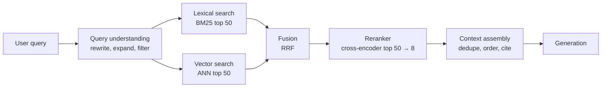

## Retrieval quality caps answer quality

If the right passage is not in the context, the best model in the world cannot use it. If ten wrong passages are, the model may use those instead. Most "the LLM hallucinated" bugs in RAG systems are retrieval bugs. So treat retrieval as its own system with its own metrics, and measure it separately from generation.

The modern retrieval pipeline has stages, each trading cost for precision:



Cheap, broad stages first (recall), expensive, precise stages last (precision).

## Measure retrieval on its own

Build a retrieval eval set: queries paired with the chunk or document IDs that answer them. 50 to 200 pairs is enough to start. Take queries from real logs and label which documents are relevant, or generate questions from chunks with a model and then review them.

| Metric | Question it answers |
|---|---|
| Recall@k | Of the relevant documents, what fraction appear in the top k? The most important metric for RAG, because the model can only use what it sees. |
| Precision@k | Of the top k, how many are relevant? Matters for context cost and distraction. |
| MRR | How high is the first relevant result? |
| nDCG@k | Rank-aware quality with graded relevance. |

> [!rule] Optimise recall@k first (for k equal to what you pass to the model), then precision. Every change to chunking, embedding model, or ranking gets a before/after number.

## Query understanding

Users write short, vague, or conversational queries. "what about the blue one?" is meaningless without the conversation. Fix the query before you search:

- **Conversational rewrite.** Turn the latest message plus history into a standalone query: "Ridgeline 2P tent in blue: stock and return window". A cheap model call.
- **Multi-query.** Generate 3 to 5 paraphrases, search each, and fuse. Improves recall on ambiguous queries at extra search cost.
- **HyDE.** Generate a hypothetical answer and embed that instead of the question, since answers look more like documents than questions do ([paper](https://arxiv.org/abs/2212.10496)). Helps when queries and documents are phrased very differently.
- **Filter extraction.** Pull structured constraints from the query: "return policy for orders in Canada after 2025" becomes `{region: CA, effective_after: 2025-01-01}` applied as metadata filters.
- **Routing.** Decide which index (policies, product catalogue, past tickets) or whether to search at all. Many messages ("thanks!") need no retrieval.

In an agent, much of this happens naturally: the model writes the search query as a tool argument. Your job is to give it a good search tool and good description, and to let it search again if the first results are poor.

## Hybrid search: lexical plus semantic

Embeddings capture meaning but blur exact tokens. Ask a vector index for "error E-4471" and you may get documents about other errors. BM25, the classic keyword ranking function, nails exact identifiers, product codes, and rare terms, but misses paraphrases ("get my money back" vs "refund").

Running both and fusing the results is the most reliable improvement you can make to a basic RAG system. Weaviate's [hybrid search explainer](https://weaviate.io/blog/hybrid-search-explained) shows the mechanics.

In Postgres you can do both in one database: `tsvector` with a GIN index for full text, and pgvector for vectors. [ParadeDB](https://github.com/paradedb/paradedb) adds true BM25 to Postgres if you need it.

### Reciprocal rank fusion

Lexical and vector scores live on different scales, so you cannot just add them. **Reciprocal rank fusion** (RRF) ignores scores and combines ranks:

`RRF(d) = Σ over result lists of 1 / (k + rank(d))`, with k usually 60.

```python
def rrf(*ranked_lists, k=60, top_n=50):
    scores = {}
    for results in ranked_lists:
        for rank, doc_id in enumerate(results, start=1):
            scores[doc_id] = scores.get(doc_id, 0.0) + 1.0 / (k + rank)
    return sorted(scores, key=scores.get, reverse=True)[:top_n]

fused = rrf(bm25_ids, vector_ids)
```

RRF is simple, robust, and needs no tuning. It is from a 2009 [SIGIR paper](https://plg.uwaterloo.ca/~gvcormac/cormacksigir09-rrf.pdf) and is still the default in most hybrid systems.

## Reranking

First-stage retrieval uses **bi-encoders**: query and document are embedded separately, so documents can be pre-computed. Fast, but the model never sees query and document together. A **cross-encoder reranker** reads the pair together and scores relevance much more accurately, at the cost of one model pass per candidate.

So: retrieve 50 to 100 candidates cheaply, rerank them, keep the top 5 to 10.

Options: hosted rerank APIs (for example [Cohere Rerank](https://docs.cohere.com/docs/rerank-overview)), open models such as [bge-reranker-v2-m3](https://huggingface.co/BAAI/bge-reranker-v2-m3) that you run yourself, or an LLM scoring candidates (accurate, slow, and expensive). Sentence-Transformers documents the [retrieve and re-rank](https://sbert.net/examples/sentence_transformer/applications/retrieve_rerank/README.html) pattern well.

> [!numbers] Reranking 50 candidates of 400 tokens each with a hosted reranker typically adds 100 to 300 ms. On a GPU-hosted open model, a batch of 50 pairs takes tens of milliseconds. Both are small next to multi-second generation, and reranking usually lifts precision enough that you can send fewer chunks to the LLM, which saves more time and money than the reranker costs.

## Context assembly

What you do after ranking also matters:

- **Deduplicate** near-identical chunks (the same paragraph in three versions of a policy).
- **Prefer fresh content** when documents conflict, or show dates and let the model reason.
- **Expand** small matched chunks to their parent section if more context helps (parent–child retrieval).
- **Order** the best chunk first or last, not buried in the middle.
- **Label** each chunk with an ID and source so the model can cite it, and so you can verify citations.

```text
<search_results query="return window used tent">
<doc id="POL-RETURNS-2026#3" title="Returns policy 2026 › Tents › Used items" updated="2026-09-01">
Used tents and sleeping bags may be returned within 30 days of delivery ...
</doc>
<doc id="FAQ-118" title="Can I return a tent I camped in?" updated="2026-05-14">
...
</doc>
</search_results>
```

## Choosing an embedding model

Check the [MTEB leaderboard](https://huggingface.co/spaces/mteb/leaderboard) for retrieval scores, then test the top few on **your** retrieval eval set, because leaderboards rarely match your domain. Consider: dimension (storage and speed), max input length, multilingual support, cost, and whether you can self-host. Many models support shortened (Matryoshka) embeddings: you can store 256 dimensions instead of 1,024 with a small quality loss and a 4x storage saving.

## Making it fast at scale

### ANN tuning

HNSW has three knobs that matter:

| Parameter | Effect | Typical |
|---|---|---|
| `m` | Graph connections per node. Higher means better recall, more memory | 16 (pgvector default) to 32 |
| `ef_construction` | Build-time search width. Higher means a better graph, slower builds | 64 (default) to 200 |
| `ef_search` | Query-time search width. Higher means better recall, slower queries | 40 (default) to 200 |

Tune `ef_search` against your recall eval: plot recall@10 and p95 latency as it rises, and pick the knee.

### Filtering and ANN

Metadata filters (tenant, ACL, language) interact badly with ANN indexes. **Post-filtering** (search, then drop non-matching results) can return almost nothing when the filter is selective. **Pre-filtering** (search only matching vectors) can make HNSW degrade. Modern engines handle this with filtered HNSW traversal or iterative scans. pgvector filters after the index scan, so with the default `hnsw.ef_search = 40` a filter matching 10% of rows returns only about 4 rows on average; version 0.8.0 added iterative index scans (`SET hnsw.iterative_scan = relaxed_order`) to keep scanning until enough rows match. For very selective filters, such as a single tenant's 2,000 documents, an exact scan over the filtered rows is fast and perfectly accurate.

### Memory and sharding

> [!numbers] 10M chunks × 1,024 float32 dimensions × 4 bytes = **41 GB** of raw vectors, plus HNSW graph overhead (roughly m × 2 × 4 bytes per vector for links, about 1.3 GB at m=16). HNSW wants this in RAM. Halving to 512 dimensions or using int8 quantization (1 byte per dimension) brings 41 GB down to about 10 GB. In pgvector, `halfvec` (2 bytes per dimension) halves memory, and an HNSW index on the plain `vector` type supports up to 2,000 dimensions.

When one node is not enough, shard. **Shard by tenant** when queries are always tenant-scoped (most B2B apps): each query hits one shard. **Shard by hash** when queries span everything: each query fans out to all shards and results are merged, so latency follows the slowest shard. Add replicas for read throughput.

### Latency budget

Set one and measure each stage.

| Stage | Budget (p95) |
|---|---|
| Query rewrite (small model) | 300 ms |
| BM25 + vector in parallel | 80 ms |
| Fusion | 1 ms |
| Rerank 50 → 8 | 200 ms |
| Assembly | 5 ms |
| **Retrieval total** | **≈ 600 ms** |

## Advanced: when flat chunks are not enough

- **Hierarchical summaries** ([RAPTOR](https://arxiv.org/abs/2401.18059)) for questions that need a whole-document view.
- **Late interaction** ([ColBERT](https://arxiv.org/abs/2004.12832)) for higher accuracy than single-vector embeddings at more storage.
- **Agentic retrieval**: let the agent search, read, and search again with refined queries. Often the biggest gain for complex questions, at the cost of latency.
- **Structured data**: for "how many orders shipped late last week?", generate SQL, do not embed tables.

## Design review questions

> [!interview] What is your recall@8 on the retrieval eval set, and what changed it most?

> [!interview] A user searches for an exact SKU and gets the wrong product. Which stage failed, and what is your fix?

> [!interview] How much RAM does your index need at 10x today's corpus, and what is the plan?

> [!interview] When does the agent decide not to retrieve at all?

## Further reading

- [Systematically Improving Your RAG](https://jxnl.co/writing/2024/05/22/systematically-improving-your-rag/), Jason Liu. Practical, metrics-first.
- [Patterns for Building LLM-based Systems](https://eugeneyan.com/writing/llm-patterns/), Eugene Yan. The RAG section is excellent.
- [Hybrid search explained](https://weaviate.io/blog/hybrid-search-explained), Weaviate.
- [Retrieve and re-rank](https://sbert.net/examples/sentence_transformer/applications/retrieve_rerank/README.html), Sentence-Transformers.
- [Reciprocal Rank Fusion paper](https://plg.uwaterloo.ca/~gvcormac/cormacksigir09-rrf.pdf).
- [RAG survey](https://arxiv.org/abs/2312.10997) for a map of the research.

```quiz
[
  {"q": "Which metric matters most for the retrieval stage of a RAG system?", "options": ["Precision@1", "Recall@k, where k is the number of chunks you pass to the model", "Embedding dimension", "Index build time"], "answer": 1, "why": "The model can only use relevant passages that reach its context. Recall at the cutoff you actually use is the ceiling on answer quality."},
  {"q": "Why use reciprocal rank fusion instead of adding BM25 and cosine scores?", "options": ["It is more accurate in every case", "The scores are on incompatible scales; RRF uses ranks and needs no calibration", "BM25 scores are always negative", "It is required by pgvector"], "answer": 1, "why": "Raw scores from different retrievers are not comparable. Rank-based fusion is robust without tuning."},
  {"q": "What does a cross-encoder reranker do that a bi-encoder cannot?", "options": ["Store embeddings", "Read the query and document together to judge relevance", "Search millions of documents quickly", "Generate answers"], "answer": 1, "why": "Joint encoding is far more accurate but costs a model pass per pair, so it runs only on a short candidate list."},
  {"q": "Queries are always scoped to one tenant. How should you shard?", "options": ["By hash of chunk ID", "By tenant, so each query hits one shard", "Randomly", "By embedding dimension"], "answer": 1, "why": "Tenant sharding means no fan-out, simple isolation, and latency independent of the number of shards."},
  {"q": "10M vectors at 1,024 dimensions in float32 need roughly how much memory for raw vectors?", "options": ["4 GB", "41 GB", "410 GB", "1 GB"], "answer": 1, "why": "10,000,000 × 1,024 × 4 bytes ≈ 41 GB, before graph overhead. Dimension reduction or quantization shrinks it."}
]
```
