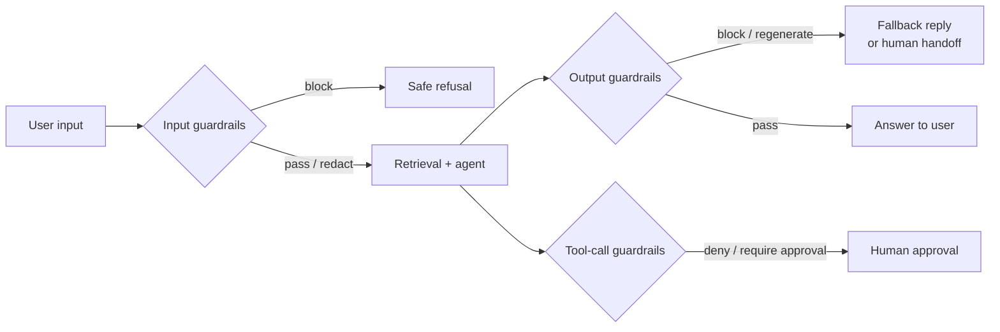

## What guardrails are for

A guardrail is a check, outside the main model call, that can block, modify, or flag an input or output. Guardrails exist because the main model is probabilistic: no system prompt makes it follow your rules 100% of the time. Guardrails turn some of those rules into deterministic or independently verified checks.

They are not a substitute for good design. Least-privilege tools (Week 3) prevent more damage than any filter. But a layered set of guardrails catches a lot: PII leaking into logs, off-topic abuse, a reply that promises a refund the policy does not allow, an answer not supported by the retrieved documents.



## The guardrail menu

### Input side

| Check | Catches | Typical implementation | Cost |
|---|---|---|---|
| Size and rate limits | Abuse, cost attacks | Code | ~0 ms |
| PII detection and redaction | Card numbers, SSNs, emails going to the model or logs | Regex + checksums, [Presidio](https://microsoft.github.io/presidio/) | 1 to 20 ms |
| Topic / scope classifier | Off-topic use ("write my essay") | Small classifier or small LLM | 50 to 300 ms |
| Harmful content | Self-harm, violence, abuse | Moderation model, e.g. [Llama Guard](https://huggingface.co/meta-llama/Llama-Guard-3-8B) | 100 to 400 ms |
| Prompt injection detection | Known jailbreak patterns | Classifier | 20 to 200 ms |

### Output side

| Check | Catches | Typical implementation |
|---|---|---|
| Schema validation | Malformed JSON for downstream code | Pydantic / structured outputs |
| Policy rules | "We'll refund you $500" when limit is $200 | Regex for amounts + code rules, or a judge |
| Groundedness | Claims not supported by retrieved context | NLI model or LLM judge comparing answer to sources |
| Citation check | Cited IDs that were not retrieved | Code: every `[DOC-ID]` must be in the retrieved set |
| PII / secrets leakage | Another customer's data, API keys | Regex + allow-list of the current user's identifiers |
| Tone and brand | Rude, sarcastic, or legally risky phrasing | Small judge |

### Tool-call side

Tool-call guardrails are the most important for agents, because that is where the agent touches the world. Validate arguments against business rules, check the caller's permission for this specific resource, and require human approval for high-impact actions. Week 3 covers this in depth.

## Cheap checks first, in parallel where possible

Guardrails add latency and cost to every request. Design the stack like an airport security line: quick checks for everyone, expensive checks only when needed.

1. **Deterministic code checks first.** Length, regexes, checksums (a Luhn check catches real card numbers with few false positives), allow-lists. Microseconds.
2. **Small classifiers next.** Fine-tuned small models or small LLMs, for topic and safety.
3. **LLM judges last, and selectively.** Only on outputs that trip a cheaper check, or on a sample.

```python
import re

CARD = re.compile(r"\b(?:\d[ -]?){13,19}\b")

def luhn_ok(digits: str) -> bool:
    total, alt = 0, False
    for d in reversed(digits):
        n = int(d)
        if alt:
            n = n * 2 - 9 if n * 2 > 9 else n * 2
        total += n
        alt = not alt
    return total % 10 == 0

def redact_cards(text: str) -> tuple[str, int]:
    count = 0
    def sub(m):
        nonlocal count
        digits = re.sub(r"\D", "", m.group())
        if 13 <= len(digits) <= 19 and luhn_ok(digits):
            count += 1
            return "[CARD REDACTED]"
        return m.group()
    return CARD.sub(sub, text), count
```

**Run independent checks in parallel with the main call.** The input topic classifier can run concurrently with retrieval. If it says "block", cancel the agent run. You pay its cost but not its latency.

```python
async def handle(message):
    guard = asyncio.create_task(input_guard(message))     # ~200 ms
    work = asyncio.create_task(retrieve_and_answer(message))
    verdict = await guard
    if verdict.block:
        work.cancel()
        return refusal(verdict.reason)
    return await work
```

> [!numbers] Sequential: input guard 200 ms + agent 4,000 ms + output guard 300 ms = 4.5 s. Input guard in parallel: 4.3 s. Output check on streamed text is harder, see below. For a cheap-model judge at 1,500 input and 50 output tokens on Haiku 5.5, each check costs about $0.00018. At 1M messages a month, that is **$180** for the check, often worth it, but only if it measurably catches problems.

## Guardrails and streaming

Streaming shows tokens as they are generated, which conflicts with checking the full output before showing it. Options:

- **Buffer and check** short answers before sending. Simple and safe; adds latency equal to generation time.
- **Stream with incremental checks**: run cheap regex checks on the growing buffer (sentence by sentence) and stop the stream if one trips, replacing the partial output with a safe message. Good for PII and banned phrases.
- **Stream, then retract**: check after completion and replace the message if it fails. Acceptable for low-risk issues; not acceptable for leaking data, since the user already saw it.
- **Do not stream high-risk paths**, such as final refund confirmations.

## Every guardrail has a false-positive rate

A guardrail that blocks legitimate users is a product bug, and often a worse one than the problem it prevents. A topic classifier that blocks "my tent smells like gas after the stove leaked" as "unsafe content" is turning away a customer with a real safety issue.

Treat each guardrail as a classifier and measure it:

- **Precision**: of the things it blocked, how many should have been blocked?
- **Recall**: of the things that should be blocked, how many did it catch?

Build a labelled set for each guardrail with both bad inputs and tricky legitimate ones. Track the block rate in production and sample blocked messages for review. A sudden jump in block rate usually means the guardrail broke, not that users got worse.

> [!rule] Every guardrail ships with an eval set, a precision and recall number, a production block-rate metric, and a defined user experience when it fires.

## What the user sees when a guardrail fires

Design the failure path:

- **Block with explanation** for clear policy cases ("I can only help with Northwind orders and products").
- **Regenerate** once with feedback when an output check fails ("Your previous answer cited POL-9, which was not in the sources; answer again using only the sources"). Cap retries.
- **Hand off to a human** for high-stakes cases (a safety complaint, a large refund dispute).
- **Log** every firing with the guardrail name, version, and input hash for analysis, while respecting PII rules.

## Build or buy

Frameworks such as [Guardrails AI](https://github.com/guardrails-ai/guardrails) and [NeMo Guardrails](https://github.com/NVIDIA/NeMo-Guardrails) give you a library of validators and a way to compose them. Cloud providers offer managed content filters. They are good starting points. Whatever you use, the evaluation discipline above still applies: you need your own labelled data to know whether a guardrail works for your traffic.

## Design review questions

> [!interview] List your guardrails with their p95 latency, precision, and recall. Which one would you remove first, and why?

> [!interview] A customer reports being blocked for a legitimate question. How do you find out how often this happens?

> [!interview] What happens on the streaming path if the output contains another customer's email address?

> [!interview] Which of your rules are enforced in code, and which only in the prompt?

## Further reading

- [OWASP Top 10 for LLM Applications](https://genai.owasp.org/llm-top-10/), the standard risk list.
- [How to implement LLM guardrails](https://cookbook.openai.com/examples/how_to_use_guardrails), OpenAI Cookbook. Covers async guardrails and their trade-offs.
- [Microsoft Presidio](https://microsoft.github.io/presidio/), open-source PII detection and anonymisation.
- [Llama Guard 3](https://huggingface.co/meta-llama/Llama-Guard-3-8B), an open safety classifier.
- [NeMo Guardrails](https://github.com/NVIDIA/NeMo-Guardrails) and [Guardrails AI](https://github.com/guardrails-ai/guardrails).

```quiz
[
  {"q": "How do you add an input safety classifier without adding its latency to every request?", "options": ["Run it after the response", "Run it concurrently with retrieval and the agent, and cancel the agent if it blocks", "Use a bigger model", "Skip it on weekends"], "answer": 1, "why": "Parallel execution means you pay the classifier's cost but not its latency, as long as it finishes before the agent does."},
  {"q": "Why combine a regex with a Luhn checksum for card numbers?", "options": ["Regex alone is too slow", "The checksum filters out random digit strings like order numbers, cutting false positives", "Luhn detects expired cards", "It encrypts the card"], "answer": 1, "why": "Real card numbers pass the Luhn check; most arbitrary 16-digit strings do not. Cheap and much more precise."},
  {"q": "A topic guardrail's block rate doubled overnight after a deploy. What is the most likely explanation?", "options": ["Users became more abusive", "The guardrail or its inputs changed and it is now producing false positives", "The model got smarter", "Traffic doubled"], "answer": 1, "why": "Sudden shifts in a classifier's firing rate usually indicate a regression. Sample blocked messages and check precision."},
  {"q": "When is \"stream, then retract\" not acceptable?", "options": ["For tone issues", "When the problem is data leakage, because the user has already seen it", "For long answers", "Never acceptable"], "answer": 1, "why": "Retracting after the fact does not un-leak data. For leakage risks, check before showing, or check incrementally and stop the stream."}
]
```
