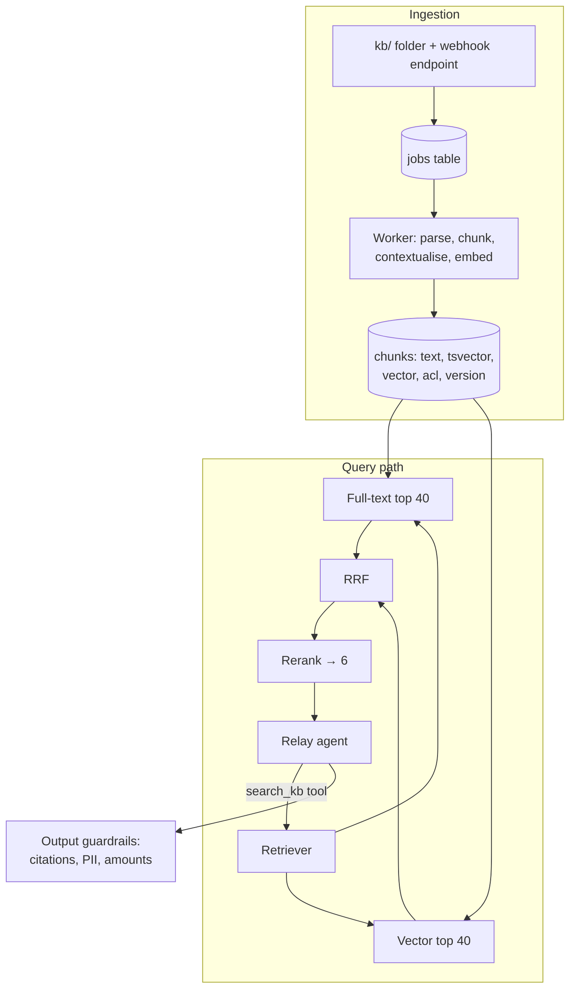

## What you will build



```viz
caption: What "done" looks like: three checks your finished system passes on demand.
<div class="vz-cols" style="--k:3">
  <div class="vz-panel sk"><h5>Edit one paragraph</h5>
    <div class="vz-row"><span class="ch sk g">kept</span><span class="ch sk g">kept</span><span class="ch sk c">re-embed</span><span class="ch sk g">kept</span></div>
    <p>delete a file: gone from search within a minute</p>
  </div>
  <div class="vz-panel sk"><h5>Ask as a customer</h5>
    <div class="vz-row"><span class="ch sk g">public</span><span class="ch sk g">own docs</span><span class="ch sk b">playbooks: 0</span></div>
    <p>staff also see group:support</p>
  </div>
  <div class="vz-panel sk"><h5>Reply cites POL-9</h5>
    <div class="vz-row"><span class="ch sk b">not retrieved</span><span class="arr sk"></span><span class="ch sk c">regenerate once</span></div>
    <p>then a safe fallback</p>
  </div>
</div>
<div class="vz-row"><span class="ch sk">40 queries</span><span class="arr sk"></span><span class="ch sk">4 retrieval modes</span><span class="arr sk"></span><span class="ch sk g">recall and MRR in DESIGN.md</span></div>
```

**Acceptance criteria**

1. A worker process ingests Markdown and PDF files from `kb/` (provide at least 30 documents: write policies, FAQs, product pages, and 5 internal-only playbooks).
2. Editing one paragraph re-embeds only the changed chunks. Deleting a file removes it from search within one minute.
3. Every chunk has an ACL. Customers see `public` and their own `user:` documents; staff also see `group:support`. Enforced in SQL.
4. `search_kb` uses hybrid retrieval with RRF and a reranker, and returns chunks with IDs for citation.
5. Output guardrails: every cited ID must be in the retrieved set, card numbers are redacted from inputs and logs, and refund amounts above the limit in replies trigger a regeneration.
6. A retrieval eval of at least 40 query → relevant-chunk pairs reports recall@6 and MRR for vector-only, BM25-only, hybrid, and hybrid + rerank.

> [!tip] A tested reference implementation is in the course repository under [`relay/` at tag `lab2`](https://github.com/Rachneet/ai-system-design-course/tree/lab2/relay). It runs local embedding and reranking models on a laptop CPU, so the retrieval eval needs no API key: `uv run python -m evals.retrieval`.

> [!tip] **Use any model provider.** Nothing in this lab depends on one vendor. Relay takes a model spec of the form `provider:model` in `RELAY_MODEL` and its sibling settings, for example `openai:gpt-5`, `gemini:gemini-2.5-flash`, `anthropic:claude-haiku-5-5`, `openrouter:qwen/qwen3-235b-a22b`, or a local open-weights model with `ollama:qwen3:8b` or `vllm:Qwen/Qwen3-32B`. The same goes for retrieval: the reference uses the open `bge-small-en-v1.5` (384 dimensions) through fastembed; you can swap in a hosted embedder (OpenAI, Gemini, Cohere, Voyage) or another open one (BGE, E5, anything in sentence-transformers). Set the `vector(...)` column to your model's output size. See "Choose any model provider" in `relay/README.md`.

## Step 1: schema

```sql
CREATE EXTENSION IF NOT EXISTS vector;

CREATE TABLE documents (
  doc_id      text PRIMARY KEY,
  title       text,
  source_path text,
  version     bigint NOT NULL,
  acl         text[] NOT NULL,
  deleted_at  timestamptz
);

CREATE TABLE chunks (
  chunk_id     text PRIMARY KEY,
  doc_id       text REFERENCES documents(doc_id) ON DELETE CASCADE,
  ord          int,
  section      text,
  content      text NOT NULL,
  context      text,                                   -- contextual retrieval prefix
  content_hash text NOT NULL,
  embedding    vector(1024),                           -- your embedding model's size: 384 for bge-small-en-v1.5
  embed_model  text NOT NULL,
  tsv          tsvector GENERATED ALWAYS AS (to_tsvector('english', coalesce(context,'') || ' ' || content)) STORED
);
CREATE INDEX ON chunks USING gin (tsv);
CREATE INDEX ON chunks USING hnsw (embedding vector_cosine_ops);

CREATE TABLE ingest_jobs (
  id         bigserial PRIMARY KEY,
  doc_path   text NOT NULL,
  op         text NOT NULL CHECK (op IN ('upsert','delete')),
  attempts   int NOT NULL DEFAULT 0,
  status     text NOT NULL DEFAULT 'queued',   -- queued | running | done | dead
  last_error text,
  run_after  timestamptz NOT NULL DEFAULT now()
);
```

The ACL lives on `documents` so a permission change is one row update. Retrieval joins to it.

## Step 2: a Postgres-backed job queue

You do not need Redis or Kafka for this lab. Postgres `SELECT ... FOR UPDATE SKIP LOCKED` makes a solid queue: multiple workers can pull jobs without taking the same one.

```python
CLAIM = """
UPDATE ingest_jobs SET status = 'running', attempts = attempts + 1
WHERE id = (
  SELECT id FROM ingest_jobs
  WHERE status = 'queued' AND run_after <= now()
  ORDER BY id FOR UPDATE SKIP LOCKED LIMIT 1
)
RETURNING id, doc_path, op, attempts;
"""

async def worker_loop(pool):
    while True:
        async with pool.connection() as conn:
            job = await (await conn.execute(CLAIM)).fetchone()
        if job is None:
            await asyncio.sleep(1)
            continue
        try:
            await process(job)
            await mark(job.id, "done")
        except TransientError as e:
            backoff = min(300, 2 ** job.attempts) + random.random()
            status = "dead" if job.attempts >= 5 else "queued"
            await requeue(job.id, status, str(e), delay_s=backoff)
```

Write `process` using the sync algorithm from the incremental indexing lesson: chunk by headings (about 500 tokens), hash each chunk, diff against stored hashes, embed only new chunks in batches, and apply inserts and deletes in one transaction.

A small file watcher (or a `POST /kb/webhook` endpoint) enqueues jobs. Add a nightly reconcile command that lists `kb/` and enqueues deletes for documents no longer present.

## Step 3: contextual chunks (optional but recommended)

For each new chunk, ask a small model for one sentence placing the chunk in its document, and store it in `context`. Every call repeats the whole document, so put the document first and the chunk last: the identical prefix can then be served from the provider's prompt cache, and each call mostly pays for the chunk.

Most providers, and local servers such as vLLM and Ollama, accept the OpenAI Chat Completions format, so one client covers them by changing `base_url` and the model name:

```python
from openai import AsyncOpenAI

# base_url examples: OpenAI (default), https://generativelanguage.googleapis.com/v1beta/openai/ (Gemini),
# https://openrouter.ai/api/v1, https://router.huggingface.co/v1, http://localhost:8000/v1 (vLLM),
# http://localhost:11434/v1 (Ollama)
client = AsyncOpenAI(base_url=BASE_URL, api_key=API_KEY)

resp = await client.chat.completions.create(
    model=SMALL_MODEL,
    messages=[
        {"role": "system", "content": f"<document>\n{doc_text}\n</document>"},   # same prefix for every chunk
        {"role": "user", "content": f"<chunk>\n{chunk_text}\n</chunk>\nWrite one sentence situating this "
                                    "chunk within the document to improve search retrieval. Answer with the sentence only."},
    ],
)
context = resp.choices[0].message.content.strip()
```

How the cached prefix works depends on the provider:

| Provider | Prefix caching |
|---|---|
| OpenAI | Automatic on supported models for long prefixes ([docs](https://developers.openai.com/api/docs/guides/prompt-caching)) |
| Gemini | Implicit caching on by default for Gemini 2.5 and newer, from 2,048 tokens on 2.5 Flash ([docs](https://ai.google.dev/gemini-api/docs/caching)) |
| Anthropic | Mark the document block with `cache_control` ([docs](https://platform.claude.com/docs/en/build-with-claude/prompt-caching)) |
| vLLM | [Automatic prefix caching](https://docs.vllm.ai/en/latest/features/automatic_prefix_caching.html) in the engine |

On Anthropic's own SDK, the cached call looks like this:

```python
resp = await client.messages.create(
    model=SMALL_MODEL,
    max_tokens=100,
    system=[{"type": "text", "text": f"<document>\n{doc_text}\n</document>",
             "cache_control": {"type": "ephemeral"}}],
    messages=[{"role": "user", "content": f"<chunk>\n{chunk_text}\n</chunk>\nWrite one sentence situating this chunk "
               "within the document to improve search retrieval. Answer with the sentence only."}],
)
```

Measure recall with and without it. Keep it only if it helps on your data.

## Step 4: hybrid retrieval with ACLs

```sql
-- $1 query embedding, $2 query text, $3 caller principals
WITH visible AS (
  SELECT c.* FROM chunks c JOIN documents d USING (doc_id)
  WHERE d.deleted_at IS NULL AND d.acl && $3::text[]
),
vec AS (
  SELECT chunk_id, row_number() OVER (ORDER BY embedding <=> $1) AS r
  FROM visible ORDER BY embedding <=> $1 LIMIT 40
),
lex AS (
  SELECT chunk_id, row_number() OVER (ORDER BY ts_rank_cd(tsv, q) DESC) AS r
  FROM visible, websearch_to_tsquery('english', $2) q
  WHERE tsv @@ q ORDER BY ts_rank_cd(tsv, q) DESC LIMIT 40
)
SELECT chunk_id, sum(1.0 / (60 + r)) AS rrf
FROM (SELECT * FROM vec UNION ALL SELECT * FROM lex) u
GROUP BY chunk_id ORDER BY rrf DESC LIMIT 40;
```

At lab scale this query is fast even if Postgres scans every visible row. At larger scale, check with `EXPLAIN` that the vector branch uses the HNSW index, and enable `SET hnsw.iterative_scan = relaxed_order` so ACL filters do not starve the result list.

Then rerank the 40 with a cross-encoder (an open model such as `BAAI/bge-reranker-v2-m3` via `sentence-transformers`, or a hosted rerank API such as Cohere's or Voyage's) and return the top 6 with IDs and titles.

> [!warn] Test the ACL path explicitly: an eval case where a customer asks about something only in an internal playbook must retrieve nothing from that playbook, and the answer must not reveal its content.

## Step 5: guardrails

Implement three:

1. **Input**: redact card numbers (regex + Luhn) before the message is stored, logged, or sent to the model.
2. **Output, citations**: parse `[DOC-ID]` citations from the reply; any ID not in this turn's retrieved set fails the check.
3. **Output, amounts**: find dollar amounts near "refund" in the reply; any above the limit, where no approval exists in session state, fails the check.

On failure, regenerate once with a short note explaining the failure. If it fails again, return a safe fallback and flag the session.

## Step 6: retrieval eval

Create `evals/retrieval.yaml` with at least 40 pairs. Generate candidates by asking a model to write a realistic customer question for random chunks, then **review and fix them by hand**, and add 10 real-sounding questions written from scratch. Report a table like this in your `DESIGN.md`:

```text
config                recall@6   MRR    p95 ms
vector only           0.71       0.58   45
bm25 only             0.63       0.55   12
hybrid (RRF)          0.83       0.66   52
hybrid + rerank       0.91       0.79   240
hybrid + ctx + rerank 0.94       0.82   245
```

(Illustrative. Your numbers will differ, and the point is to have them.)

The reference implementation measured this on its 30-document knowledge base with local models (`bge-small-en-v1.5` and a MiniLM cross-encoder), at k=1:

| Mode | recall@1 | MRR | p50 latency |
|---|---|---|---|
| Full text | 0.61 | 0.68 | <1 ms |
| Vector | 0.82 | 0.89 | 3 ms |
| Hybrid (RRF) | 0.77 | 0.84 | 3 ms |
| Hybrid + rerank | 0.89 | 0.96 | 82 ms |

Notice that plain hybrid search came out *below* vector search alone: the weaker keyword ranker pulled noise into the top result. Fusion helps when both rankers are decent; a reranker fixes the ordering either way. This is exactly why you measure each change instead of assuming.

## Stretch goals

- Add a query-rewrite step for follow-up questions and measure its effect on conversational queries.
- Implement blue/green re-embedding: add `embedding_v2`, backfill with a second model, compare recall, switch with a flag.
- Add a groundedness judge that checks each sentence of the answer against the retrieved chunks, and measure its agreement with your own labels on 30 answers. Run the judge on a different model family from the agent (in Relay, set `RELAY_JUDGE_MODEL` to another provider's spec), because judges tend to favour outputs from their own family ([Panickssery et al., 2024](https://arxiv.org/abs/2404.13076)).
- Add a revocation test: change a document's ACL and assert it disappears from a customer's results within one worker cycle.

## Reference reading

- [pgvector](https://github.com/pgvector/pgvector) and [pgvector-python](https://github.com/pgvector/pgvector-python).
- [Postgres full-text search](https://www.postgresql.org/docs/current/textsearch.html).
- [Contextual Retrieval](https://www.anthropic.com/engineering/contextual-retrieval).
- Prompt caching for cheap per-chunk context: [OpenAI](https://developers.openai.com/api/docs/guides/prompt-caching), [Gemini](https://ai.google.dev/gemini-api/docs/caching), [Anthropic](https://platform.claude.com/docs/en/build-with-claude/prompt-caching), [vLLM](https://docs.vllm.ai/en/latest/features/automatic_prefix_caching.html).
