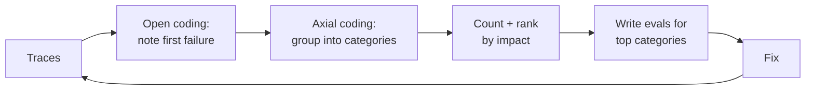

## From 25 cases to a real dataset

In Week 1 you wrote 25 cases by hand. That is the right start, and the wrong end state. A mature agent eval set has hundreds of cases that cover the space of real traffic, include every bug you have ever fixed, and run against environments that behave like production.

This lesson is about building that dataset systematically.

## Start from error analysis, not from a wishlist

The most effective teams do not begin by brainstorming metrics. They read traces. The workflow popularised by Hamel Husain and Shreya Shankar ([FAQ](https://hamel.dev/blog/posts/evals-faq/)) goes:

1. **Sample** 100 or so real (or realistic) conversations.
2. **Open-code** them: read each one and write a short note on the first thing that went wrong, if anything. "Called `issue_refund` before checking the delivery date." "Answered from an outdated policy." "Asked for the order number twice."
3. **Axial-code**: group the notes into failure categories and count them.
4. **Prioritise** by frequency and severity. Build evals for the top categories first.



> [!rule] Your eval categories should come from failures you observed, not from a generic list of metrics. "Helpfulness" is not a failure mode. "Refunds issued without checking the return window" is.

## Anatomy of an agent test case

An agent case needs more than input and expected output, because an agent acts in an environment.

```yaml
id: refund-window-expired-017
category: refund_eligibility          # from error analysis
source: prod-trace-2026-09-14-8fa2    # or "synthetic", "red-team", "bug-412"
tags: [refund, edge-case, used-item]
persona: "frustrated, terse, on mobile"
env:
  customer_id: c_301
  now: 2026-10-01T10:00:00Z           # freeze time: windows depend on it
  orders:
    - {id: 5520, customer_id: c_301, total: 189.00, status: delivered,
       delivered_at: 2026-08-10, items: [{sku: TENT-RDG-2P, used: true}]}
conversation:                         # multi-turn: scripted or simulated
  - user: "I want to return my tent, order 5520. It leaks."
expect:
  must_call:
    - {tool: get_order, args: {order_id: 5520}}
  must_not_call: [issue_refund]
  may_call: [search_kb, escalate_to_human, request_refund_approval]
  end_state:
    refunds: []
  reply:
    rubric: >
      Explains that used tents must be returned within 30 days and this one was delivered
      52 days ago; offers the warranty claim route for the leak; does not promise a refund.
    must_cite: [POL-RETURNS-2026]
```

Key ideas in this format:

- **Frozen environment.** Time, database rows, and external API responses are fixed per case, so failures are reproducible.
- **Required, forbidden, and allowed tools.** Assert the actions that define correctness and leave the path flexible.
- **End-state assertion.** The single most reliable check for agents with write tools.
- **Rubric for the reply**, graded by a judge (next lesson), since there are many correct wordings.
- **Provenance.** Every case says where it came from, so you can tell whether your suite reflects reality.

## Four sources of cases

| Source | Strength | Weakness | Share of a mature suite |
|---|---|---|---|
| Production traces | Real distribution, real phrasing | Needs labelling; PII to scrub | 40–60% |
| Bug regressions | Each one is a proven failure | Narrow | Growing over time |
| Synthetic generation | Covers rare cases and new features before launch | Can be unrealistic or repetitive | 20–40% |
| Red-team / adversarial | Security and abuse coverage | Skews toward attacks | 10–20% |

### Turning traces into cases

When a conversation goes wrong in production (a thumbs-down, a support escalation, an alert), the trace already contains the input, the tool calls, and the tool results. Write a script that converts a trace into a case skeleton: copy the user turns, snapshot the database rows the tools touched into `env`, and leave `expect` for a human to fill in. Then every bug becomes a test in minutes.

Scrub PII before a trace enters the eval set: replace names, emails, and addresses with realistic fakes, consistently within a case.

### Synthetic cases with dimensions

Asking a model to "generate 100 test cases" produces 100 near-identical easy cases. Instead, define **dimensions** and generate combinations:

```python
DIMENSIONS = {
    "intent": ["order_status", "return", "refund", "exchange", "product_question", "complaint"],
    "complication": ["none", "wrong_order_id", "outside_window", "over_refund_limit",
                     "someone_elses_order", "multiple_orders", "changes_mind"],
    "persona": ["polite_detailed", "terse_mobile", "angry", "non_native_english", "elderly_confused"],
}
# sample combinations, then for each: generate a realistic first message, an env, and draft expectations
```

Generate the scenario and environment with one model call, then have a human review and fix expectations. **Never let the same model that runs the agent write the expected answers unchecked**: you would be testing the model against itself.

### Simulated users for multi-turn cases

Many agent failures only appear over several turns: the customer gives the order number late, changes their mind, or gets annoyed. Scripted conversations break as soon as the agent asks something unexpected. Use a **user simulator**: a second model given a persona, a goal, and hidden facts, which replies to the agent until the goal is met or a turn limit is hit. This is how [τ-bench](https://github.com/sierra-research/tau-bench) evaluates customer-service agents.

```python
SIMULATOR = """You are role-playing a customer of Northwind Outfitters.
Goal: {goal}
Facts you know (reveal only when asked): {facts}
Personality: {persona}
Reply in one or two short sentences, as a real customer would. When your goal is
met or clearly impossible, end your message with ###DONE###."""
```

Simulators introduce their own variance, so run multi-turn cases several times and look at pass^k.

## Environments: sandboxes for write tools

You cannot run evals against your production order system. Options, from simplest to most realistic:

1. **In-memory fakes.** Tools call a fake repository seeded from the case's `env`. Fast and deterministic. Good default.
2. **Ephemeral database.** A Postgres schema created per case (or a transaction rolled back after). Tests your real SQL.
3. **Recorded external APIs.** For third-party services (shipping carrier, payment provider), record responses once and replay them (VCR-style).
4. **Full staging environment.** For end-to-end release checks. Slow, so use for a small smoke set.

Benchmarks such as [AgentDojo](https://github.com/ethz-spylab/agentdojo) and [AgentBench](https://arxiv.org/abs/2308.03688) are worth studying for how they structure environments, tasks, and checks.

## Coverage: know what you are not testing

Tag every case and report coverage as a matrix: intents × complications, tools × (called, must-not-call), risk tier × count. Gaps are obvious: "we have zero cases where `escalate_to_human` is the right answer." Also track the **production distribution** of intents and compare: if 30% of real traffic is exchanges and 5% of your evals are, your pass rate is not telling you much.

## Versioning and hygiene

- Keep cases in Git as YAML or JSONL next to the code. Review changes like code.
- Version the dataset; report results as `suite v14, 412 cases`.
- Split into a **dev** set (you look at failures and iterate) and a **held-out** set (run only before release) to avoid overfitting prompts to your evals.
- When a case is wrong (expectations out of date after a policy change), fix the case in the same PR as the policy change.
- Prune near-duplicates. 50 copies of the same easy case inflate your score.

## Design review questions

> [!interview] Where did your eval cases come from? What percentage are from real traffic?

> [!interview] Show me the coverage matrix. Which tool has no must-not-call cases?

> [!interview] How long does it take to turn a production failure into a regression test?

> [!interview] How do you stop your team overfitting prompts to the eval set?

## Further reading

- [AI Evals FAQ](https://hamel.dev/blog/posts/evals-faq/), Hamel Husain and Shreya Shankar. Error analysis, synthetic data, and much more.
- [Demystifying evals for AI agents](https://www.anthropic.com/engineering/demystifying-evals-for-ai-agents), Anthropic.
- [τ-bench](https://arxiv.org/abs/2406.12045), user simulation and database-state grading.
- [AgentDojo](https://github.com/ethz-spylab/agentdojo), tasks plus injection attacks in tool environments.
- [Inspect](https://inspect.aisi.org.uk/), the UK AI Security Institute's open-source eval framework, with good agent support.

```quiz
[
  {"q": "What should determine your first eval categories?", "options": ["A standard list like helpfulness, harmlessness, honesty", "Failure categories found by reading and grouping real traces", "Whatever the eval framework offers by default", "Benchmark leaderboards"], "answer": 1, "why": "Error analysis grounds evals in the failures your system actually has, so improvements map to user impact."},
  {"q": "Why freeze 'now' in each test case's environment?", "options": ["To speed up tests", "Eligibility rules depend on dates; a case that passes today could fail next month without a code change", "Databases require it", "To save tokens"], "answer": 1, "why": "Time-dependent logic needs a fixed clock for reproducibility."},
  {"q": "What is the main problem with asking a model to \"generate 100 test cases\"?", "options": ["It is too expensive", "The output clusters around similar, easy cases; dimensions and review are needed for coverage", "Models cannot write YAML", "It violates terms of service"], "answer": 1, "why": "Without explicit dimensions, generated cases are repetitive. Structured sampling plus human review gives diverse, realistic coverage."},
  {"q": "Why use a user simulator instead of scripted multi-turn conversations?", "options": ["Simulators are deterministic", "Scripts break when the agent asks something unexpected; a simulator responds plausibly to any agent turn", "Simulators are cheaper", "Scripts cannot contain tool calls"], "answer": 1, "why": "Agents take different valid paths. A goal-driven simulator keeps the conversation coherent regardless."},
  {"q": "Why keep a held-out eval set?", "options": ["To save money", "Repeatedly tuning prompts against the same cases overfits to them; a held-out set gives an honest estimate", "Regulators require it", "Held-out sets run faster"], "answer": 1, "why": "Just as in ML, iterating on the test set inflates scores. Keep some cases you rarely look at."}
]
```
