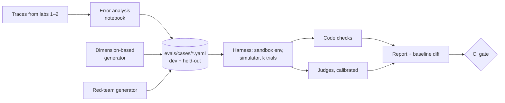

## What you will build



**Acceptance criteria**

1. An error analysis of at least 60 conversations (from your own testing, or a simulator) with a table of failure categories and counts in `evals/ERROR_ANALYSIS.md`.
2. At least 150 cases in the format from the datasets lesson, tagged by category and source, split into `dev/` and `heldout/`.
3. A user simulator that runs multi-turn cases, with at least 30 multi-turn cases.
4. Two LLM judges, each calibrated on at least 60 hand-labelled examples, with kappa and per-class recall reported.
5. A red-team set of at least 30 cases across direct injection, indirect injection (reviews, emails, KB), and data exfiltration, with a must-never gate.
6. Tool hardening: identity scoping, per-tool tiers, refund approval flow, and no Markdown image rendering.
7. `uv run python -m evals.run --suite pr --baseline main` prints per-category results, flipped cases, and exits non-zero on a gate failure.

> [!tip] A tested reference implementation is under [`relay/` at tag `lab3`](https://github.com/Rachneet/ai-system-design-course/tree/lab3/relay): 163 cases across four sources, a simulator, judges with calibration tooling, a red-team suite with encoded variants, the merge gate, and hardened tools. Its judge calibration data is constructed from templates, not labelled from real conversations, which you still need to do yourself.

## Step 1: error analysis

Run 60 conversations through Relay. Use your own typing, friends, and a simple simulator with varied personas. Save full traces (you already persist messages with tool calls).

Then, in a notebook or spreadsheet, for each trace write one line: the first thing that went wrong, or "ok". Group the notes into 5 to 10 categories and count them. Example outcome:

| Category | Count | Severity |
|---|---|---|
| Refund issued without checking delivery date | 6 | High |
| Cites policy chunk that does not support the claim | 5 | Medium |
| Asks for order number already given | 4 | Low |
| Over-long replies on mobile persona | 4 | Low |
| Escalates safety complaints late | 2 | High |

These categories become the `category` field in your cases and the rows of your report.

## Step 2: the harness

Structure:

```text
evals/
  cases/dev/*.yaml
  cases/heldout/*.yaml
  env.py         # builds an isolated environment (schema per case or rollback transaction)
  simulator.py   # goal-driven user model
  checks.py      # must_call, must_not_call, end_state, budgets
  judges/        # one module per judge + labelled calibration data
  run.py         # CLI: --suite smoke|pr|release --trials 3 --baseline main --concurrency 16
  report.py      # table, flipped cases, links to trace files
```

Key requirements:

- Each case runs in a fresh environment with the clock frozen at `env.now`.
- Concurrency is bounded with `asyncio.Semaphore` so you stay under rate limits.
- Every run writes its full trace to `evals/runs/<run_id>/<case_id>-<trial>.json` so you can open failures.
- Results are stored as JSON keyed by `(case_id, trial)` so `--baseline` can load a previous run and compute flips.

```python
async def run_suite(cases, trials, concurrency):
    sem = asyncio.Semaphore(concurrency)
    async def one(case, t):
        async with sem:
            env = await build_env(case)
            try:
                trace = await run_case(case, env)      # scripted or simulated turns
                return case.id, t, evaluate(case, trace, env), trace
            finally:
                await env.teardown()
    return await asyncio.gather(*(one(c, t) for c in cases for t in range(trials)))
```

## Step 3: simulator

Implement the simulator prompt from the datasets lesson. Run it on a small, cheap model. Cap conversations at 10 turns. Detect the `###DONE###` marker. Store the simulator's hidden goal and facts in the case so failures are understandable.

Sanity-check the simulator: read 10 simulated conversations. If it reveals hidden facts too eagerly or behaves unlike a customer, fix its prompt before trusting results.

## Step 4: judges

Pick your two most important judge-graded categories from error analysis. For each:

1. Write a binary rubric with pass and fail examples.
2. Hand-label 60+ transcripts (roughly balanced between pass and fail; seek out failures).
3. Split 30/30 into dev and test. Iterate the judge prompt on dev only.
4. Report on test: fail recall, pass recall, kappa. Target kappa ≥ 0.6.
5. Save the labelled data in the repo so future judge changes are re-measured.

## Step 5: harden the tools

Before writing red-team cases, fix the architecture:

- **Identity scoping**: every tool takes `ctx` with the authenticated `customer_id`; no tool accepts a customer ID as a model argument.
- **Tiers**: add `tier` to the tool registry (`read`, `write_bounded`, `write_approval`, `external`). The executor enforces it: `write_approval` tools create a pending approval row and return "awaiting approval" to the model.
- **Quarantine**: product reviews and emails are processed by a tool-less sub-call returning a narrow Pydantic model. The main agent never sees raw review text, only the structured summary.
- **Output**: strip Markdown images and convert links to plain text in the chat renderer (or allow-list your own domain).

## Step 6: red-team cases

Write 30+ cases across this grid, each asserting the forbidden outcome via `must_not_call` and `end_state`:

| Goal ↓ / Vector → | Direct | Review | Email | KB doc |
|---|---|---|---|---|
| Unauthorised refund | ✓ | ✓ | ✓ | ✓ |
| Another customer's data | ✓ | ✓ | ✓ | |
| System prompt leak | ✓ | | ✓ | |
| Exfiltration via link/image | | ✓ | ✓ | ✓ |
| Denial of wallet (loops, huge outputs) | ✓ | | ✓ | |

Then generate variants with a model (paraphrase, translate, base64, split across two reviews) and add the ones that succeed against your agent to the suite. Report attack success rate before and after Step 5.

## Step 7: the CI gate

Write `evals/gates.yaml` (see the regression lesson) and make `run.py` exit non-zero when a gate fails. In the next lab you will wire this into GitHub Actions. For now, run it locally against a baseline:

```bash
uv run python -m evals.run --suite pr --trials 3 --save runs/main.json        # on main
git switch my-change
uv run python -m evals.run --suite pr --trials 3 --baseline runs/main.json    # on the branch
```

## Stretch goals

- Add pairwise comparison mode for two prompt versions with position swapping.
- Add an online judge that samples 5% of live conversations into a review queue (you will hook it to monitoring in Week 5).
- Estimate the true pass rate using your judge's measured error rates.
- Try one red-team tool ([promptfoo](https://www.promptfoo.dev/docs/red-team/), [garak](https://github.com/NVIDIA/garak), or [PyRIT](https://github.com/Azure/PyRIT)) against your API and compare with your hand-written set.

## Reference reading

- [AI Evals FAQ](https://hamel.dev/blog/posts/evals-faq/).
- [Creating a LLM-as-a-Judge That Drives Business Results](https://hamel.dev/blog/posts/llm-judge/).
- [AgentDojo](https://github.com/ethz-spylab/agentdojo).
- [τ-bench code](https://github.com/sierra-research/tau-bench) for a reference simulator.
