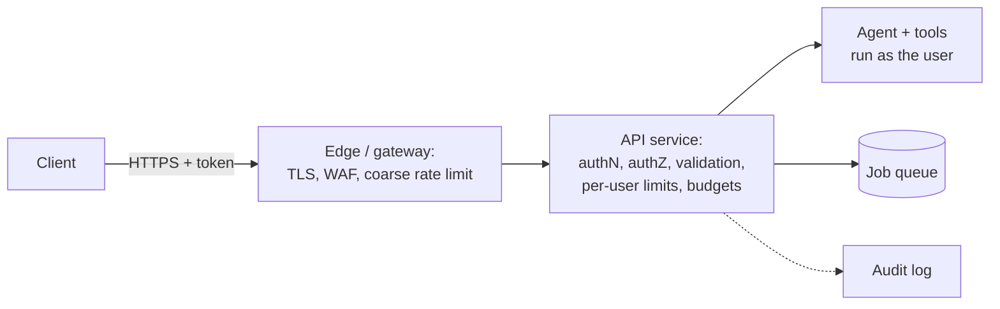
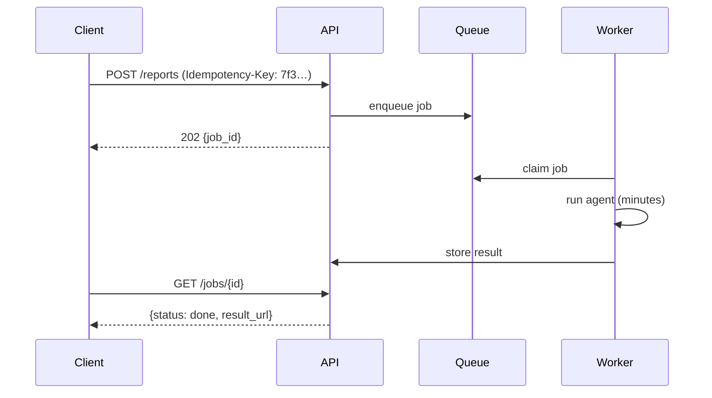

## The API is the trust boundary

Everything before your API is untrusted: browsers, mobile apps, partner servers, scripts. Everything after it (agent, tools, databases) trusts what the API tells it, especially **who the caller is**. Weeks 1 to 3 assumed a `customer_id` header. This lesson replaces that with a real boundary.



## Authentication

Pick based on who calls you:

| Caller | Mechanism | Notes |
|---|---|---|
| Your web/mobile app, end users | OAuth 2.0 / OIDC via an identity provider; short-lived JWT access tokens | Verify signature, issuer, audience, expiry on every request |
| Server-to-server (partners, internal services) | API keys or OAuth client credentials | Store keys hashed; support rotation; scope keys |
| Internal service mesh | mTLS or workload identity | No long-lived secrets |

Do not build your own login system for a course project or a startup. Use an identity provider (Auth0, Clerk, Supabase Auth, Cognito, Firebase Auth, Keycloak) and verify tokens in the API.

```python
# app/auth.py
import jwt                     # PyJWT
from fastapi import Depends, HTTPException
from fastapi.security import HTTPBearer, HTTPAuthorizationCredentials

bearer = HTTPBearer()
jwks = jwt.PyJWKClient(settings.jwks_url)          # caches the provider's public keys

async def current_user(creds: HTTPAuthorizationCredentials = Depends(bearer)) -> User:
    try:
        key = jwks.get_signing_key_from_jwt(creds.credentials)
        claims = jwt.decode(creds.credentials, key.key, algorithms=["RS256"],
                            audience=settings.api_audience, issuer=settings.issuer)
    except jwt.PyJWTError:
        raise HTTPException(401, "Invalid or expired token")
    return User(id=claims["sub"], tenant=claims.get("org_id"), roles=claims.get("roles", []))
```

For API keys, store only a hash (`sha256(key)`) plus a short visible prefix (`rk_live_3f9a…`) for identification. Look up by hash. Show the full key once at creation.

## Authorization: in the API and in every tool

Authentication says who. Authorization says what they may do. In an agent system, authorization has to happen in two places:

1. **At the endpoint**: may this user start a chat, see this session, access this tenant?
2. **In every tool**: may this user read this order, refund this amount? The tool receives the authenticated principal through context and checks it. The model's arguments are never trusted for identity.

Return `404` rather than `403` for resources the caller cannot see, so you do not reveal that they exist.

## Validating input

The OWASP [API Security Top 10](https://owasp.org/API-Security/) applies fully to AI APIs. LLM-specific additions:

- **Bound sizes.** Max message length, max attachments, max file size, max conversation length. An attacker who sends 500,000 tokens per message is running a cost attack ("denial of wallet").
- **Validate types and shapes** with Pydantic. Reject unknown fields.
- **Treat uploaded files as hostile**: check content type by magic bytes, scan, parse in a sandboxed worker with resource limits, never execute.
- **Never let input choose the model, system prompt, or tools** unless that is a deliberate, validated feature.

```python
class ChatIn(BaseModel):
    model_config = ConfigDict(extra="forbid")
    session_id: UUID | None = None
    message: constr(strip_whitespace=True, min_length=1, max_length=4000)
```

## Rate limits and budgets

Limit at several levels:

| Level | Example | Protects against |
|---|---|---|
| Edge, per IP | 60 requests/min | Floods, scrapers |
| Per user | 20 messages/min, 300/day | Abuse by one account |
| Per user token budget | 200k tokens/day | Cost attacks with long inputs |
| Per tenant | Contracted quota | Noisy neighbours |
| Global | Below your provider's limits | Provider 429s cascading |

Implement per-user limits with a token bucket in Redis or Postgres. Return `429` with a `Retry-After` header. Track spend per user and tenant, and cut off or degrade (smaller model) when a budget is exhausted. Week 5 goes deeper.

## Streaming safely

Server-sent events (SSE) are the simplest way to stream tokens to a browser over plain HTTP. Production details:

- **Timeouts**: proxies and load balancers often close idle connections after 30 to 60 seconds. Send a heartbeat comment (`: ping\n\n`) every 15 seconds during long tool calls.
- **Disconnects**: if the client goes away, cancel the agent run (or decide deliberately to finish it and store the result). Otherwise you pay for answers nobody reads.
- **Buffering**: some proxies buffer responses; disable it (`X-Accel-Buffering: no` for nginx).
- **Errors mid-stream**: you cannot change the HTTP status after streaming starts, so send a typed error event (`event: error`) the client understands.

## Long-running work: do not hold the request open

Some agent tasks take minutes: research, bulk processing, long document analysis. Do not run them inside an HTTP request. Accept the job, return `202 Accepted` with a job ID, process it in a worker (next lesson), and let the client poll `GET /jobs/{id}`, subscribe to SSE on the job, or receive a webhook.



## Idempotency

Clients retry. Networks drop responses. If a retried `POST /refund-requests` creates two refunds, you have a real money bug. Accept an `Idempotency-Key` header on non-idempotent endpoints; store the key with the response; on a repeat, return the stored response. Brandur Leach's [Implementing Stripe-like Idempotency Keys in Postgres](https://brandur.org/idempotency-keys) is the reference.

## Secrets

- Never commit secrets. Use a `.env` file locally (git-ignored) and a secret manager in the cloud (Google Secret Manager, AWS Secrets Manager, Doppler, 1Password). Inject as environment variables at runtime, following [12-factor config](https://12factor.net/).
- Give each environment its own model API key with a spending limit, so a leaked dev key cannot burn your production budget.
- Rotate keys. Scan the repo and CI logs for leaks (GitHub secret scanning is free for public repos).
- Never put secrets in prompts. Tools hold credentials; the model never sees them.

## Packaging: a small, reproducible container

Containers make "works on my machine" into "works everywhere". Good AI service images are small, reproducible, and run as non-root. With uv, a multi-stage build looks like this (see the [uv Docker guide](https://docs.astral.sh/uv/guides/integration/docker/)):

```dockerfile
# syntax=docker/dockerfile:1
FROM python:3.12-slim AS build
COPY --from=ghcr.io/astral-sh/uv:0.12.21 /uv /uvx /bin/
WORKDIR /app
ENV UV_COMPILE_BYTECODE=1 UV_LINK_MODE=copy
RUN --mount=type=cache,target=/root/.cache/uv \
    --mount=type=bind,source=uv.lock,target=uv.lock \
    --mount=type=bind,source=pyproject.toml,target=pyproject.toml \
    uv sync --frozen --no-dev --no-install-project
COPY . .
RUN --mount=type=cache,target=/root/.cache/uv \
    uv sync --locked --no-dev

FROM python:3.12-slim
RUN useradd --create-home --uid 10001 relay
WORKDIR /app
COPY --from=build --chown=relay:relay /app /app
ENV PATH="/app/.venv/bin:$PATH" PYTHONUNBUFFERED=1
USER relay
EXPOSE 8080
HEALTHCHECK CMD python -c "import urllib.request; urllib.request.urlopen('http://localhost:8080/healthz')"
CMD ["uvicorn", "app.main:app", "--host", "0.0.0.0", "--port", "8080", "--proxy-headers"]
```

Why each choice:

- **Multi-stage**: build tools and caches stay out of the final image.
- **Dependencies before code**: the `uv sync --no-install-project` layer is cached until `uv.lock` changes, so code edits rebuild in seconds.
- **`--frozen`, then `--locked`**: the first sync installs exactly what the lockfile says without checking it; the final sync, with the full project present, also fails if the lockfile is out of date. The cache mount speeds up rebuilds without bloating the image.
- **Non-root user**: limits damage if the process is compromised.
- **Pinned base and tool versions**: rebuilds next month produce the same image. Pin the base image by digest for full reproducibility.

Keep prompts, tool schemas, and eval cases in the repo and in the image. The image tag (Git SHA) then identifies the exact behaviour you deployed.

## Health checks

Expose two endpoints:

- `/healthz` (liveness): the process is up. Do not check dependencies here, or a database blip restarts every instance.
- `/readyz` (readiness): the instance can serve traffic. Checks the database pool and config. Do **not** call the LLM provider here on every probe: it costs money, and a provider outage should degrade your service, not take every instance out of rotation.

## Design review questions

> [!interview] Trace a request from the browser to `issue_refund`. Where is identity established, and where is it checked?

> [!interview] What stops one user from spending $1,000 of model tokens in an hour?

> [!interview] A client retries a refund request after a timeout. What happens?

> [!interview] How big is your image, how long does a code-only rebuild take, and what user does it run as?

## Further reading

- [FastAPI security tutorial](https://fastapi.tiangolo.com/tutorial/security/).
- [OWASP API Security Top 10](https://owasp.org/API-Security/) and the [REST Security Cheat Sheet](https://cheatsheetseries.owasp.org/cheatsheets/REST_Security_Cheat_Sheet.html).
- [Using uv in Docker](https://docs.astral.sh/uv/guides/integration/docker/).
- [Docker build best practices](https://docs.docker.com/build/building/best-practices/).
- [Implementing Stripe-like Idempotency Keys in Postgres](https://brandur.org/idempotency-keys).
- [The Twelve-Factor App](https://12factor.net/).

```quiz
[
  {"q": "Why should /readyz not call the LLM provider?", "options": ["It is slow", "It costs money per probe, and a provider outage would pull every instance out of rotation instead of letting the service degrade", "Providers forbid it", "Health checks cannot make HTTP calls"], "answer": 1, "why": "Readiness should reflect whether this instance can serve. Provider health is handled with fallbacks and circuit breakers, not by killing your own fleet."},
  {"q": "A research task takes four minutes. How should the API handle it?", "options": ["Hold the HTTP request open", "Return 202 with a job ID, run it in a worker, and let the client poll, subscribe, or receive a webhook", "Increase the load balancer timeout to 10 minutes", "Split it into 240 requests"], "answer": 1, "why": "Long work belongs in background workers. Requests stay short and robust to disconnects."},
  {"q": "How should API keys be stored server-side?", "options": ["In plain text in the database", "Hashed, with a short visible prefix for identification", "Encrypted with the user's password", "In the system prompt"], "answer": 1, "why": "Like passwords, keys should be stored as hashes so a database leak does not leak usable keys."},
  {"q": "What is the purpose of an Idempotency-Key on POST endpoints?", "options": ["Authentication", "Retries of the same request return the original result instead of performing the action twice", "Rate limiting", "Caching model output"], "answer": 1, "why": "Clients and networks retry. Idempotency keys make retries safe for actions like refunds."},
  {"q": "In the Dockerfile, why copy pyproject.toml and uv.lock and install dependencies before copying app code?", "options": ["Docker requires it", "The dependency layer stays cached until the lockfile changes, so code-only changes rebuild quickly", "It makes the image smaller", "It runs tests"], "answer": 1, "why": "Layer ordering from least to most frequently changed maximises cache hits."}
]
```
