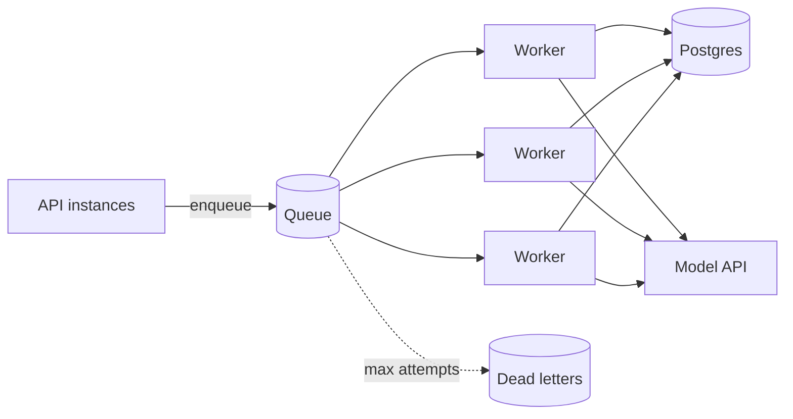
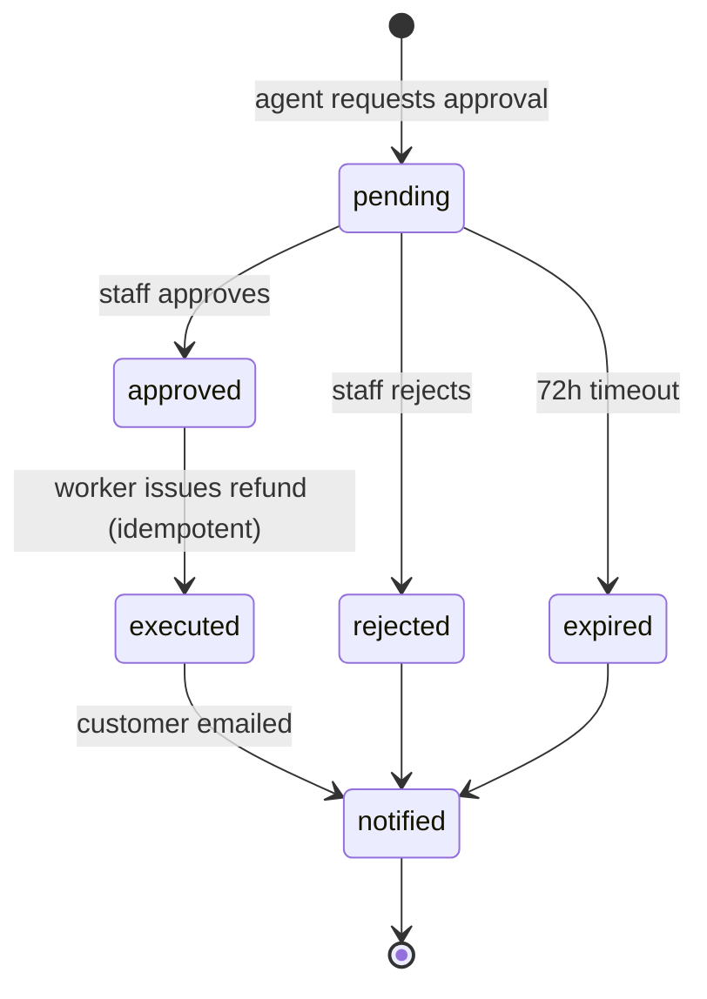

## A typical AI application's data layer

| Data | Store | Why |
|---|---|---|
| Users, orders, sessions, messages, approvals | Postgres | Transactions, constraints, joins, durability |
| Vectors (up to tens of millions) | Postgres + pgvector | One system to run; joins with ACLs |
| Vectors (very large, or specialised needs) | Dedicated vector DB | Scale, advanced filtering, managed ops |
| Rate-limit counters, short-lived caches, locks | Redis or Valkey | Fast, TTLs, atomic increments |
| Job queue | Postgres (`SKIP LOCKED`), Redis-based queue, or managed (SQS, Pub/Sub, Cloud Tasks, Azure Service Bus) | Depends on volume and ops appetite |
| Files: uploads, PDFs, generated reports | Object storage (S3, GCS, Azure Blob Storage, R2) | Cheap, durable, signed URLs |
| Traces and analytics | Tracing backend, warehouse | Volume and query patterns differ from OLTP |

> [!rule] Start with Postgres for almost everything. Add a new data store only when you can name the specific requirement Postgres is failing to meet.

### Connection management

Every API instance and worker opens database connections. Postgres handles hundreds, not tens of thousands. With autoscaling containers (next lessons), 50 instances × 20 pool connections = 1,000 connections, which will exhaust a small database.

```viz
caption: Autoscaling multiplies connection pools. Fifty instances with modest pools ask for ten times what a default Postgres accepts.
<div class="vz-bars"><span>Postgres default</span><span class="bar sk"><i class="sk g" style="--w:10%"></i></span><b>100</b><span>50 x pool of 20</span><span class="bar sk"><i class="sk b" style="--w:100%"></i></span><b>1,000</b><span>via PgBouncer</span><span class="bar sk"><i class="sk g" style="--w:5%"></i></span><b>~50 real</b></div>
<div class="vz-src">Default <code>max_connections</code> is typically 100: <a href="https://www.postgresql.org/docs/current/runtime-config-connection.html">PostgreSQL docs</a>. Managed services size it by instance tier. The PgBouncer row is an example pool size; in <a href="https://www.pgbouncer.org/features.html">transaction pooling</a> a server connection is held only for the length of a transaction.</div>
```

- Use a pool per process (`psycopg_pool`, SQLAlchemy pool) with a modest size (5 to 10).
- Put **PgBouncer** (transaction pooling) or your provider's pooler in front of Postgres when instance counts grow.
- Do not hold a connection across an LLM call. A 6-second model call holding a connection means 6 seconds of a scarce resource doing nothing. Read what you need, release, call the model, then write.

```python
# Bad: connection held during a slow model call
async with pool.connection() as conn:
    history = await load_history(conn, session_id)
    reply = await run_agent(history)            # seconds
    await save(conn, session_id, reply)

# Good: short transactions around the slow part
async with pool.connection() as conn:
    history = await load_history(conn, session_id)
reply = await run_agent(history)
async with pool.connection() as conn:
    await save(conn, session_id, reply)
```

## Why background workers

Move work out of the request path when it is:

- **Slow**: ingestion, long agent tasks, report generation.
- **Retryable**: anything that calls flaky external APIs.
- **Deferred**: memory extraction after a session, nightly evals, reconciliation.
- **Spiky**: a bulk import should queue, not overwhelm the API.

Workers are separate processes (often the same container image with a different command) that pull jobs from a queue.



### Choosing a queue

| Option | Good for | Watch out for |
|---|---|---|
| Postgres table + `SKIP LOCKED` | Up to hundreds of jobs/sec, transactional enqueue | Table bloat; vacuum; polling |
| [RQ](https://python-rq.org/) / [arq](https://arq-docs.helpmanual.io/) (Redis) | Simple Python workers, async (arq) | Redis persistence settings |
| [Celery](https://docs.celeryq.dev/) | Mature, many features, scheduling | Complexity, configuration sprawl |
| Managed (SQS, Pub/Sub, Cloud Tasks) | No ops, scale | At-least-once delivery semantics, visibility timeouts |
| [Temporal](https://docs.temporal.io/) and similar | Long, multi-step, durable workflows | New programming model, more infrastructure |

## Delivery semantics: plan for at-least-once

Almost every queue guarantees **at-least-once** delivery: a job can run twice (a worker crashes after doing the work but before acknowledging). Exactly-once delivery is not something you get from infrastructure; you build **effectively-once processing** from idempotent handlers.

```viz
caption: The queue will deliver some jobs twice. An idempotency key turns the second delivery into a no-op instead of a second refund.
<div class="vz-cols">
  <div class="vz-panel sk b"><h5>No key</h5>
    <div class="vz-row"><span class="ch sk c">run 1</span><span class="arr sk"></span><span class="ch sk">refund $40</span></div>
    <div class="vz-row"><span class="ch sk c">crash, redeliver</span></div>
    <div class="vz-row"><span class="ch sk c">run 2</span><span class="arr sk"></span><span class="ch sk b">refund $40 again</span></div>
  </div>
  <div class="vz-panel sk g"><h5>Key = job ID</h5>
    <div class="vz-row"><span class="ch sk c">run 1</span><span class="arr sk"></span><span class="ch sk">refund $40</span></div>
    <div class="vz-row"><span class="ch sk c">crash, redeliver</span></div>
    <div class="vz-row"><span class="ch sk c">run 2</span><span class="arr sk"></span><span class="ch sk g">seen: return result</span></div>
  </div>
</div>
```

Techniques:

- **Natural idempotency**: `INSERT ... ON CONFLICT DO NOTHING` with a unique key (`UNIQUE (order_id)` on refunds).
- **Idempotency keys** on external calls: pass the job ID as the idempotency key to the payment provider, so a retried refund call is a no-op on their side.
- **Check-then-act inside a transaction** with row locks for state transitions (`UPDATE approvals SET status='executed' WHERE id=$1 AND status='approved' RETURNING *`; if no row returns, someone else did it).

## The dual-write problem and the outbox

A common bug: the API writes a row to Postgres, then publishes a message to a queue. If the process dies between the two, the row exists but no job runs. Reverse the order and you get jobs for rows that do not exist.

```viz
caption: Two separate writes can be split by a crash. One transaction holding both rows cannot.
<div class="vz-cols">
  <div class="vz-panel sk b"><h5>Dual write</h5>
    <div class="vz-row"><span class="ch sk m">INSERT approval</span><span class="arr sk"></span><span class="ch sk b">crash</span></div>
    <div class="vz-row"><span class="ch sk ghost">publish job</span></div>
    <p class="big b">row, no job</p>
  </div>
  <div class="vz-panel sk g"><h5>Outbox</h5>
    <div class="vz-row"><span class="ch wide sk m">one transaction: approval + outbox row</span></div>
    <div class="vz-row"><span class="arr d sk"></span></div>
    <div class="vz-row"><span class="ch sk">relay</span><span class="arr sk"></span><span class="ch sk">queue</span></div>
    <p class="big g">both or neither</p>
  </div>
</div>
```

The **transactional outbox** fixes this: write the business row and an `outbox` row in the **same transaction**. A relay process reads the outbox and publishes to the queue, marking rows sent. If you use Postgres as the queue, the job row itself is the outbox, which is one reason Postgres queues are attractive at small scale. See [microservices.io on the outbox pattern](https://microservices.io/patterns/data/transactional-outbox.html).

```sql
BEGIN;
INSERT INTO approvals (id, order_id, amount, status) VALUES ($1, $2, $3, 'pending');
INSERT INTO outbox (topic, payload) VALUES ('approval.created', jsonb_build_object('id', $1));
COMMIT;
```

## Long-running agent jobs

An agent job that runs for 20 minutes and makes 60 tool calls will, sooner or later, be interrupted by a deploy, a crash, or a scale-down. Restarting from scratch wastes money and can repeat side effects.

**Checkpoint** after each step: persist the message list and task state. On restart, the worker loads the checkpoint and continues the loop. Because tool calls are recorded with their results, the agent does not repeat completed writes. Combine with idempotent tools for the step that was in flight.

For complex, long-lived processes (wait for human approval for up to 3 days, then refund, then email), consider a **durable execution** engine such as Temporal. You write the workflow as ordinary code; the engine records each step's result and replays the workflow after failures, so `await approval_signal()` can wait for days without holding a process. LangGraph's checkpointers offer a lighter version for agent graphs.

### Human approval as a workflow

Relay's refund approvals are a natural workflow:



Model it as a state machine in a table with explicit transitions. Each transition is a guarded `UPDATE` that only succeeds from the expected state, which makes concurrent workers and double-clicks safe.

## Concurrency and backpressure

Your workers share the model provider's rate limits with the API. If 50 workers start a bulk job, they can starve interactive users.

- Separate queues and worker pools for **interactive** and **batch** work, with batch workers capped.
- A global concurrency limit on model calls (a Redis semaphore or token bucket shared across processes).
- Batch work should use the provider's batch API when latency does not matter. OpenAI, Anthropic and Gemini batch APIs all charge half the standard price, and OpenAI states its [batch rate limits are separate](https://developers.openai.com/api/docs/guides/batch) from per-model limits. If you self-host with vLLM, run batch work on its own replicas, or use vLLM's [offline inference](https://docs.vllm.ai/en/stable/serving/offline_inference/) for bulk jobs, so it cannot fill the KV cache that live chats need.
- Autoscale workers on **queue depth and age**, not CPU. A worker waiting on a model API uses almost no CPU.

> [!numbers] Ingestion and memory jobs average 6 seconds of wall time, mostly waiting on APIs. One async worker process can run 20 jobs concurrently. To drain 10,000 jobs in under 30 minutes you need 10,000 × 6 s / 1,800 s ≈ 34 concurrent slots, so two worker processes with concurrency 20, provided your rate limits allow about 34 concurrent model calls.

## Scheduled jobs

Some work runs on a clock: nightly reconciliation, evals against production snapshots, cleanup of expired sessions, budget resets. Use your platform's scheduler (Cloud Scheduler, Amazon EventBridge Scheduler, scheduled [Azure Container Apps jobs](https://learn.microsoft.com/en-us/azure/container-apps/jobs), Kubernetes CronJob) to enqueue a job, rather than a `while True: sleep` in a container. Make scheduled jobs idempotent too: schedulers can fire twice.

## Design review questions

> [!interview] A worker crashes after calling the payment API but before marking the job done. What happens on retry?

> [!interview] How many database connections does your system open at peak scale, and what is the database's limit?

> [!interview] How do you stop a bulk backfill from slowing down live chats?

> [!interview] Where is the state of a pending approval, and what happens to it during a deploy?

## Further reading

- [Transactional outbox](https://microservices.io/patterns/data/transactional-outbox.html), microservices.io.
- [Implementing Stripe-like Idempotency Keys in Postgres](https://brandur.org/idempotency-keys).
- [Temporal documentation](https://docs.temporal.io/), for durable execution concepts even if you never use it.
- [arq](https://arq-docs.helpmanual.io/), a small async job queue for Python.
- [Designing Data-Intensive Applications](https://dataintensive.net/), Martin Kleppmann. Not free, but often in libraries; chapters on transactions and stream processing are the background for this lesson.

```quiz
[
  {"q": "Why should you not hold a database connection while waiting on an LLM call?", "options": ["LLM SDKs forbid it", "Connections are scarce; holding them during multi-second waits exhausts the pool under load", "It corrupts data", "It increases token usage"], "answer": 1, "why": "A slow model call holding a connection wastes a limited resource. Keep transactions short around the slow work."},
  {"q": "What does at-least-once delivery imply for your job handlers?", "options": ["Nothing", "They must be idempotent, because a job can run more than once", "They must be faster", "They must use Redis"], "answer": 1, "why": "Duplicate execution is normal. Unique constraints, idempotency keys, and guarded state transitions make it harmless."},
  {"q": "What problem does the transactional outbox solve?", "options": ["Slow queries", "Writing to the database and publishing to a queue atomically, so neither happens without the other", "Rate limiting", "Embedding updates"], "answer": 1, "why": "By recording the message in the same transaction as the data, a separate relay can publish reliably."},
  {"q": "What should you autoscale model-calling workers on?", "options": ["CPU usage", "Queue depth and job age", "Memory", "Number of API instances"], "answer": 1, "why": "Workers waiting on remote APIs use little CPU, so CPU-based autoscaling never triggers. Queue metrics reflect actual demand."}
]
```
