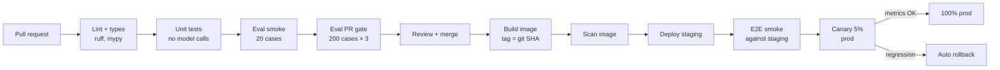
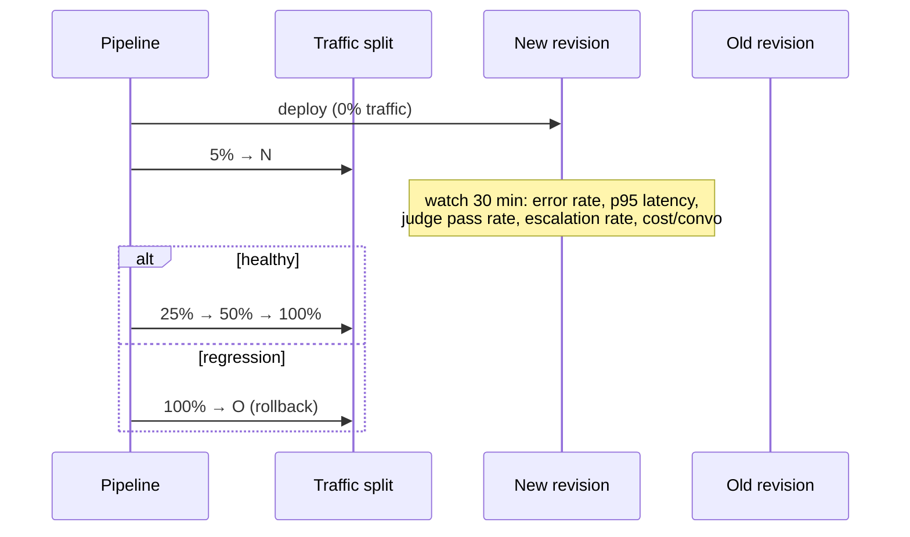

## What is different about CI/CD for AI systems

The mechanics are the same as any service: build, test, package, deploy. Three things differ:

1. **Tests are probabilistic and cost money.** Your eval suite takes minutes, spends tokens, and has noise. It needs tiers, budgets, and statistical gates (Week 3).
2. **Behaviour changes without code changes.** Prompts, model versions, knowledge base content, and config all change behaviour. They must flow through the pipeline too.
3. **Production is the real test.** Offline evals approximate reality, so progressive rollout with online monitoring is part of the pipeline, not an afterthought.

## The pipeline



### Stage by stage

**Lint and type check.** Ruff and a type checker. Cheap, fast, catch a surprising number of bugs.

**Unit tests without models.** Most of your code (tool logic, auth, permission checks, guardrails, parsing, the retrieval SQL) can be tested deterministically with fake models. Use a fake LLM client that returns scripted responses, including tool calls, so you can test the agent loop's control flow: step limits, error handling, parallel tool results. These run in seconds and cost nothing.

```python
class ScriptedLLM:
    """Returns pre-baked responses in order. Lets you test the loop without the API."""
    def __init__(self, responses): self.responses = iter(responses)
    async def create(self, **kwargs): return next(self.responses)

async def test_step_limit_escalates():
    llm = ScriptedLLM([tool_use("get_order", {"order_id": 1})] * 20)   # never stops
    result = await run_turn(ctx_with(llm), [user("hi")], on_text=noop)
    assert ctx.escalations == ["step_limit"]
```

**Eval smoke and PR gate.** Run only when behaviour-affecting paths change (`app/**`, `prompts/**`, `evals/**`, model config). Post results as a PR comment. Block merge on gate failure.

**Build once, deploy the same artifact everywhere.** The image built from `main` at SHA `9f3e2c1` is what goes to staging and then production. Never rebuild for production.

```viz
caption: One image, promoted. Only configuration changes between environments, so production runs exactly the bytes that passed staging.
<div class="vz-row"><span class="ch sk c">build once</span><span class="arr sk"></span><span class="ch sk c">relay:9f3e2c1</span><span class="arr sk"></span><span class="ch sk g">staging</span><span class="arr sk"></span><span class="ch sk g">production</span></div>
<div class="vz-cols">
  <div class="vz-panel sk c"><h5>Inside the image</h5><div class="vz-row"><span class="ch sk">code</span><span class="ch sk">prompts</span><span class="ch sk">tool schemas</span><span class="ch sk">model config</span></div></div>
  <div class="vz-panel sk"><h5>Injected per environment</h5><div class="vz-row"><span class="ch sk ghost">database URL</span><span class="ch sk ghost">API keys</span><span class="ch sk ghost">flags</span></div></div>
</div>
```

**Scan.** Check the image for known vulnerabilities (Trivy, Grype, or your registry's scanner) and dependencies for licences and CVEs.

**Staging + end-to-end smoke.** Deploy to a staging environment with its own database and model key, then run a handful of real requests through the public endpoint: auth works, a chat streams, a tool call succeeds.

**Canary, then full rollout.** Covered below.

## A GitHub Actions example

```yaml
# .github/workflows/ci.yml
name: ci
on:
  pull_request:
  push:
    branches: [main]

permissions:
  contents: read
  pull-requests: write          # to post eval comments
  id-token: write               # for keyless cloud auth (OIDC)

jobs:
  test:
    runs-on: ubuntu-latest
    services:
      db:
        image: pgvector/pgvector:pg16
        env: { POSTGRES_PASSWORD: relay }
        ports: ["5432:5432"]
        options: --health-cmd pg_isready --health-interval 5s
    steps:
      - uses: actions/checkout@v7
      - uses: astral-sh/setup-uv@v10.0.1
        with: { enable-cache: true }
      - run: uv sync --frozen
      - run: uv run ruff check . && uv run ruff format --check .
      - run: uv run pytest -q

  evals:
    needs: test
    if: github.event_name == 'pull_request'
    runs-on: ubuntu-latest
    steps:
      - uses: actions/checkout@v7
      - uses: dorny/paths-filter@v4
        id: changed
        with:
          filters: |
            behaviour: ['app/**', 'prompts/**', 'evals/**', 'config/models.yaml']
      - if: steps.changed.outputs.behaviour == 'true'
        uses: astral-sh/setup-uv@v10.0.1
      - if: steps.changed.outputs.behaviour == 'true'
        env:
          # Model specs live in repo variables, so switching provider is a settings change.
          RELAY_MODEL: ${{ vars.EVAL_MODEL }}               # e.g. openai:gpt-5 or gemini:gemini-2.5-flash
          RELAY_JUDGE_MODEL: ${{ vars.EVAL_JUDGE_MODEL }}   # e.g. anthropic:claude-opus-5-5
          # Separate eval-only keys with spend caps. Set only the ones your specs use.
          OPENAI_API_KEY: ${{ secrets.EVAL_OPENAI_API_KEY }}
          GEMINI_API_KEY: ${{ secrets.EVAL_GEMINI_API_KEY }}
          ANTHROPIC_API_KEY: ${{ secrets.EVAL_ANTHROPIC_API_KEY }}
          OPENROUTER_API_KEY: ${{ secrets.EVAL_OPENROUTER_API_KEY }}
        run: |
          uv sync --frozen
          uv run python -m evals.run --suite pr --trials 3 \
            --baseline gs://relay-evals/baselines/main.json --report report.md   # or s3://, or Azure Blob
      - if: always() && steps.changed.outputs.behaviour == 'true'
        uses: marocchino/sticky-pull-request-comment@v3.0.5
        with: { path: report.md }
```

A separate `deploy.yml` on pushes to `main` builds the image, pushes it to a registry, deploys to staging, runs the E2E smoke, then promotes to production.

Security notes for pipelines (see GitHub's [security hardening guide](https://docs.github.com/en/actions/security-for-github-actions/security-guides/security-hardening-for-github-actions)):

- Use **OIDC** to authenticate to your cloud instead of storing long-lived cloud keys in GitHub. GitHub documents the setup for [AWS](https://docs.github.com/en/actions/how-tos/secure-your-work/security-harden-deployments/oidc-in-aws), [Azure](https://docs.github.com/en/actions/how-tos/secure-your-work/security-harden-deployments/oidc-in-azure) and [Google Cloud](https://docs.github.com/en/actions/how-tos/secure-your-work/security-harden-deployments/oidc-in-google-cloud-platform). Model API keys are usually still static secrets, so keep eval keys separate and capped.
- Running evals against a self-hosted model (vLLM or Ollama) in CI needs a GPU runner or a reachable private endpoint; most teams point CI at a hosted provider or a staging inference server instead.
- Give workflows **minimal permissions**.
- Do not expose secrets to workflows triggered by pull requests from forks.
- Pin third-party actions to an exact version or, better, a commit SHA. Not every action publishes a moving major tag such as `@v10`, so check the action's releases page for the tags that actually exist.

## Versioning prompts and models

Treat prompts as code:

- Store prompts as files (`prompts/system.md`, `prompts/judges/refund_promise.md`), not strings scattered through Python.
- Reference models through one config file:

```yaml
# config/models.yaml: provider:model specs, so any role can move to any provider
agent:      {model: "openai:gpt-5",                 max_tokens: 2048}
fallback:   {model: "anthropic:claude-sonnet-5-5",  max_tokens: 2048}   # a different vendor
router:     {model: "ollama:qwen3:8b",              max_tokens: 64}     # small local model
judge:      {model: "gemini:gemini-2.5-flash",      max_tokens: 512}    # another family
embeddings: {model: "BAAI/bge-small-en-v1.5", dim: 384}                  # open weights, CPU
```

The mix above is an illustration, not a recommendation: pick each role from your own evals. Embedding models are the exception to free swapping, because vectors from two models are not comparable. Changing the embedding model means re-embedding the whole index.

- Log the prompt hash and model ID on every trace, so any conversation can be tied to the exact behaviour that produced it.
- Upgrading a model is a PR that changes one line in this file and must pass the full release suite.

Some teams use a prompt management platform so non-engineers can edit prompts. That is fine if edits still go through evals and produce a versioned artifact the deploy pins to. "Edit in a web UI and it is live instantly" bypasses everything this week teaches.

## Feature flags

Flags decouple deploy from release. Ship new behaviour dark, then turn it on for staff, then 5% of users, then everyone. Useful flags in AI systems:

- Which prompt version or model a user gets (for A/B tests).
- Enabling a new tool.
- Kill switches: disable the refund tool instantly if something goes wrong, without a deploy.

## Progressive delivery and rollback

```viz
caption: Canary risks a small slice of users and needs time; blue-green switches everyone at once but rolls back in one step.
<div class="vz-cols">
  <div class="vz-panel sk"><h5>Canary: new revision's share</h5>
    <div class="vz-bars"><span>step 1</span><span class="bar sk"><i class="sk c" style="--w:5%"></i></span><b>5%</b><span>step 2</span><span class="bar sk"><i class="sk c" style="--w:25%"></i></span><b>25%</b><span>step 3</span><span class="bar sk"><i class="sk c" style="--w:50%"></i></span><b>50%</b><span>done</span><span class="bar sk"><i class="sk g" style="--w:100%"></i></span><b>100%</b></div>
    <p>a bad prompt reaches 5% of users before metrics catch it</p>
  </div>
  <div class="vz-panel sk"><h5>Blue-green: new revision's share</h5>
    <div class="vz-bars"><span>before</span><span class="bar sk"><i class="sk c" style="--w:1%"></i></span><b>0%</b><span>switch</span><span class="bar sk"><i class="sk c" style="--w:100%"></i></span><b>100%</b><span>rollback</span><span class="bar sk"><i class="sk b" style="--w:1%"></i></span><b>0%</b></div>
    <p>old revision stays warm, so rollback is one traffic switch</p>
  </div>
</div>
<p>Cloud Run and <a href="https://learn.microsoft.com/en-us/azure/container-apps/traffic-splitting">Azure Container Apps</a> split traffic between revisions by percentage, <a href="https://docs.aws.amazon.com/AmazonECS/latest/developerguide/deployment-type-bluegreen.html">Amazon ECS</a> supports blue/green with canary or linear shifting, and on Kubernetes <a href="https://argoproj.github.io/argo-rollouts/">Argo Rollouts</a> does both. Percentages are this lesson's example steps.</p>
```



Canary analysis for AI services should watch AI-specific signals in addition to errors and latency:

- Online judge pass rates on sampled conversations.
- Escalation-to-human rate and thumbs-down rate.
- Tokens and cost per conversation.
- Tool error rates and guardrail firing rates.

Rollback must be one command (or automatic) and fast: shift traffic back to the previous revision. Because the image tag is the Git SHA and prompts are inside the image, rolling back the image rolls back the prompt too.

> [!warn] Database migrations do not roll back with traffic. Make schema changes backward-compatible (expand, migrate, contract over several deploys) so the previous revision can still run against the new schema.

## Design review questions

> [!interview] A product manager wants to change one sentence in the system prompt. Walk me through how it reaches production.

> [!interview] How long from merge to 100% production, and how long to roll back?

> [!interview] Which signals does the canary watch, and who decided the thresholds?

> [!interview] How would you know if your eval budget in CI doubled?

## Further reading

- [GitHub Actions documentation](https://docs.github.com/en/actions).
- [Using uv in GitHub Actions](https://docs.astral.sh/uv/guides/integration/github/).
- [Security hardening for GitHub Actions](https://docs.github.com/en/actions/security-for-github-actions/security-guides/security-hardening-for-github-actions).
- [SLSA](https://slsa.dev/), a framework for supply-chain integrity of build artifacts.
- [promptfoo CI integration](https://github.com/promptfoo/promptfoo) for a ready-made eval-in-CI option.

```quiz
[
  {"q": "What can you unit test without calling a model?", "options": ["Nothing useful", "Tool logic, permission checks, guardrails, retrieval SQL, and the agent loop's control flow using a scripted fake LLM", "Only formatting", "Only the database"], "answer": 1, "why": "Most of an AI application is deterministic code. Fakes let you test it fast and for free, leaving evals for model behaviour."},
  {"q": "Why build the image once and promote it through environments?", "options": ["It saves CI minutes only", "So production runs exactly the artifact that was tested, including prompts", "Registries charge per build", "Docker requires it"], "answer": 1, "why": "Rebuilding can pull different dependencies. Promoting one artifact guarantees what you tested is what you run."},
  {"q": "Which signal is specific to canarying an AI service?", "options": ["HTTP 5xx rate", "CPU usage", "Online judge pass rate and escalation rate on sampled conversations", "Disk usage"], "answer": 2, "why": "A new prompt can be fast and error-free but worse at the job. Quality signals must be part of canary analysis."},
  {"q": "Why must schema migrations be backward-compatible?", "options": ["For performance", "Rolling back the app does not roll back the database; the old revision must still work with the new schema", "Postgres requires it", "To keep migrations small"], "answer": 1, "why": "Expand and contract migrations let you roll back code safely."}
]
```
