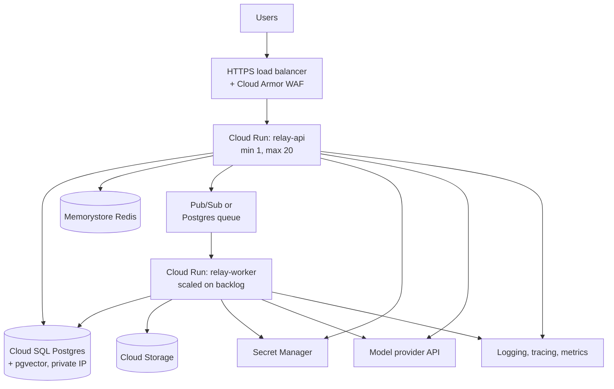

## Choosing a runtime

Your Relay image can run on many platforms. The choice is mostly about how much infrastructure you want to operate.

| Platform | Model | Good for | Trade-offs |
|---|---|---|---|
| Google Cloud Run, Azure Container Apps | Serverless containers, scale to zero, per-request billing | Most API-calling AI apps, small teams, spiky traffic | Request timeouts (Cloud Run up to 60 min), cold starts, less control |
| AWS ECS on Fargate | Managed containers, no servers | AWS shops, steady services | More configuration (task defs, load balancers) |
| Fly.io, Render, Railway | Developer platforms | Fast setup, free or cheap small apps | Fewer enterprise features |
| Kubernetes (GKE, EKS, AKS) | Full orchestration | Many services, GPUs, custom networking, platform teams | Significant operational cost |
| VMs | You manage everything | Special hardware or licensing | You manage everything |

> [!rule] If your app calls hosted model APIs and you do not already run Kubernetes, start on a serverless container platform. Move only when you hit a concrete limit.

**When you self-host models** (open-weight models on GPUs), the picture changes: GPU scheduling, model loading time, and batching make Kubernetes with an inference server (vLLM, TGI, or similar) or a managed inference platform the usual choice. This course focuses on API-calling apps; the same deployment principles apply to the API layer in front of self-hosted models.

## LLM apps are I/O bound

A request to Relay spends perhaps 95% of its time waiting: for the model API, the database, the reranker. CPU and memory use per request are small. This shapes sizing and scaling:

- **Use async servers** (FastAPI on uvicorn with async handlers and async clients). One process can hold hundreds of concurrent waiting requests.
- **Scale on concurrency, not CPU.** CPU-based autoscaling sees idle CPUs and never scales out, while requests queue. Cloud Run's concurrency setting and Kubernetes HPA on custom metrics (in-flight requests) fit better.
- **Long requests limit throughput per instance.** If streams last 20 seconds, each instance can only complete a bounded number per minute even when idle.

> [!numbers] Peak: 40 new chats/sec, each holding a streaming connection for 12 s on average. By Little's law, concurrent requests = arrival rate × duration = 40 × 12 = **480**. With async instances configured for 80 concurrent requests each, you need 6 instances at peak, 8 with headroom. Memory per in-flight request is small (tens of KB of conversation), so 1 vCPU / 1 GB instances are plenty. Your real bottleneck will be the model provider's rate limits, not compute.

## Cold starts and minimum instances

Scale-to-zero platforms start containers on demand. A Python app that imports heavy libraries can take several seconds to start, which a user experiences as a slow first response.

- Keep images small and imports lean (do not import a local reranker model in the API container if it is only used by workers).
- Set **minimum instances** to 1 or 2 for user-facing services. The cost is small compared with the experience.
- Lazy-load rarely used heavy components.

## Networking and data services

A minimal production layout on Google Cloud (equivalents exist on every cloud):



Principles:

- **Private networking for data.** Databases and caches have no public IP. Services reach them through a VPC connector or private service access.
- **Managed databases.** Use a managed Postgres (Cloud SQL, RDS, Neon, Supabase). Backups, point-in-time recovery, and failover are not things you want to build. Check the provider supports pgvector.
- **Secrets from a secret manager**, mounted as environment variables, with each service's identity granted access only to its own secrets.
- **Service identities.** Each service runs as its own service account with least-privilege IAM. The worker can write to the bucket; the API cannot.
- **Egress control.** If tools make outbound requests, consider routing through a proxy with an allow-list, which also helps against injection-driven exfiltration.

## Configuration per environment

Same image, different configuration:

| Setting | Staging | Production |
|---|---|---|
| Database | `relay-staging` | `relay-prod` |
| Model API key | Staging key, $50/day cap | Prod key, monitored |
| Models | Same as prod (test what you ship) | Pinned IDs |
| Min instances | 0 | 2 |
| Refund tool | Writes to sandbox payment provider | Live |
| Log level | Debug | Info |

## Infrastructure as code

Click-ops does not survive the second environment. Describe infrastructure in code (Terraform/OpenTofu, Pulumi, or the platform's own config files) and apply it from CI. Then staging and production differ only in variables, and every change is reviewed. For a course project, a short shell script with `gcloud run deploy` flags checked into the repo is an acceptable start. Treat servers and containers as **immutable**: replace them with new versions rather than patching them in place.

## Cost management

For API-calling apps, the cloud bill is usually small compared with the model bill. Still:

- Set **budgets and alerts** on the cloud account and on the model provider account, from day one.
- Scale to zero for staging and preview environments.
- Right-size the database: it is often the largest fixed cost.
- Watch egress charges if you move large files.
- Track **cost per conversation** as a product metric, combining model tokens, infrastructure, and third-party APIs.

Free tiers are enough for this course: Cloud Run, [Google Cloud free tier](https://cloud.google.com/free), [AWS free tier](https://aws.amazon.com/free/), [Render free instances](https://render.com/docs/free), [Neon](https://neon.com/) and [Supabase](https://supabase.com/docs/guides/ai) free Postgres with pgvector.

## Reliability basics

- **Run at least two instances** for anything users depend on, across zones if the platform allows.
- **Graceful shutdown**: when an instance is told to stop (SIGTERM), stop accepting new requests and let in-flight streams finish within the grace period. Configure the platform's termination grace period longer than your typical stream.
- **Timeouts everywhere**: platform request timeout > your agent's overall timeout > per-tool timeouts > model call timeout. Mismatched timeouts cause confusing failures (the platform kills the request while your code thinks it has time).
- **Backups tested by restoring them.**

## Design review questions

> [!interview] How many instances do you need at peak, and how did you calculate it?

> [!interview] What happens to in-flight streaming responses during a deploy?

> [!interview] Which service can read which secret? Show me the IAM bindings.

> [!interview] What is the monthly cost at today's traffic and at 10x, split into model, compute, database, and other?

## Further reading

- [Cloud Run documentation](https://cloud.google.com/run/docs) and its [concurrency guide](https://cloud.google.com/run/docs/configuring/concurrency).
- [Fly.io docs](https://fly.io/docs/), a simple alternative with a generous developer experience.
- [Kubernetes autoscaling concepts](https://kubernetes.io/docs/concepts/workloads/autoscaling/), when you outgrow serverless.
- [AWS Well-Architected Generative AI Lens](https://docs.aws.amazon.com/wellarchitected/latest/generative-ai-lens/generative-ai-lens.html), a checklist-style review of AI workloads.
- [Azure AI architecture guidance](https://learn.microsoft.com/en-us/azure/architecture/ai-ml/) and [Google Cloud AI/ML architecture](https://cloud.google.com/architecture/ai-ml).

```quiz
[
  {"q": "Your CPU-based autoscaler never adds instances, yet users see queueing. Why?", "options": ["The autoscaler is broken", "LLM requests are I/O-bound; CPU stays low while concurrency is saturated", "Too many instances", "The model is slow"], "answer": 1, "why": "Waiting on remote APIs uses little CPU. Scale on concurrent requests or queue depth instead."},
  {"q": "40 chats per second each hold a connection for 10 seconds. How many concurrent requests is that?", "options": ["4", "40", "400", "4,000"], "answer": 2, "why": "Little's law: concurrency = arrival rate × duration = 40 × 10 = 400."},
  {"q": "Why set minimum instances to 1 or 2 on a user-facing serverless service?", "options": ["Required by the platform", "To avoid cold-start delays and keep at least one warm, available instance", "To reduce cost", "For logging"], "answer": 1, "why": "Cold starts add seconds to the first request. A small always-on floor is cheap insurance."},
  {"q": "What should the relationship between timeouts be?", "options": ["All equal", "Platform request timeout greater than agent timeout greater than tool and model call timeouts", "Model timeout largest", "No timeouts on streaming"], "answer": 1, "why": "Inner operations must time out before outer ones, so your code handles the failure instead of being killed mid-flight."}
]
```
