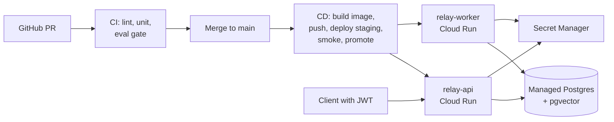

## What you will build



The lab shows Google Cloud Run. Fly.io, Render, Railway, ECS Fargate, or Azure Container Apps work too; translate the commands.

**Acceptance criteria**

1. `docker build` produces a non-root image under 250 MB that runs locally with `docker compose up` (API, worker, Postgres).
2. The API verifies JWTs from an identity provider (Auth0, Clerk, Supabase Auth, or Firebase Auth free tiers). Customer identity comes only from the token.
3. Per-user rate limit (messages per minute) and daily token budget, returning `429` with `Retry-After`.
4. `Idempotency-Key` support on the refund approval endpoint.
5. Memory extraction and ingestion run in a separate worker service, not in API background tasks.
6. CI runs lint, unit tests (with a scripted fake LLM), and the eval PR gate. CD deploys to staging, runs a smoke test, then production.
7. You can roll back production to the previous revision with one command, and you have done it once.

## Step 1: container and compose

Use the multi-stage Dockerfile from the secure APIs lesson. Add a worker entry point that uses the same image:

```yaml
# docker-compose.yml
services:
  db:
    image: pgvector/pgvector:pg16
    environment: { POSTGRES_PASSWORD: relay, POSTGRES_DB: relay }
  api:
    build: .
    env_file: .env
    environment: { DATABASE_URL: postgresql://postgres:relay@db/relay }
    ports: ["8080:8080"]
    depends_on: [db]
  worker:
    build: .
    command: ["python", "-m", "app.worker"]
    env_file: .env
    environment: { DATABASE_URL: postgresql://postgres:relay@db/relay }
    depends_on: [db]
```

Add `.dockerignore` (exclude `.venv`, `evals/runs`, `.git`, `.env`). Check the image size with `docker image ls` and that `docker run --rm relay id` prints a non-root user.

## Step 2: authentication

Create a free application in an identity provider. Configure the API with the JWKS URL, issuer, and audience. Replace the `X-Customer-Id` dependency with `current_user` from the lesson. Map the token's `sub` to your `customers` table (create the row on first login).

Write tests: expired token → 401; token for customer A requesting session of customer B → 404; valid token → 200.

## Step 3: rate limits and budgets

Implement a token bucket in Postgres or Redis keyed by user:

```python
async def allow(user_id: str, cost: int = 1, rate_per_min: int = 20, burst: int = 20) -> tuple[bool, float]:
    """Atomic token bucket in Redis using a small Lua script. Returns (allowed, retry_after_s)."""
    now = time.time()
    allowed, retry = await redis.eval(TOKEN_BUCKET_LUA, 1, f"rl:{user_id}", now, rate_per_min / 60, burst, cost)
    return bool(allowed), float(retry)
```

Also record tokens used per user per day (from `resp.usage`), and refuse new turns past the budget with a clear message.

## Step 4: worker service and idempotency

Move memory extraction and ingestion into `app/worker.py`, consuming the Postgres job table from Lab 2. The API enqueues jobs in the same transaction as the data that triggers them (outbox style).

Add an `idempotency_keys` table and wrap `POST /approvals/{id}/decision`: the first request with a key stores its response; repeats return it.

## Step 5: cloud setup

```bash
gcloud services enable run.googleapis.com sqladmin.googleapis.com secretmanager.googleapis.com artifactregistry.googleapis.com
gcloud artifacts repositories create relay --repository-format=docker --location=europe-west1

# Postgres: Cloud SQL (or a free Neon/Supabase database with pgvector)
# Secrets
printf "%s" "$ANTHROPIC_API_KEY" | gcloud secrets create anthropic-key --data-file=-
printf "%s" "$DATABASE_URL"      | gcloud secrets create database-url  --data-file=-

# Service accounts with least privilege
gcloud iam service-accounts create relay-api
gcloud iam service-accounts create relay-worker
gcloud secrets add-iam-policy-binding anthropic-key \
  --member=serviceAccount:relay-api@$PROJECT.iam.gserviceaccount.com --role=roles/secretmanager.secretAccessor
# ... repeat per secret and per service as needed
```

Deploy:

```bash
IMAGE=europe-west1-docker.pkg.dev/$PROJECT/relay/relay:$(git rev-parse --short HEAD)
docker build -t $IMAGE . && docker push $IMAGE

gcloud run deploy relay-api --image $IMAGE --region europe-west1 \
  --service-account relay-api@$PROJECT.iam.gserviceaccount.com \
  --set-secrets ANTHROPIC_API_KEY=anthropic-key:latest,DATABASE_URL=database-url:latest \
  --concurrency 80 --min-instances 1 --max-instances 10 --timeout 300 \
  --allow-unauthenticated          # the app checks JWTs itself

gcloud run deploy relay-worker --image $IMAGE --region europe-west1 \
  --command python --args=-m,app.worker \
  --service-account relay-worker@$PROJECT.iam.gserviceaccount.com \
  --set-secrets ANTHROPIC_API_KEY=anthropic-key:latest,DATABASE_URL=database-url:latest \
  --no-cpu-throttling --min-instances 1 --max-instances 3 --no-allow-unauthenticated
```

`--no-cpu-throttling` keeps CPU allocated to the worker between requests so its polling loop runs. A Cloud Run *service* must listen on `$PORT`, so have the worker start a tiny health endpoint alongside its loop (a few lines with `uvicorn` or `http.server`). Alternatively, use Cloud Run worker pools, which are built for pull-based workers and need no port. Run database migrations as a one-off job (`gcloud run jobs`) before shifting traffic.

## Step 6: CI/CD

Create `.github/workflows/ci.yml` from the CI/CD lesson. Then `deploy.yml` on push to `main`:

1. Authenticate to Google Cloud with **Workload Identity Federation** (OIDC), no JSON keys.
2. Build and push the image tagged with the Git SHA.
3. Deploy to `relay-api-staging` and run `scripts/smoke.sh` (get a test token, send one chat, assert a streamed reply and a tool call).
4. Deploy to production with `--no-traffic --tag canary`, shift 10% of traffic, wait, check error rate and latency from the platform's metrics, then shift 100%.

Rollback:

```bash
gcloud run services update-traffic relay-api --to-revisions=PREVIOUS_REVISION=100
```

Practice it. Deploy a deliberately broken prompt (for example one that makes the agent refuse everything), watch the smoke test or canary catch it, and roll back. Write down how long it took.

## Stretch goals

- Terraform or Pulumi for all of the above.
- A `preview` environment per PR, torn down on merge.
- Cloud Armor (or your platform's WAF) rate limiting at the edge.
- Egress through a proxy with an allow-list for any tool that calls external URLs.
- Graceful shutdown: handle SIGTERM by finishing in-flight streams within the grace period.

## Reference reading

- [Cloud Run docs](https://cloud.google.com/run/docs).
- [Using uv in Docker](https://docs.astral.sh/uv/guides/integration/docker/) and [in GitHub Actions](https://docs.astral.sh/uv/guides/integration/github/).
- [Security hardening for GitHub Actions](https://docs.github.com/en/actions/security-for-github-actions/security-guides/security-hardening-for-github-actions).
- [FastAPI in containers](https://fastapi.tiangolo.com/deployment/docker/).
