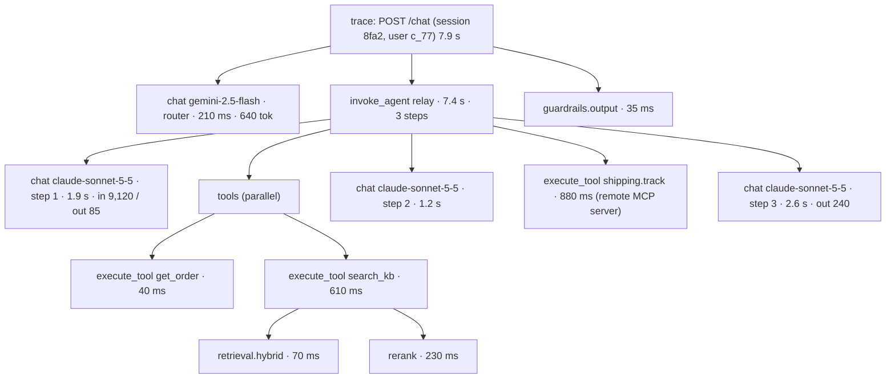

## Why logs are not enough

An agent turn might involve a router call, three model calls, five tool calls (two in parallel), a retrieval with reranking, and a call to a remote MCP server that itself queries a database. When a user says "it gave me the wrong refund amount", you need to see that entire tree, in order, with inputs, outputs, timings, and token counts. Flat log lines with no relationship to one another make this nearly impossible.

**Distributed tracing** records each unit of work as a **span** with a start time, duration, attributes, and a parent. All spans for one request share a **trace ID**. The result is a tree you can open and read.



The same trace drawn against time, as tracing tools show it, makes the bottleneck obvious:

```viz
caption: Four model calls take 5.9 of the 7.9 seconds, and they run one after another. Faster tools would barely help; fewer steps would.
<div class="vz-bars">
<span>router (model)</span><span class="bar sk"><i class="sk c" style="--w:3%"></i></span><b>0.2 s</b>
<span>agent step 1</span><span class="bar sk"><i class="sk c" style="--w:24%;margin-left:3%"></i></span><b>1.9 s</b>
<span>get_order</span><span class="bar sk"><i class="sk m" style="--w:1%;margin-left:27%"></i></span><b>0.04 s</b>
<span>search_kb</span><span class="bar sk"><i class="sk m" style="--w:8%;margin-left:27%"></i></span><b>0.6 s</b>
<span>agent step 2</span><span class="bar sk"><i class="sk c" style="--w:15%;margin-left:35%"></i></span><b>1.2 s</b>
<span>MCP shipping</span><span class="bar sk"><i class="sk m" style="--w:11%;margin-left:50%"></i></span><b>0.9 s</b>
<span>agent step 3</span><span class="bar sk"><i class="sk c" style="--w:33%;margin-left:62%"></i></span><b>2.6 s</b>
<span>guardrail</span><span class="bar sk"><i class="sk g" style="--w:1%;margin-left:96%"></i></span><b>0.04 s</b>
</div>
<div class="vz-row"><span class="ch sk c">model call</span><span class="ch sk m">tool or MCP</span><span class="ch sk g">guardrail</span><b>time runs left to right, 0 to 7.9 s</b></div>
<div class="vz-src">Illustrative timings from the example trace above, not a benchmark. The two tools run in parallel, so their bars overlap.</div>
```

## OpenTelemetry and the GenAI conventions

[OpenTelemetry](https://opentelemetry.io/docs/languages/python/) (OTel) is the vendor-neutral standard for traces, metrics, and logs. Instrument once, send anywhere: Jaeger, Grafana Tempo, Honeycomb, Datadog, or LLM-focused tools like [Langfuse](https://langfuse.com/docs) and [Arize Phoenix](https://github.com/Arize-ai/phoenix) that accept OTel data.

OTel defines [semantic conventions for generative AI](https://github.com/open-telemetry/semantic-conventions-genai/tree/main/docs/gen-ai): standard span names and attribute keys for model calls, agent operations, and tool executions. Using them means your traces work across tools without custom mapping. Key attributes include:

| Attribute | Example |
|---|---|
| `gen_ai.operation.name` | `chat`, `generate_content`, `execute_tool`, `invoke_agent`, `embeddings` |
| `gen_ai.provider.name` | `anthropic`, `openai`, `gcp.gemini`, `aws.bedrock`; a custom value such as `vllm` or `ollama` when none applies |
| `gen_ai.request.model` / `gen_ai.response.model` | `claude-sonnet-5-5`, `gpt-5`, `gemini-2.5-flash`, `qwen3:8b` |
| `gen_ai.usage.input_tokens` / `gen_ai.usage.output_tokens` | `9120` / `85` (input includes cached tokens) |
| `gen_ai.response.finish_reasons` | `["tool_use"]` (Anthropic), `["tool_calls"]` (OpenAI) |
| `gen_ai.tool.name` / `gen_ai.tool.call.id` | `get_order` / `toolu_01A…` |
| `gen_ai.conversation.id` | session ID |

This is what makes traces **provider-neutral**. Relay can run its agent on one provider, its router on another and its judge on a third, and every model call still lands in the same trace with the same attribute names, so one dashboard compares them. `gen_ai.provider.name` has a list of well-known values (`anthropic`, `openai`, `gcp.gemini`, `aws.bedrock`, `groq`, `mistral_ai` and others); for anything not listed, such as your own vLLM or Ollama server, the spec allows a custom value.

The conventions are marked **Development** (not yet stable) and moved to their own repository in 2026, so pin the version you follow and expect renames. Cached tokens, for example, are `gen_ai.usage.cache_read.input_tokens` and `gen_ai.usage.cache_write.input_tokens`, and the spec says `gen_ai.usage.input_tokens` **should include** cached tokens. Providers report usage differently, so map each one carefully:

| Provider | What its usage fields mean | `gen_ai.usage.input_tokens` |
|---|---|---|
| Anthropic | `input_tokens`, `cache_creation_input_tokens` and `cache_read_input_tokens` are separate counts ([docs](https://platform.claude.com/docs/en/api/rate-limits#cache-aware-itpm)) | sum all three |
| OpenAI | `input_tokens` already includes `input_tokens_details.cached_tokens` ([docs](https://developers.openai.com/api/docs/guides/prompt-caching)) | `input_tokens` |
| Gemini | `prompt_token_count` already includes `cached_content_token_count` ([docs](https://ai.google.dev/api/generate-content)) | `prompt_token_count` |
| OpenAI-compatible servers (vLLM, Ollama, gateways) | Chat Completions `usage`; cached counts only if the server reports them | `prompt_tokens` |

Libraries like [OpenLLMetry](https://github.com/traceloop/openllmetry) and the OTel contrib instrumentations can auto-instrument popular SDKs.

## Instrumenting the agent loop

Auto-instrumentation gives you model calls. Add manual spans for the parts that carry your application's meaning: the agent run, each tool, retrieval stages, guardrails.

```python
from opentelemetry import trace
tracer = trace.get_tracer("relay")

async def run_turn(ctx, messages, on_text):
    with tracer.start_as_current_span("invoke_agent relay") as span:
        span.set_attribute("gen_ai.operation.name", "invoke_agent")
        span.set_attribute("gen_ai.conversation.id", str(ctx.session_id))
        span.set_attribute("relay.prompt_sha", PROMPT_SHA)
        span.set_attribute("enduser.id", ctx.customer_hash)       # hashed, not raw
        for step in range(MAX_STEPS):
            with tracer.start_as_current_span(f"chat {MODEL}") as llm:
                llm.set_attribute("gen_ai.operation.name", "chat")
                llm.set_attribute("gen_ai.provider.name", PROVIDER)     # "anthropic", "openai", "gcp.gemini", ...
                llm.set_attribute("gen_ai.request.model", MODEL)
                llm.set_attribute("relay.step", step)
                resp = await call_model(ctx, messages, on_text)
                u = resp.usage   # normalised by the client: uncached, cache_read, cache_write, output
                llm.set_attribute("gen_ai.usage.input_tokens", u.uncached + u.cache_read + u.cache_write)  # total, per the spec
                llm.set_attribute("gen_ai.usage.output_tokens", u.output)
                llm.set_attribute("gen_ai.usage.cache_read.input_tokens", u.cache_read)
                llm.set_attribute("gen_ai.usage.cache_write.input_tokens", u.cache_write)
                llm.set_attribute("gen_ai.response.finish_reasons", [resp.stop_reason])
            ...

async def run_tool(ctx, block):
    with tracer.start_as_current_span(f"execute_tool {block.name}") as span:
        span.set_attribute("gen_ai.operation.name", "execute_tool")
        span.set_attribute("gen_ai.tool.name", block.name)
        span.set_attribute("gen_ai.tool.call.id", block.id)
        try:
            ...
        except ToolError as e:
            span.set_status(trace.Status(trace.StatusCode.ERROR, str(e)))
            span.set_attribute("relay.tool.error_kind", type(e).__name__)
            raise
```

Because `asyncio.gather` runs tools inside the current context, parallel tool spans correctly share the agent span as parent.

## Propagating context across services and MCP

A trace is only useful if it crosses process boundaries. When the API enqueues a job for a worker, or calls a remote MCP server, the trace context (trace ID and parent span ID) must travel with the request so downstream spans attach to the same trace.

- **HTTP**: OTel's W3C `traceparent` header. Auto-instrumented HTTP clients and servers (httpx, FastAPI) inject and extract it.
- **Queues**: put the `traceparent` in the job payload when enqueuing; extract it in the worker and start the job span as a child (or as a linked span for long-delayed jobs).
- **MCP**: the [Model Context Protocol](https://modelcontextprotocol.io/) sends JSON-RPC messages over stdio or Streamable HTTP. The OpenTelemetry MCP convention puts the W3C `traceparent` (and `tracestate`, `baggage`) inside each request's `params._meta` field, unprefixed, on every transport, and the server uses it as the remote parent for its spans. Because it travels in the message body, it works on stdio too. Support varies by SDK version, so verify it end to end: make an MCP tool call and check that the server's spans appear under your agent's trace.

```viz
caption: One trace ID crosses three boundaries. Each boundary needs its own carrier for the traceparent, or the trace breaks into pieces.
<div class="vz-row"><span class="ch sk c">API</span><span class="arr sk"></span><span class="ch sk">HTTP header</span><span class="arr sk"></span><span class="ch sk c">retrieval</span></div>
<div class="vz-row"><span class="ch sk c">API</span><span class="arr sk"></span><span class="ch sk">job payload</span><span class="arr sk"></span><span class="ch sk c">worker</span></div>
<div class="vz-row"><span class="ch sk c">agent</span><span class="arr sk"></span><span class="ch sk">params._meta</span><span class="arr sk"></span><span class="ch sk c">MCP server</span></div>
<div class="vz-row"><span class="ch sk g">one trace ID: 4bf92f35...</span><b>every span joins the same tree</b></div>
<div class="vz-src">Carriers from the W3C <a href="https://www.w3.org/TR/trace-context/">Trace Context</a> spec and the OpenTelemetry <a href="https://github.com/open-telemetry/semantic-conventions-genai/blob/main/docs/gen-ai/mcp.md">MCP semantic conventions</a>.</div>
```

```python
from opentelemetry.propagate import inject, extract

# producer
carrier = {}
inject(carrier)                                # {"traceparent": "00-<trace>-<span>-01"}
await enqueue("extract_memory", {"session_id": sid, "trace": carrier})

# consumer
ctx = extract(job.payload["trace"])
with tracer.start_as_current_span("job extract_memory", context=ctx):
    ...
```

> [!warn] Third-party MCP servers you do not control will not send spans to your backend. Record a client-side span for every MCP call (server name, tool name, duration, error, response size) so you can at least see their latency and failures from your side.

## What to capture, and what not to

Traces are most useful when you can read the actual prompts and responses. They are also full of personal data. Decide deliberately:

| Capture | Default |
|---|---|
| Model, tokens, latency, finish reason, step, tool names, errors | Always |
| Prompt hash, model config, feature flags, deploy SHA | Always |
| Full message content and tool arguments/results | In a restricted store with retention limits, or sampled, or redacted |
| User identifiers | Hashed or pseudonymous IDs; raw only where policy allows |
| Secrets, card numbers | Never (redact before export) |

The OTel GenAI conventions keep message content out of span attributes by default and make content capture opt-in, for this reason. Apply redaction in an exporter or processor, so it cannot be forgotten in application code.

## Sampling

High-volume systems cannot keep every trace. Typical policy:

- **Head sampling** keeps a percentage chosen at the start of the request (for example 10%).
- **Tail sampling** decides after the trace completes: keep **all** traces with errors, guardrail firings, step-limit hits, high cost, high latency, or negative user feedback, plus a random sample of the rest. Tail sampling needs a collector (the OTel Collector) that buffers spans per trace.

For AI systems, tail sampling is almost always worth it: the interesting traces are rare, and they are the ones you need for error analysis.

## From traces to evals

Traces are the raw material for Week 3's eval datasets. Make the path short:

1. A user gives a thumbs-down, or an online judge fails a conversation.
2. The trace ID is attached to that feedback.
3. A reviewer opens the trace, labels the failure category, and clicks "add to dataset", which runs your trace-to-case converter.

Tools like Langfuse and Phoenix have dataset features for exactly this loop. You can also build it with a small script against your trace store.

## Design review questions

> [!interview] Open the trace for the slowest conversation yesterday. Which span dominated?

> [!interview] When a worker processes a memory job, can you see which chat request caused it?

> [!interview] Where does message content in traces go, who can read it, and when is it deleted?

> [!interview] Which traces are guaranteed to be kept under your sampling policy?

## Further reading

- [OpenTelemetry semantic conventions for GenAI](https://github.com/open-telemetry/semantic-conventions-genai/tree/main/docs/gen-ai), including the [span attributes](https://github.com/open-telemetry/semantic-conventions-genai/blob/main/docs/gen-ai/gen-ai-spans.md) and the [MCP conventions](https://github.com/open-telemetry/semantic-conventions-genai/blob/main/docs/gen-ai/mcp.md).
- [OpenTelemetry Python](https://opentelemetry.io/docs/languages/python/) and [contrib instrumentations](https://github.com/open-telemetry/opentelemetry-python-contrib).
- [OpenLLMetry](https://github.com/traceloop/openllmetry), OTel-based auto-instrumentation for LLM SDKs.
- [Langfuse docs](https://langfuse.com/docs) and [Arize Phoenix](https://github.com/Arize-ai/phoenix), open-source LLM observability.
- [Model Context Protocol](https://modelcontextprotocol.io/).

```quiz
[
  {"q": "What links all spans belonging to one user request?", "options": ["The session ID", "A shared trace ID, with parent-child relationships between spans", "Timestamps", "The model name"], "answer": 1, "why": "Spans share a trace ID and point to their parent, which builds the tree you navigate."},
  {"q": "How do spans in a background worker join the trace of the API request that enqueued the job?", "options": ["Automatically, always", "The producer injects trace context (traceparent) into the job payload and the worker extracts it", "By matching timestamps", "They cannot"], "answer": 1, "why": "Context propagation must cross every boundary, including queues, explicitly."},
  {"q": "Which sampling policy best fits AI systems?", "options": ["Keep 1% randomly", "Tail sampling that keeps all errors, guardrail firings, expensive, slow, or negatively rated traces plus a random sample", "Keep nothing", "Head sampling at 100%"], "answer": 1, "why": "The traces you need for debugging and eval building are rare. Tail sampling keeps them."},
  {"q": "Relay's router runs on Gemini and its agent on Claude. How do both model calls show up comparably in one trace?", "options": ["They cannot", "Both spans use the OTel GenAI attributes, with gen_ai.provider.name telling them apart", "Only by using one provider", "By logging each SDK's raw response"], "answer": 1, "why": "The GenAI semantic conventions are provider-neutral: the same attribute names for every provider, with the provider recorded as an attribute."},
  {"q": "A third-party MCP server you do not control is slow. How do you see it in your traces?", "options": ["You cannot", "Record a client-side span around each MCP call with server, tool, duration, and errors", "Ask the vendor for logs", "Use print statements"], "answer": 1, "why": "Even without their spans, your client span shows their latency and failure rate inside your trace."}
]
```
