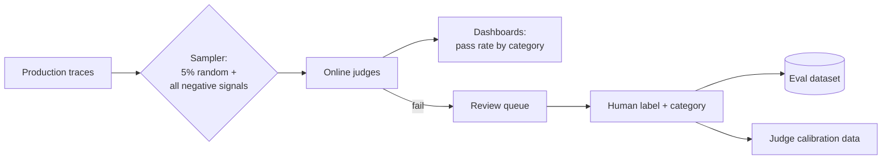

## Three questions every dashboard answers

1. **Is it working?** Errors, latency, availability, dependency health.
2. **What does it cost?** Tokens, dollars, per user, per tenant, per feature.
3. **Is it any good?** Quality signals from users, judges, and outcomes.

Traditional services stop at the first. AI systems fail quietly on the second and third: a prompt change that makes answers 30% longer doubles the bill without a single error; a retrieval regression makes answers worse with every request returning 200 OK.

```viz
caption: Every one of these requests returned 200 OK. Only the cost and quality rows of the dashboard can tell them apart.
<div class="vz-cols" style="--k:3">
  <div class="vz-panel sk g"><h5>Is it working?</h5><div class="vz-row"><span class="ch sk g">200 OK</span><span class="ch sk g">TTFT 0.9 s</span></div><p>errors, latency, saturation</p></div>
  <div class="vz-panel sk w"><h5>What does it cost?</h5><div class="vz-row"><span class="ch sk g">200 OK</span><span class="ch sk w">14 steps, $0.85</span></div><p>a loop: no error, big bill</p></div>
  <div class="vz-panel sk b"><h5>Is it any good?</h5><div class="vz-row"><span class="ch sk g">200 OK</span><span class="ch sk b">wrong refund amount</span></div><p>judges, feedback, outcomes</p></div>
</div>
```

## Golden signals, adapted

The classic four (latency, traffic, errors, saturation, from Google's [SRE book](https://sre.google/sre-book/monitoring-distributed-systems/)) still apply, with AI-specific detail:

| Signal | What to track | Why |
|---|---|---|
| Latency | TTFT p50/p95, total turn time p50/p95, per-stage (retrieval, model, tools) | Users feel TTFT; total time affects abandonment |
| Traffic | Conversations, turns, model calls per turn, by route and model | Calls-per-turn growth is often a looping or prompt bug |
| Errors | HTTP 5xx; provider errors by type (429, 5xx, overloaded, timeouts); tool errors by tool; refusals; step-limit hits; guardrail blocks | Many AI failures are not exceptions |
| Saturation | Provider rate-limit headroom (tokens/min used vs limit, read from response headers such as `anthropic-ratelimit-*` or `x-ratelimit-*`), worker queue depth and age, DB connections; GPU KV cache use and queue length if you self-host | Rate limits (or your own GPUs) are the usual bottleneck |

## Token and cost monitoring

Record usage on every model call (you already have it in spans): provider, model, input tokens, cached input tokens, output tokens, and the feature, user, and tenant it served. Compute cost from a price table versioned in your repo. Providers count tokens differently, so first turn each provider's usage object into the same four disjoint numbers, then price them:

```python
PRICES = {  # USD per million tokens: uncached input, cache write, cache read, output (checked 2026-10-14)
    "claude-opus-5-5":   {"in": 4.00, "cache_write": 5.00,  "cache_read": 0.20,  "out": 20.00},
    "claude-sonnet-5-5": {"in": 2.00, "cache_write": 2.50,  "cache_read": 0.10,  "out": 10.00},
    "claude-haiku-5-5":  {"in": 0.10, "cache_write": 0.125, "cache_read": 0.01,  "out": 0.50},  # prompts ≤100k tokens
    "gpt-5":             {"in": 1.25, "cache_write": 1.25,  "cache_read": 0.125, "out": 10.00}, # no write premium
    "gemini-2.5-flash":  {"in": 0.30, "cache_write": 0.30,  "cache_read": 0.03,  "out": 2.50},  # text; explicit caches add storage
    "qwen3:8b":          {"in": 0.0,  "cache_write": 0.0,   "cache_read": 0.0,   "out": 0.0},   # self-hosted: price the GPU-hours instead
}

def normalise(provider, u) -> tuple[int, int, int, int]:
    """Return (uncached input, cache write, cache read, output) as disjoint counts."""
    if provider == "anthropic":   # three separate input counts that add up to the total
        return u.input_tokens, u.cache_creation_input_tokens or 0, u.cache_read_input_tokens or 0, u.output_tokens
    if provider == "openai":      # input_tokens already includes cached tokens
        d = u.input_tokens_details
        write = getattr(d, "cache_write_tokens", 0) or 0
        return u.input_tokens - d.cached_tokens - write, write, d.cached_tokens, u.output_tokens
    if provider == "gcp.gemini":  # prompt_token_count already includes cached tokens; thinking is billed as output
        cached = u.cached_content_token_count or 0
        return u.prompt_token_count - cached, 0, cached, u.candidates_token_count + (u.thoughts_token_count or 0)
    raise ValueError(provider)

def cost_usd(model, uncached, write, read, out) -> float:
    p = PRICES[model]
    return (uncached * p["in"] + write * p["cache_write"] + read * p["cache_read"] + out * p["out"]) / 1e6
```

> [!warn] Check exactly how each provider reports cached tokens and cache writes, because they disagree. On the Claude API, `input_tokens`, `cache_creation_input_tokens`, and `cache_read_input_tokens` are separate counts that add up to the total input, and cache writes cost more than normal input (1.25x for 5-minute, 2x for 1-hour caches); Haiku 5.5 also charges higher rates when a prompt exceeds 100,000 tokens. On OpenAI, `input_tokens` already includes `cached_tokens`; GPT-5.6 and later also bill cache writes at 1.25x, reported as `cache_write_tokens`. On Gemini, `prompt_token_count` already includes `cached_content_token_count`, and explicit caches add an hourly storage charge. Getting this wrong makes your cost dashboards disagree with the invoice, and nobody trusts a dashboard that disagrees with the invoice. Reconcile against each provider's usage report monthly.

Prices: [Anthropic](https://platform.claude.com/docs/en/about-claude/pricing), [OpenAI](https://developers.openai.com/api/docs/pricing), [Gemini](https://ai.google.dev/gemini-api/docs/pricing), all checked 2026-10-14. Usage fields: [Anthropic](https://platform.claude.com/docs/en/api/rate-limits#cache-aware-itpm), [OpenAI](https://developers.openai.com/api/docs/guides/prompt-caching), [Gemini](https://ai.google.dev/api/generate-content). For self-hosted models (vLLM, Ollama) there is no token bill: cost is GPU-hours divided by tokens served, as in the [inference lesson](#w5-inference).

Dashboards to build:

- **Cost per conversation** (p50, p95, max) over time, by route and model. The single most useful AI cost chart.
- **Tokens per turn**, split into input, cached input, and output. Rising input means context bloat; rising output means verbosity.
- **Cache hit rate** (cached input / total input). A sudden drop means a prefix change broke caching.
- **Spend by tenant and by feature**, for pricing and abuse detection.
- **Top 20 most expensive conversations** this week, linked to their traces. Read them. They are usually loops, huge tool results, or abuse.

> [!numbers] Relay's p50 conversation costs $0.012 but p99 costs $0.85. The top 1% of conversations is about 0.01 × 0.85 / (0.99 × 0.012 + 0.01 × 0.85) ≈ **42% of total spend** (using p99 as a rough stand-in for the tail). Fixing the tail (step limits, result truncation, compaction) often saves more than optimising the median.

```viz
caption: The top 1% of conversations spends 42% of the budget. Read the expensive ones first.
<div class="vz-cols">
  <div class="vz-panel sk"><h5>Cost of one conversation</h5>
    <div class="vz-bars"><span>p50</span><span class="bar sk"><i class="sk g" style="--w:2%"></i></span><b>$0.012</b><span>p99</span><span class="bar sk"><i class="sk w" style="--w:100%"></i></span><b>$0.85</b></div>
    <p>71 times the median</p>
  </div>
  <div class="vz-panel sk"><h5>Share of total spend</h5>
    <div class="vz-bars"><span>99% of chats</span><span class="bar sk"><i class="sk g" style="--w:58%"></i></span><b>58%</b><span>top 1%</span><span class="bar sk"><i class="sk w" style="--w:42%"></i></span><b>42%</b></div>
    <p>loops, huge tool results, abuse</p>
  </div>
</div>
<div class="vz-src">Illustrative Relay numbers from the worked example above; 0.85 / 0.012 ≈ 71.</div>
```

## Quality monitoring

### Explicit feedback

Thumbs up/down, star ratings, "report a problem". Cheap to add, but:

- Response rates are low (often 1 to 5%) and skewed toward unhappy users.
- A thumbs-down without a reason is hard to act on. Offer quick reason chips ("wrong info", "didn't do what I asked", "too long", "unsafe") and an optional comment.
- Always store the trace ID with feedback.

### Implicit feedback

Behaviour tells you more, more often:

| Signal | Suggests |
|---|---|
| User rephrases the same question | The answer missed |
| User asks for a human / escalation rate | The agent could not resolve it |
| Conversation abandoned mid-flow | Frustration or slowness |
| Copy or click on a cited source | The answer was useful |
| Repeat contact on the same order within 48 hours | The issue was not actually resolved |
| Refund reversed or approval rejected by staff | The agent proposed a wrong action |

Define a **resolution rate**: the share of conversations that end without escalation and without repeat contact within N days. It is a better north-star metric for a support agent than thumbs-up rate.

### Online evaluation

Run your Week 3 judges on a sample of live conversations (for example 5%, plus all conversations with negative signals). Chart judge pass rates per category over time. A drop after a deploy is a regression; a slow drift may mean user behaviour or the knowledge base changed.



Human review of the review queue keeps judges honest and turns production failures into eval cases. Budget a few hours a week for it. This loop is where most quality improvement comes from after launch.

## Error tracking

Use an error tracker (for example [Sentry](https://docs.sentry.io/), which has a free tier) for exceptions with stack traces, grouped and deduplicated. Tag errors with model, prompt SHA, route, and trace ID. Many AI "errors" are not exceptions (a refusal, a guardrail block, a step-limit hit, a malformed tool argument the model retried), so emit them as **metrics and structured events** too.

## Metrics plumbing

A simple, standard stack: OTel metrics (or Prometheus client) → [Prometheus](https://prometheus.io/docs/introduction/overview/) or your cloud's metrics service → [Grafana](https://grafana.com/docs/grafana/latest/) dashboards. LLM observability platforms (Langfuse, Phoenix, and commercial ones) give you token, cost, and feedback views out of the box from traces. Many teams use both: infrastructure metrics in Grafana, conversation-level analytics in an LLM tool.

Watch **cardinality**: do not put user IDs or session IDs as metric labels (millions of series). Put them on traces and events; keep metric labels to bounded sets like route, model, tool, and tenant tier.

## A Relay dashboard

| Row | Panels |
|---|---|
| Health | Requests/min, 5xx rate, provider error rate by type, TTFT p95, turn p95 |
| Cost | $/hour, $/conversation p50/p95/p99, cache hit rate, tokens/turn split, spend by tenant and by provider and model |
| Agent behaviour | Steps per turn histogram, step-limit hits, tool calls by tool, tool error rate, guardrail fires by guardrail |
| Quality | Online judge pass rate by category, resolution rate, escalation rate, thumbs-down rate, review queue size |
| Capacity | Rate-limit headroom per model, queue depth and age, DB connections, instance count |

## Design review questions

> [!interview] What did the most expensive conversation yesterday cost, and why?

> [!interview] How would you notice a 10-point drop in answer quality that throws no errors?

> [!interview] What is your resolution rate, and how is it defined?

> [!interview] Does your cost dashboard match last month's invoice within 5%?

## Further reading

- [Monitoring Distributed Systems](https://sre.google/sre-book/monitoring-distributed-systems/), Google SRE book.
- [Building A Generative AI Platform](https://huyenchip.com/2024/07/25/genai-platform.html), Chip Huyen. The observability and feedback sections.
- [Langfuse docs](https://langfuse.com/docs) for cost tracking, scores, and datasets.
- [Arize Phoenix](https://github.com/Arize-ai/phoenix) for open-source tracing and online evals.
- [Prometheus overview](https://prometheus.io/docs/introduction/overview/) and [Grafana docs](https://grafana.com/docs/grafana/latest/).

```quiz
[
  {"q": "Average input tokens per turn rose 40% after a release while error rates stayed flat. What is the likely issue?", "options": ["Traffic growth", "Context bloat: larger prompts, tool results, or history, or broken compaction", "The provider raised prices", "Users typing more"], "answer": 1, "why": "Input growth per turn points to what you put in the context. Check prompt size, tool result size, and compaction."},
  {"q": "Why is resolution rate a better north-star than thumbs-up rate for a support agent?", "options": ["It is easier to compute", "It measures whether the problem was actually solved, from behaviour on all conversations rather than a small, skewed sample", "Users prefer it", "It is always higher"], "answer": 1, "why": "Explicit feedback is sparse and biased. Outcome-based metrics reflect real value."},
  {"q": "Why not use user IDs as metric labels?", "options": ["Privacy only", "Unbounded label values create huge numbers of time series and overwhelm the metrics system", "Prometheus forbids strings", "They are not useful"], "answer": 1, "why": "High cardinality explodes metric storage. Keep per-user detail in traces and events."},
  {"q": "Your cache hit rate dropped from 80% to 5% overnight. What should you check first?", "options": ["Provider status page", "Recent changes to anything at the start of the prompt: system prompt, tool definitions, or their ordering", "User traffic", "Database indexes"], "answer": 1, "why": "Cache hits depend on byte-identical prefixes. A small change near the top invalidates everything after it."}
]
```
