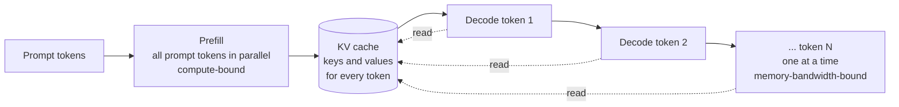

## Why a system designer needs this

You can build everything in this course on hosted APIs and never touch a GPU. But two questions come up in every design review and interview, and both need a mental model of inference:

1. **"Why is the chatbot so slow?"** The answer is rarely "the model is slow". It is usually something you control.
2. **"Should we self-host an open model?"** You cannot answer without knowing what limits a GPU's throughput and what one conversation costs in memory.

This lesson gives you that model, with numbers you can reproduce.

## Two phases: prefill and decode

Generating a reply has two very different phases.



- **Prefill** processes the whole prompt in one parallel pass and fills the KV cache. It is limited by raw compute, and its time grows with prompt length. It determines **time to first token** (TTFT).
- **Decode** generates one token at a time. Each step must read all the model weights (and the KV cache so far) from GPU memory to produce a single token. It is limited by **memory bandwidth**, not compute, and its time grows with output length.

> [!numbers] An 8-billion-parameter model in 16-bit precision has about 8B × 2 bytes = **16 GB** of weights. A current datacenter GPU reads memory at roughly 3 TB/s, so one decode step at batch size 1 takes at least 16 GB ÷ 3 TB/s ≈ **5 ms**, a ceiling of about 200 tokens per second for one user. The GPU's compute sits mostly idle. Serving many users at once is how you use it.

## The KV cache

During attention, every new token looks at the keys and values of all previous tokens. Recomputing them at every step would be wasteful, so servers keep them in a **KV cache**. It makes decoding fast, and it is the main consumer of GPU memory under load.

Per token, the cache holds: 2 (keys and values) × layers × KV heads × head dimension × bytes per value.

> [!numbers] A Llama-3-8B-shaped model: 32 layers, 8 KV heads (grouped-query attention), head dimension 128, 16-bit values. Per token: 2 × 32 × 8 × 128 × 2 bytes = **128 KB**. One 8,000-token conversation: about **1 GB**. On an 80 GB GPU holding 16 GB of weights, roughly 60 GB is left for caches, so about 60 such conversations fit at once. Without grouped-query attention (32 KV heads instead of 8), each token needs 512 KB and only about 15 conversations fit.

This is why long contexts are expensive even when a provider accepts a million tokens. A long conversation occupies memory for its whole life, which limits how many others can be served alongside it. Hugging Face's [Optimizing your LLM in production](https://huggingface.co/blog/optimize-llm) walks through the same arithmetic, including how multi-query and grouped-query attention shrink the cache.

## Batching: where throughput comes from

Because decode is bandwidth-bound, a server that reads the weights once can produce one token for *many* sequences at the same cost. Batching is therefore the main lever for throughput.

- **Static batching** waits to fill a batch and runs it until the longest sequence finishes. Short requests wait for long ones.
- **Continuous batching** adds and removes sequences at every decode step, so the GPU stays full and short requests leave early. Every modern server does this.
- **PagedAttention** (the technique behind [vLLM](https://docs.vllm.ai/en/latest/)) stores the KV cache in fixed-size pages, like virtual memory, which removes fragmentation and lets requests share cached prefixes. The [vLLM paper](https://arxiv.org/abs/2309.06180) reports 2 to 4 times higher throughput than earlier systems at the same latency.

The trade-off: larger batches raise total throughput but make each step slightly slower, so per-user tokens per second fall. Servers let you tune this against your latency target.

## Making each token cheaper

| Technique | What it does | Typical effect | Cost |
|---|---|---|---|
| Quantization (8-bit, 4-bit) | Stores weights in fewer bits | Weights shrink 2 to 4 times; faster decode, more room for KV cache | Some quality loss; must evaluate |
| Grouped-query attention | Fewer KV heads shared by query heads | KV cache shrinks several times | A model architecture choice, not a runtime switch |
| FlashAttention | Computes attention without materialising the full attention matrix | Less memory, faster on long prompts | None; it is the default in modern stacks |
| Prefix caching | Reuses the KV cache for a shared prompt prefix | Skips prefill for repeated system prompts and history | Memory to hold cached prefixes |
| Speculative decoding | A small draft model proposes several tokens; the large model checks them in one pass | The [original paper](https://arxiv.org/abs/2211.17192) reports 2 to 3 times faster decoding with **identical outputs** | A draft model to run; gains depend on how often drafts are accepted |

Provider-side prompt caching (Week 5) is prefix caching sold as an API feature: you are paying less because the provider skips prefill for your repeated prefix.

## Why is the chatbot so slow? A diagnostic order

When users complain about speed, check these in order. Most are not about the model.

1. **No streaming.** Users stare at a spinner for the whole generation. Stream, and perceived latency drops to TTFT.
2. **Too many sequential model calls.** A router, a query rewrite, three agent steps, and an output judge are six round trips in a row. Trace a slow request (Week 5) and count them. Parallelise or remove steps.
3. **Long outputs.** Decode time is proportional to output tokens. Ask for shorter answers.
4. **Long prompts without caching.** TTFT grows with uncached prompt length. Check your cache hit rate.
5. **Reasoning tokens.** Models that think before answering spend output tokens you do not see. Lower the effort setting on routes that do not need it.
6. **Slow tools.** A 3-second inventory API inside an agent loop is a 3-second delay per call. Add timeouts and caching.
7. **Queueing.** Hitting rate limits means waiting for capacity. Check 429 rates and client-side throttles.
8. **Model size.** Only now: a smaller model on easy routes.

> [!tip] Put TTFT and total turn time on the same dashboard, broken down by span: router, retrieval, each model call, each tool. The slow part is usually obvious within a minute of looking.

## API or self-host?

| Factor | Hosted API | Self-hosted open model |
|---|---|---|
| Quality | Frontier models | Strong but usually behind the frontier |
| Cost at low or spiky volume | Pay per token, scale to zero | Idle GPUs cost money around the clock |
| Cost at very high, steady volume | Can be expensive | Can be cheaper if GPUs stay busy |
| Data control | Provider terms, regions, zero-retention options | Full control |
| Latency control | Limited | Full (batch size, hardware, placement) |
| Operational burden | Low | High: GPUs, serving stack, upgrades, on-call |

A rough break-even test: estimate your monthly tokens, price them on the API, then price the GPUs needed at a realistic utilisation (often 30 to 60%, not 100%) plus the engineering time to run them. For most teams building products, the API wins until volume is large and steady, or a data constraint forces the decision.

## Design review questions

> [!interview] Walk me through where the time goes in your slowest p95 turn. How many sequential model calls are there?

> [!interview] How much KV cache does one of your longest conversations need, and how many fit on one GPU?

> [!interview] What would speculative decoding change for your users, and what would it not change?

> [!interview] At what monthly volume would self-hosting be cheaper than your API bill, including people?

## Further reading

- [Optimizing your LLM in production](https://huggingface.co/blog/optimize-llm), Hugging Face. Quantization, FlashAttention, KV cache, and grouped-query attention with worked numbers.
- [Efficient Memory Management for LLM Serving with PagedAttention](https://arxiv.org/abs/2309.06180), the vLLM paper.
- [Fast Inference from Transformers via Speculative Decoding](https://arxiv.org/abs/2211.17192).
- [vLLM documentation](https://docs.vllm.ai/en/latest/), the most widely used open-source serving engine.
- [Artificial Analysis](https://artificialanalysis.ai/), for measured TTFT and tokens per second across hosted models.

```quiz
[
  {"q": "Which phase of generation is limited mainly by memory bandwidth?", "options": ["Prefill", "Decode", "Tokenization", "Embedding lookup"], "answer": 1, "why": "Each decode step reads all weights and the KV cache to produce one token, so bandwidth, not compute, is the limit."},
  {"q": "A model has 32 layers, 8 KV heads, head dimension 128, 16-bit values. How much KV cache does a 4,000-token conversation need?", "options": ["About 50 MB", "About 500 MB", "About 5 GB", "About 50 GB"], "answer": 1, "why": "2 × 32 × 8 × 128 × 2 bytes = 128 KB per token; × 4,000 ≈ 512 MB."},
  {"q": "Why does batching raise throughput so much for LLM serving?", "options": ["It reduces output length", "One read of the weights produces a token for many sequences at once", "It skips prefill", "It compresses the KV cache"], "answer": 1, "why": "Decode is bandwidth-bound; batching amortises the cost of reading the weights across many sequences."},
  {"q": "What does speculative decoding change about the model's outputs?", "options": ["They become shorter", "Nothing; the output distribution is identical, it is only faster", "They come from the small draft model", "They skip the KV cache"], "answer": 1, "why": "The large model verifies every drafted token, so outputs match standard decoding while several tokens can be accepted per pass."},
  {"q": "Users say the agent is slow. Traces show six sequential model calls per turn. What should you try first?", "options": ["A bigger GPU", "Remove or parallelise calls and stream the final answer", "Quantize the model", "Increase the context window"], "answer": 1, "why": "Sequential round trips dominate. Fix the pipeline before touching the model."}
]
```
