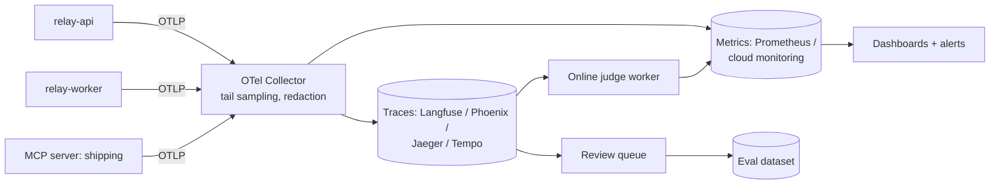

## What you will build



**Acceptance criteria**

1. Every chat turn produces one trace containing the agent span, each model call (with GenAI attributes and token usage), each tool call, retrieval stages, guardrails, and the worker job it triggered.
2. Relay calls at least one tool through an MCP server you run (for example a `shipping` server with `track_package`), and its spans appear in the same trace.
3. A dashboard with the five rows from the monitoring lesson (health, cost, agent behaviour, quality, capacity).
4. An online judge worker samples 5% of conversations plus all thumbs-down, and records pass rates as metrics.
5. Before/after numbers for at least three optimizations: cost per conversation, TTFT p95, and turn p95.
6. At least four alerts (fast-burn availability, cost spike, step-limit spike, online judge drop), each with a runbook, and two kill switches you have tested.

## Step 1: tracing setup

Run an OpenTelemetry backend locally. Two easy options:

- **Langfuse** (self-host with Docker Compose, or the free cloud tier), which accepts OTLP and shows LLM-specific views.
- **Arize Phoenix** (`uv add arize-phoenix` and run `phoenix serve`), lightweight and open source.

Add the OTel SDK and instrumentations:

```bash
uv add opentelemetry-sdk opentelemetry-exporter-otlp \
  opentelemetry-instrumentation-fastapi opentelemetry-instrumentation-httpx \
  opentelemetry-instrumentation-psycopg
```

```python
# app/telemetry.py
from opentelemetry import trace
from opentelemetry.sdk.resources import Resource
from opentelemetry.sdk.trace import TracerProvider
from opentelemetry.sdk.trace.export import BatchSpanProcessor
from opentelemetry.exporter.otlp.proto.http.trace_exporter import OTLPSpanExporter

def setup(service: str):
    provider = TracerProvider(resource=Resource.create({
        "service.name": service, "service.version": GIT_SHA, "deployment.environment": ENV,
    }))
    provider.add_span_processor(BatchSpanProcessor(OTLPSpanExporter()))   # OTEL_EXPORTER_OTLP_ENDPOINT
    trace.set_tracer_provider(provider)
```

Then add the manual spans from the tracing lesson: `invoke_agent`, `chat {model}`, `execute_tool {name}`, `retrieval.*`, `guardrail.*`. Propagate context into jobs via the payload.

Add a **redaction** step before export: a span processor that masks emails, phone numbers, and card numbers in any content attributes, and drops full message content unless `RELAY_TRACE_CONTENT=1`.

## Step 2: an MCP server

Write a tiny MCP server with the official Python SDK exposing `track_package(tracking_number)` that returns fake carrier data with a random 200 to 900 ms delay. Run it over streamable HTTP. Connect Relay to it as a tool source. Instrument both sides and confirm the server's span is a child of Relay's `execute_tool` span. If propagation does not work out of the box, pass `traceparent` explicitly (HTTP header or the request `_meta`) and document what you had to do.

## Step 3: metrics and dashboards

Emit metrics (OTel metrics or Prometheus client):

```python
turns = meter.create_counter("relay.chat.turns", unit="1")
turn_failures = meter.create_counter("relay.chat.turn_failures", unit="1")
ttft = meter.create_histogram("relay.chat.ttft", unit="s")
turn_latency = meter.create_histogram("relay.chat.turn_duration", unit="s")
tokens = meter.create_counter("relay.llm.tokens", unit="1")       # attrs: model, kind=input|cached|output
cost = meter.create_counter("relay.llm.cost", unit="USD")         # attrs: model, route, tenant_tier
steps = meter.create_histogram("relay.agent.steps", unit="1")
tool_calls = meter.create_counter("relay.tool.calls", unit="1")   # attrs: tool, outcome
guard_fires = meter.create_counter("relay.guardrail.fires", unit="1")
```

Build the dashboard. Generate realistic load with your Week 3 simulator (for example 200 simulated conversations at 5 concurrent) so the charts have data.

## Step 4: online judges and feedback

Add `POST /feedback` (thumbs, reason chip, comment, trace ID). Write a worker that samples conversations, runs your two calibrated judges, emits pass/fail metrics, and pushes failures into a review queue table. Review 20 items and convert at least 5 into eval cases.

## Step 5: optimize, measuring each change

Take a baseline with the simulator load: cost per conversation (p50, p95), TTFT p95, turn p95, cache hit rate. Then apply and measure, one at a time:

1. **Prompt caching**: make the prefix stable (sort tools, remove any dynamic values from the system prompt, add cache breakpoints). Target a cache hit rate above 70% of input tokens.
2. **Tool result trimming**: cap tool outputs (fields and length), paginate lists.
3. **Routing**: a small-model router for simple intents with a reduced toolset. Run the eval suite to confirm category pass rates hold.
4. **Parallelism**: input guardrail concurrent with retrieval; parallel multi-query retrieval.
5. **Retry and fallback**: client-side throttle per model, backoff with jitter, circuit breaker with fallback model, without exceeding your latency budget.

Record results in `DESIGN.md`:

```text
change                 cost/conv p50  p95     TTFT p95  turn p95  evals (pr suite)
baseline               $0.031  $0.140  2.9 s     11.8 s    93.1%
+ prompt caching       $0.017  $0.081  2.1 s     11.0 s    93.1%
+ tool result trimming $0.014  $0.052  2.0 s     10.2 s    93.4%
+ routing              $0.008  $0.049  1.4 s      8.9 s    92.8% (refund cats unchanged)
+ parallel guardrails  $0.008  $0.049  1.1 s      8.6 s    92.8%
```

## Step 6: alerts, runbooks, kill switches

Define SLOs and four alerts. Write a runbook for each in `runbooks/`. Implement kill switches as feature flags read at request time (a `flags` table cached for 10 seconds is fine): `tools.issue_refund.enabled`, `agent.force_model`. Test each: flip it under load, confirm behaviour changes within a minute, flip it back.

Run a **game day**: make the model client fail 50% of calls (an env flag that injects errors). Watch the alert fire, follow the runbook, use the fallback, and write a short postmortem.

## Stretch goals

- Tail sampling in the OTel Collector: keep all error, high-cost, guardrail, and negative-feedback traces plus 10% of others.
- A "most expensive conversations" daily report sent to your team chat.
- Semantic cache for generic FAQ answers only, with KB version in the key and a threshold validated on 100 labelled question pairs. Report its false-hit rate.
- Use the batch API for nightly release-suite judging and compare cost.

## Reference reading

- [OpenTelemetry Python](https://opentelemetry.io/docs/languages/python/) and [GenAI conventions](https://opentelemetry.io/docs/specs/semconv/gen-ai/).
- [Langfuse docs](https://langfuse.com/docs) or [Phoenix](https://github.com/Arize-ai/phoenix).
- [Model Context Protocol](https://modelcontextprotocol.io/).
- [Alerting on SLOs](https://sre.google/workbook/alerting-on-slos/).
