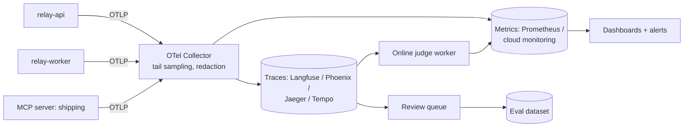

## What you will build



```viz
caption: What you build this week: see every turn, make it cheaper and faster with the evidence, then protect it. Each part feeds the next.
<div class="vz-cols" style="--k:3">
  <div class="vz-panel sk c"><h5>1. Observe</h5>
    <div class="vz-row"><span class="ch sk c">traces</span><span class="ch sk c">metrics</span></div>
    <div class="vz-row"><span class="ch sk c">dashboard</span><span class="ch sk c">online judges</span></div>
    <p>steps 1 to 4</p>
  </div>
  <div class="vz-panel sk g"><h5>2. Optimize</h5>
    <div class="vz-row"><span class="ch sk g">prompt cache</span><span class="ch sk g">trim results</span></div>
    <div class="vz-row"><span class="ch sk g">route</span><span class="ch sk g">parallelise</span></div>
    <p>step 5, measured one at a time</p>
  </div>
  <div class="vz-panel sk w"><h5>3. Protect</h5>
    <div class="vz-row"><span class="ch sk w">burn-rate alerts</span><span class="ch sk w">runbooks</span></div>
    <div class="vz-row"><span class="ch sk w">kill switches</span><span class="ch sk w">fallback</span></div>
    <p>step 6 and a game day</p>
  </div>
</div>
<div class="vz-row"><b>any provider:</b><span class="ch sk">anthropic:</span><span class="ch sk">openai:</span><span class="ch sk">gemini:</span><span class="ch sk">openrouter:</span><span class="ch sk">ollama:</span><span class="ch sk">vllm:</span></div>
```

**Acceptance criteria**

1. Every chat turn produces one trace containing the agent span, each model call (with GenAI attributes and token usage), each tool call, retrieval stages, guardrails, and the worker job it triggered.
2. Relay calls at least one tool through an MCP server you run (for example a `shipping` server with `track_package`), and its spans appear in the same trace.
3. A dashboard with the five rows from the monitoring lesson (health, cost, agent behaviour, quality, capacity).
4. An online judge worker samples 5% of conversations plus all thumbs-down, and records pass rates as metrics.
5. Before/after numbers for at least three optimizations: cost per conversation, TTFT p95, and turn p95.
6. At least four alerts (fast-burn availability, cost spike, step-limit spike, online judge drop), each with a runbook, and two kill switches you have tested.

> [!tip] A tested reference implementation is under [`relay/` at tag `lab5`](https://github.com/Rachneet/ai-system-design-course/tree/lab5/relay). Its tests check the full trace tree, that a call to the carrier MCP server continues the caller's trace, the retry and circuit-breaker behaviour, kill switches, and that every metric used by the alerts exists. CI validates the alert rules and Collector config with the real tools. The before/after optimization numbers still need a run against the real model.

## Step 0: pick your providers

Relay runs on any model provider. Every model setting takes a `provider:model` spec, so you choose with environment variables, and you can mix providers: the agent on one, the fallback on a second, the judge on a third family so it does not grade its own habits.

```bash
RELAY_MODEL=openai:gpt-5 RELAY_FALLBACK_MODEL=gemini:gemini-2.5-flash \
RELAY_JUDGE_MODEL=anthropic:claude-opus-5-5 RELAY_MEMORY_MODEL=ollama:qwen3:8b uv run uvicorn app.main:app
```

Specs such as `anthropic:...`, `openai:...`, `gemini:...`, `openrouter:...`, `huggingface:...`, `ollama:...`, `vllm:...` and `compatible:...` (any OpenAI-compatible gateway, such as a LiteLLM proxy) are listed in the [relay README](https://github.com/Rachneet/ai-system-design-course/tree/main/relay#choose-any-model-provider). Anthropic prices are built in; for every other model, put its prices in `RELAY_PRICES`, a JSON map of USD per million tokens `[input, cache_write, cache_read, output]`, copied from the provider's pricing page with the date you checked. Self-hosted models cost nothing per token, so compare them by GPU-hours instead. For this lab, a hosted model is easiest; a small local model works for the memory and judge steps once your evals say it is good enough.

## Step 1: tracing setup

Run an OpenTelemetry backend locally. Two easy options:

- **Langfuse** (self-host with Docker Compose, or the free cloud tier), which accepts OTLP and shows LLM-specific views.
- **Arize Phoenix** (`uv add arize-phoenix` and run `phoenix serve`), lightweight and open source.

Add the OTel SDK and instrumentations:

```bash
uv add opentelemetry-sdk opentelemetry-exporter-otlp \
  opentelemetry-instrumentation-fastapi opentelemetry-instrumentation-httpx \
  opentelemetry-instrumentation-psycopg
```

```python
# app/telemetry.py
from opentelemetry import trace
from opentelemetry.sdk.resources import Resource
from opentelemetry.sdk.trace import TracerProvider
from opentelemetry.sdk.trace.export import BatchSpanProcessor
from opentelemetry.exporter.otlp.proto.http.trace_exporter import OTLPSpanExporter

def setup(service: str):
    provider = TracerProvider(resource=Resource.create({
        "service.name": service, "service.version": GIT_SHA, "deployment.environment": ENV,
    }))
    provider.add_span_processor(BatchSpanProcessor(OTLPSpanExporter()))   # OTEL_EXPORTER_OTLP_ENDPOINT
    trace.set_tracer_provider(provider)
```

Then add the manual spans from the tracing lesson: `invoke_agent`, `chat {model}`, `execute_tool {name}`, `retrieval.*`, `guardrail.*`. Set `gen_ai.provider.name` on every model span and record `gen_ai.usage.input_tokens` as the total including cached tokens, normalising each provider's usage fields as the tracing lesson shows. Propagate context into jobs via the payload.

Add a **redaction** step before export: a span processor that masks emails, phone numbers, and card numbers in any content attributes, and drops full message content unless `RELAY_TRACE_CONTENT=1`.

## Step 2: an MCP server

Write a tiny MCP server with the official Python SDK exposing `track_package(tracking_number)` that returns fake carrier data with a random 200 to 900 ms delay. Run it over streamable HTTP. Connect Relay to it as a tool source. Instrument both sides and confirm the server's span is a child of Relay's `execute_tool` span. If propagation does not work out of the box, inject `traceparent` into the request's `params._meta` yourself (the OpenTelemetry MCP convention) and extract it on the server, and document what you had to do.

## Step 3: metrics and dashboards

Emit metrics (OTel metrics or Prometheus client):

```python
turns = meter.create_counter("relay.chat.turns", unit="1")
turn_failures = meter.create_counter("relay.chat.turn_failures", unit="1")
ttft = meter.create_histogram("relay.chat.ttft", unit="s")
turn_latency = meter.create_histogram("relay.chat.turn_duration", unit="s")
tokens = meter.create_counter("relay.llm.tokens", unit="1")       # attrs: provider, model, kind=input|cached|output
cost = meter.create_counter("relay.llm.cost", unit="USD")         # attrs: provider, model, route, tenant_tier
steps = meter.create_histogram("relay.agent.steps", unit="1")
tool_calls = meter.create_counter("relay.tool.calls", unit="1")   # attrs: tool, outcome
guard_fires = meter.create_counter("relay.guardrail.fires", unit="1")
```

Build the dashboard. Generate realistic load with your Week 3 simulator (for example 200 simulated conversations at 5 concurrent) so the charts have data.

## Step 4: online judges and feedback

Add `POST /feedback` (thumbs, reason chip, comment, trace ID). Write a worker that samples conversations, runs your two calibrated judges, emits pass/fail metrics, and pushes failures into a review queue table. Review 20 items and convert at least 5 into eval cases.

## Step 5: optimize, measuring each change

Take a baseline with the simulator load: cost per conversation (p50, p95), TTFT p95, turn p95, cache hit rate. Then apply and measure, one at a time:

1. **Prompt caching**: make the prefix stable (sort tools, remove any dynamic values from the system prompt). On Anthropic, add cache breakpoints (Relay already marks the growing prefix); on OpenAI and Gemini caching is automatic once the prefix is long enough; on vLLM prefix caching is on by default. Target a cache hit rate above 70% of input tokens, and see the [caching lesson](#w5-scaling) for each provider's minimums and lifetimes.
2. **Tool result trimming**: cap tool outputs (fields and length), paginate lists.
3. **Routing**: a small-model router for simple intents with a reduced toolset. Run the eval suite to confirm category pass rates hold.
4. **Parallelism**: input guardrail concurrent with retrieval; parallel multi-query retrieval.
5. **Retry and fallback**: client-side throttle per model, backoff with jitter, circuit breaker with a fallback model on a different provider (`RELAY_FALLBACK_MODEL`), without exceeding your latency budget. Add the fallback model to your eval run.

Record results in `DESIGN.md`:

```text
change                 cost/conv p50  p95     TTFT p95  turn p95  evals (pr suite)
baseline               $0.031  $0.140  2.9 s     11.8 s    93.1%
+ prompt caching       $0.017  $0.081  2.1 s     11.0 s    93.1%
+ tool result trimming $0.014  $0.052  2.0 s     10.2 s    93.4%
+ routing              $0.008  $0.049  1.4 s      8.9 s    92.8% (refund cats unchanged)
+ parallel guardrails  $0.008  $0.049  1.1 s      8.6 s    92.8%
```

## Step 6: alerts, runbooks, kill switches

Define SLOs and four alerts. Write a runbook for each in `runbooks/`. Implement kill switches as feature flags read at request time (a `flags` table cached for 10 seconds is fine): `tools.issue_refund.enabled`, `agent.force_model`. Test each: flip it under load, confirm behaviour changes within a minute, flip it back.

Run a **game day**: make the model client fail 50% of calls (an env flag that injects errors). Watch the alert fire, follow the runbook, use the fallback, and write a short postmortem.

## Stretch goals

- Tail sampling in the OTel Collector: keep all error, high-cost, guardrail, and negative-feedback traces plus 10% of others.
- A "most expensive conversations" daily report sent to your team chat.
- Semantic cache for generic FAQ answers only, with KB version in the key and a threshold validated on 100 labelled question pairs. Report its false-hit rate.
- Use the batch API for nightly release-suite judging and compare cost.
- Run the same simulator load with the agent on two providers and compare cost per conversation, TTFT p95 and eval pass rate side by side, all from the same dashboard.

## Reference reading

- [OpenTelemetry Python](https://opentelemetry.io/docs/languages/python/) and [GenAI conventions](https://github.com/open-telemetry/semantic-conventions-genai/tree/main/docs/gen-ai).
- [Langfuse docs](https://langfuse.com/docs) or [Phoenix](https://github.com/Arize-ai/phoenix).
- [Model Context Protocol](https://modelcontextprotocol.io/).
- [Alerting on SLOs](https://sre.google/workbook/alerting-on-slos/).
