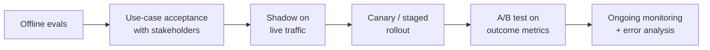

## Offline evals are necessary, not sufficient

Your eval suite tells you whether the system does what **you** think it should, on cases **you** chose. Real users bring tasks you did not imagine, phrase things differently, and care about outcomes your rubric may not capture. Before calling a system production-grade, test it against real use, in increasing order of realism and risk.



## Use-case acceptance testing

Sit with the people who will use or be affected by the system: support agents, operations staff, a handful of customers. Define 10 to 20 **end-to-end scenarios** in their words, with what success means to them:

| Scenario | Success criterion (stakeholder's words) |
|---|---|
| Customer with a leaking tent, 45 days after delivery | "They understand they can't return it but get the warranty form in one message, and don't need to call us." |
| Customer disputes a $340 refund denial | "It reaches a human with the whole context and a suggested decision, so I can approve or reject in under a minute." |
| Customer asks about an order shipped to an old address | "The agent catches it before dispatch and updates it, or tells them clearly it's too late." |

Run the scenarios live with the stakeholders watching, using staging. Their reactions find problems your rubrics miss: tone that feels robotic, an approval screen missing the one field staff need, a correct but unhelpful answer. Record findings as eval cases and backlog items.

## Shadow mode

Run the new system on a copy of real traffic without showing its output to users. For a support agent, shadow mode can draft replies for incoming tickets while human agents respond as usual. Then compare:

- How often would the AI's reply have been acceptable as is? (Have the human agents rate drafts, or judge them.)
- Which tool actions would it have taken, and were they the same as the human's?
- What would it have cost, and how long would it have taken?

Write tools must be stubbed in shadow mode: record the intended action, do not execute it.

A natural next step is **assist mode**: the AI drafts, a human reviews and sends. Every edit the human makes is free, high-quality feedback data, and the "accepted without edits" rate is a strong readiness metric for autonomous mode.

## A/B testing and outcome metrics

When the system is live for some users, compare it with a control group (no AI, or the previous version) on metrics that reflect real value:

| Metric | Why it matters |
|---|---|
| Resolution rate (no escalation, no repeat contact within 7 days) | Did it actually solve the problem? |
| Time to resolution | Speed for the customer |
| Cost per resolved conversation | Includes human time for escalations |
| CSAT or post-chat survey | Customer perception |
| Escalation acceptance (staff agree with suggested action) | Quality of agent judgement |
| Incorrect actions (refunds reversed, approvals rejected) | Harm |
| Downstream outcomes (returns completed, repeat purchases) | Business value |

Design notes:

- **Randomise at the user level** (not per message), so one customer gets a consistent experience.
- **Pre-register** the primary metric and the minimum effect you care about, and compute the sample size before starting, so you do not stop the test the moment it looks good.
- **Watch guardrail metrics** (incorrect actions, complaints) with stop conditions, separate from the success metric.
- **Beware novelty effects**: early behaviour differs from steady state. Run long enough to cover a weekly cycle at least.

> [!numbers] Baseline resolution rate is 62%. You want to detect an improvement to 66% (4 points) with 80% power at α = 0.05. A standard two-proportion calculation gives roughly 2,300 conversations per arm, so about 4,600 in total. At 1,500 eligible conversations a day split 50/50, that is around 3 days, and you should still run a full week to cover weekday/weekend differences.

## Evaluating on use-case slices

Averages hide problems. Break every evaluation (offline and online) down by slice:

- Intent and complication (refund vs exchange; outside window; multi-order).
- Customer segment (new vs returning, language, device).
- Channel (web chat vs email).
- Tenant (in B2B systems).

A system that is 92% good overall but 70% good for non-native English speakers or for exchanges is not ready for those users. Report the worst slices, not just the mean.

## Defining "production-grade" for your capstone

Write launch criteria before you run the final evaluation, and hold yourself to them. A template:

1. Offline: release suite ≥ target per category; must-never gate at 0; held-out suite within 2 points of dev.
2. Security: red-team suite passes; threat model reviewed.
3. Stakeholder acceptance: all scenarios pass in a live session, or have accepted workarounds.
4. Shadow or assist: ≥ X% of drafts accepted without edits over N conversations.
5. Operations: readiness checklist complete with evidence.
6. Business: projected cost per resolved conversation below the current (human) cost by a stated margin.

## Keep evaluating after launch

Launch is the start of the most important feedback loop. Weekly:

1. Review dashboards (quality, cost, behaviour).
2. Read 20 to 50 traces: random, negative feedback, expensive, escalated.
3. Update error analysis categories and counts.
4. Add new eval cases; fix the top failure category.
5. Re-run the release suite on any prompt, model, or KB change.

Teams that keep this loop going improve steadily. Teams that stop after launch watch quality drift as users, content, and models change.

## Design review questions

> [!interview] Which stakeholder signed off on the acceptance scenarios, and what did they find?

> [!interview] What is the accepted-without-edits rate in assist mode, and is it high enough for autonomy?

> [!interview] What is your worst-performing slice, and what is the plan for it?

> [!interview] What are your launch criteria, and which one is closest to failing?

## Further reading

- [Your AI Product Needs Evals](https://hamel.dev/blog/posts/evals/), on the full evaluation loop.
- [Building A Generative AI Platform](https://huyenchip.com/2024/07/25/genai-platform.html), Chip Huyen, on feedback and user metrics.
- [AI Engineering book resources](https://github.com/chiphuyen/aie-book), Chip Huyen's free companion repo with notes and links.
- [Stanford AI Index](https://hai.stanford.edu/ai-index), for context on how AI systems are evaluated across the industry.

```quiz
[
  {"q": "Why must write tools be stubbed in shadow mode?", "options": ["To save money", "Shadow output is not shown or acted on; executing writes would change real state based on an untested system", "Shadow mode is read-only by law", "To reduce latency"], "answer": 1, "why": "Shadow compares intended actions without consequences."},
  {"q": "Why randomise an A/B test per user rather than per message?", "options": ["Simpler code", "Users get a consistent experience and outcomes like repeat contact are attributable to one arm", "Fewer users are needed", "Providers require it"], "answer": 1, "why": "Per-message randomisation mixes treatments within a user's journey, muddying outcome metrics."},
  {"q": "Overall pass rate is 92%, but 70% for exchange requests. What should you report?", "options": ["92%", "Both, highlighting the worst slices; exchanges are not ready", "Only the 70%", "An average of the two"], "answer": 1, "why": "Averages hide failing segments. Production readiness is per use case."},
  {"q": "What is a strong readiness signal from assist mode?", "options": ["Number of drafts generated", "Share of drafts sent without human edits, plus the nature of edits made", "Model latency", "Token count"], "answer": 1, "why": "Accepted-without-edits directly measures whether the AI's output is good enough to act on alone."}
]
```
