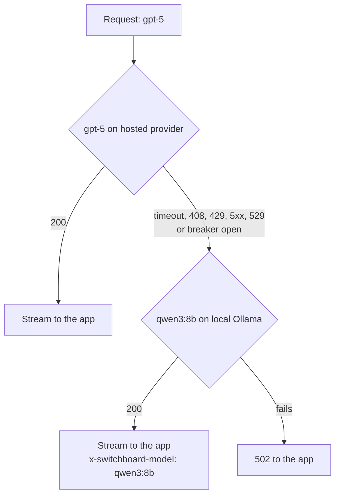

## Why a company ends up with a gateway

In Weeks 1 to 6, Relay held a provider key and called the model directly. That works for one app. Now picture forty: each team has its own keys in its own secret store, its own retry code, its own idea of what a token costs, and nobody can answer three questions the finance and security teams will ask in the first month:

1. **Who spent the $40,000 on the invoice?** The provider bills the company, not the team.
2. **Which apps send customer card numbers to which providers?** Nobody can say without reading forty codebases.
3. **What happens when a provider has an outage?** Each team finds out on its own.

An **AI gateway** is one service that every app calls instead of the provider. Apps keep their SDKs and change only the base URL and the key. The gateway holds the real provider keys and applies one set of rules to every request.

This week's reference service is [Switchboard](https://github.com/Rachneet/ai-system-design-course/tree/main/platform/switchboard), a gateway built for this course. It serves the Anthropic Messages API at `/v1/messages` and the OpenAI-compatible Chat Completions API at `/v1/chat/completions`, which reaches OpenAI, Gemini, OpenRouter, Hugging Face Inference Providers, and self-hosted vLLM or Ollama. Every number in this lesson about Switchboard comes from its code, README or ADRs.

## What a gateway centralises

```viz
caption: One request through the gateway. Each check adds a control the apps no longer write themselves, and all of them together cost Switchboard about 0.1 ms at p95 once a key is cached.
<div class="vz-row"><span class="ch sk">app: sbk_ key</span><span class="arr sk"></span><span class="ch sk c">1. verify key</span><span class="arr sk"></span><span class="ch sk c">2. model allowed?</span><span class="arr sk"></span><span class="ch sk c">3. RPM, TPM</span><span class="arr sk"></span><span class="ch sk c">4. budgets</span></div>
<div class="vz-row"><span class="arr sk"></span><span class="ch sk c">5. PII detect or redact</span><span class="arr sk"></span><span class="ch sk c">6. provider, then fallbacks</span><span class="arr sk"></span><span class="ch sk g">7. forward original bytes</span><span class="arr sk"></span><span class="ch sk m">8. meter: ledger, metrics</span></div>
<div class="vz-cols" style="--k:3">
  <div class="vz-panel sk"><h5>Refused before the provider</h5><p>401 bad key, 403 model policy, 429 limit or budget, 413 too large</p></div>
  <div class="vz-panel sk"><h5>Provider key</h5><p>held only by the gateway; apps never see it</p></div>
  <div class="vz-panel sk"><h5>Response headers</h5><p><code>x-switchboard-model</code>, <code>Server-Timing</code>, <code>x-request-id</code></p></div>
</div>
<div class="vz-src">Order of checks from <a href="https://github.com/Rachneet/ai-system-design-course/blob/main/platform/switchboard/switchboard/gateway.py">switchboard/gateway.py</a>; 0.1 ms p95 at concurrency 32 from <a href="https://github.com/Rachneet/ai-system-design-course/blob/main/platform/switchboard/docs/adr/0002-local-rate-limits-batched-ledger.md">ADR 0002</a> (one laptop, one process).</div>
```

| Concern | What the gateway does | How Switchboard does it |
|---|---|---|
| Keys | Apps get gateway keys; provider keys stay in one place | Per-app virtual keys `sbk_<id>_<secret>`, only a SHA-256 stored, expiry (90 days by default) and instant revocation |
| Tenancy and budgets | Spend limits at every level of the org chart | org, team and app, each with an optional monthly budget in USD |
| Rate limits | Stop one app from eating the company's provider quota | Requests and tokens per minute per app (defaults 60 RPM, 200,000 TPM) |
| Model policy | Which apps may use which models | `allowed_models` per app, enforced on fallbacks too; an allow-list for `anthropic-beta` headers |
| Routing and fallback | Survive a provider outage | Fallback chains that may cross providers, tried before the first byte reaches the client; a circuit breaker per model |
| Personal data | Keep card numbers and emails away from providers | `pii_mode`: off, detect (count only) or redact |
| Audit | Who changed what, and what was sent | Admin actions always logged; request bodies only on opt-in, always redacted, with an expiry |
| Metering and chargeback | Bill each team for its own use | Append-only usage ledger; `GET /admin/usage` by org, team, app or model |
| Observability | One place to see every model call | Prometheus metrics, OpenTelemetry spans, JSON logs, `Server-Timing` |

### Virtual keys

A virtual key names an app, not a person or a provider. Switchboard stores only the hash, looks the key up by its id, compares hashes in constant time, and caches a verified key for 30 seconds per instance. That cache is a trade-off you should be able to state: a revoked key keeps working on other instances for up to 30 seconds (the instance that handled the revocation forgets it at once).

### Budgets at three levels

Budgets nest. A request is refused if the org, the team or the app has used up its monthly budget, whichever runs out first.

```viz
caption: Budgets nest, and the smallest remaining one wins. Here the team still has money, but the app has hit its own cap, so the app's next request gets a 429.
<div class="vz-bars">
  <span>org: Northwind, $500</span><span class="bar sk"><i class="sk w" style="--w:62%"></i></span><b>$310 spent</b>
  <span>team: Support, $200</span><span class="bar sk"><i class="sk w" style="--w:70%"></i></span><b>$140 spent</b>
  <span>app: Relay, $20</span><span class="bar sk"><i class="sk b" style="--w:100%"></i></span><b>$20 spent</b>
</div>
<div class="vz-row"><span class="ch sk c">next request from Relay</span><span class="arr sk"></span><span class="ch sk b">429, x-switchboard-limit: budget:app</span></div>
<div class="vz-row"><span class="ch sk c">next request from another Support app</span><span class="arr sk"></span><span class="ch sk g">allowed</span></div>
<div class="vz-src">Illustrative amounts. Behaviour from <a href="https://github.com/Rachneet/ai-system-design-course/blob/main/platform/switchboard/switchboard/budgets.py">switchboard/budgets.py</a> and the 429 in <code>gateway.py</code>.</div>
```

### Rate limits that count tokens

A request limit alone does not protect a tokens-per-minute quota: one request can carry 100,000 tokens. Switchboard charges each request an **estimate** before sending it (body bytes ÷ 4, plus `max_tokens`), then refunds the difference once the real usage is known.

> [!numbers] Relay asks for `max_tokens` 4,096. A turn with a 12,000-byte body is estimated at 12,000 ÷ 4 + 4,096 = **7,096 tokens**. Against the default 200,000 TPM, only 200,000 ÷ 7,096 ≈ **28** such requests can be in flight in one minute before the bucket says no, even if each one really uses 1,500 tokens. The refund after each response gives the capacity back, so the limit is tight only during bursts. If your app sets `max_tokens` far above what it needs, it pays for that in rate limit headroom.

### Fallbacks across providers

When the requested model fails before any byte has reached the client, Switchboard tries the next model in its chain. The chain may cross providers, for example a hosted model falling back to a self-hosted one.



Three rules make fallbacks safe:

- **Only before the first byte.** Once streaming has started, the client has seen part of an answer; switching models mid-stream would splice two answers together. Switchboard decides on status codes and connection errors, then commits.
- **Policy still applies.** A fallback model the app is not allowed to use is skipped. Otherwise fallback is a way around model policy.
- **Not every error is retryable.** Switchboard falls back on 408, 429, 500, 502, 503, 504 and 529, and on connection errors. A 401 from the provider (a bad provider key) or a 400 (a bad request) goes straight back, because another model would fail the same way or hide a real bug.

A circuit breaker per model skips a failing primary for 30 seconds after 5 consecutive failures, so users do not each wait for a timeout. Every fallback model must be in your eval suite: tool calling and refusals differ across models, and the fallback's prompt cache starts cold.

### PII policy

With `pii_mode=detect` (the default) Switchboard counts card numbers (checked with the Luhn algorithm), emails, phone numbers and IBANs in the system prompt and message text, and records the count. With `redact` it replaces them before the request leaves the company. Detection by pattern is a floor, not a guarantee: names and addresses pass straight through. Some products in the comparison below plug in heavier detectors, such as Microsoft Presidio.

## The rule that matters most: do not break prompt caching

Providers cache the processed state of a prompt **prefix** and match it byte for byte ([Week 5](#w5-scaling)). A gateway that parses JSON and serialises it again can change key order, whitespace or escaping. The model sees the same meaning; the cache sees a different prefix and misses every time. Nothing errors. The bill just goes up.

```viz
caption: The same 3-step agent loop, through two gateways. Re-serialising the body turns every cache read into a full-price miss, which more than doubles this loop's input cost.
<div class="vz-cols">
  <div class="vz-panel sk b"><h5>Gateway re-serialises JSON</h5>
    <div class="vz-row"><span class="ch sk">{"model":..., "system":...}</span><span class="arr sk"></span><span class="ch sk b">{"system":..., "model":...}</span></div>
    <div class="vz-row"><span class="ch wide sk b">12,000-token prefix: miss, full price</span></div>
    <div class="vz-bars"><span>input cost</span><span class="bar sk"><i class="sk b" style="--w:100%"></i></span><b>$0.072</b></div>
  </div>
  <div class="vz-panel sk g"><h5>Gateway forwards original bytes</h5>
    <div class="vz-row"><span class="ch sk">{"model":..., "system":...}</span><span class="arr sk"></span><span class="ch sk g">identical bytes</span></div>
    <div class="vz-row"><span class="ch wide sk g">12,000-token prefix: read from cache</span></div>
    <div class="vz-bars"><span>input cost</span><span class="bar sk"><i class="sk g" style="--w:45%"></i></span><b>$0.032</b></div>
  </div>
</div>
<div class="vz-src">Worked example from <a href="#w5-scaling">Week 5</a>: Sonnet 5.5 at $2 input, $2.50 5-minute write, $0.10 read per million tokens (<a href="https://platform.claude.com/docs/en/about-claude/pricing">Anthropic pricing</a>, checked 2026-10-14). Decision from <a href="https://github.com/Rachneet/ai-system-design-course/blob/main/platform/switchboard/docs/adr/0003-forward-bytes-unchanged.md">ADR 0003</a>.</div>
```

Switchboard's decision ([ADR 0003](https://github.com/Rachneet/ai-system-design-course/blob/main/platform/switchboard/docs/adr/0003-forward-bytes-unchanged.md)): **parse the body to inspect it, but forward the original bytes.** It re-serialises only when it must change the content, and a test asserts byte-for-byte equality. The changes it does make are each a deliberate trade:

| Change | When | Effect on the cache |
|---|---|---|
| Redact PII | `pii_mode=redact` and something was found | That request loses its cache hit. Prefer redacting at the app edge for prompts that must stay cacheable |
| Replace `model` | A fallback is served | None that matters: a different model has a different, cold cache anyway |
| Add `stream_options.include_usage` | A streamed Chat Completions request without it | None: the field is not part of the prompt prefix. It is needed because only the final chunk carries token usage, and only when asked |

> [!rule] A gateway may read every byte, but it should forward the bytes it read. Write a test that sends a request through the gateway and compares what the provider received with what the app sent.

## Latency: the gateway's own budget

Every millisecond the gateway adds is paid on every model call, and an agent turn makes several. The enterprise track's target for Switchboard is **under 10 ms p95 added**, excluding provider time.

### Measure it with Server-Timing

[Server-Timing](https://www.w3.org/TR/server-timing/) is a W3C response header for exactly this: named durations, such as `db;dur=53`. Switchboard sends `Server-Timing: gateway;dur=0.07, upstream;dur=1.24` on non-streamed responses (on streams, only the gateway's time before the provider call, since the upstream time is not known when headers go out). Load tests, client logs and browsers can then separate "our gateway is slow" from "the provider is slow" without guessing.

Switchboard's load test (`uv run python -m loadtest.overhead --concurrency 32`) sends the same requests through the gateway to a mock provider and reads the header. The first version was not fast:

```viz
caption: Version 0.1 spent most of its time waiting on Postgres row locks. Moving limits into memory and batching the ledger cut p95 from 63.9 ms to 0.1 ms at concurrency 32.
<div class="vz-cols">
  <div class="vz-panel sk b"><h5>v0.1: shared Postgres buckets</h5>
    <div class="vz-bars"><span>p50</span><span class="bar sk"><i class="sk b" style="--w:80%"></i></span><b>54.1 ms</b><span>p95</span><span class="bar sk"><i class="sk b" style="--w:94%"></i></span><b>63.9 ms</b><span>p99</span><span class="bar sk"><i class="sk b" style="--w:100%"></i></span><b>67.7 ms</b></div>
    <p>every request updated the same bucket row and three spend rows</p>
  </div>
  <div class="vz-panel sk g"><h5>v0.2: local limits, batched ledger</h5>
    <div class="vz-bars"><span>p50</span><span class="bar sk"><i class="sk g" style="--w:1%"></i></span><b>&lt;0.1 ms</b><span>p95</span><span class="bar sk"><i class="sk g" style="--w:1%"></i></span><b>0.1 ms</b><span>p99</span><span class="bar sk"><i class="sk g" style="--w:2%"></i></span><b>1.0 ms</b></div>
    <p>no shared row on the request path once a key is cached</p>
  </div>
</div>
<div class="vz-src">Gateway time inside the handler, read from Server-Timing, one laptop, one process, concurrency 32: <a href="https://github.com/Rachneet/ai-system-design-course/blob/main/platform/switchboard/docs/adr/0002-local-rate-limits-batched-ledger.md">ADR 0002</a>. The mock provider shared the CPU, so these numbers say nothing about end-to-end capacity.</div>
```

The cause was found by sampling `pg_stat_activity` under load: requests queued on row locks for the app's bucket row and the `spend_monthly` rows. The fix ([ADR 0002](https://github.com/Rachneet/ai-system-design-course/blob/main/platform/switchboard/docs/adr/0002-local-rate-limits-batched-ledger.md)) has three parts, and each one trades exactness for speed:

1. **Rate limits are local.** Each instance keeps in-memory token buckets sized at `limit ÷ live instances`. Instances heartbeat into Postgres every 5 seconds to learn how many there are. This is the model of Envoy's [local rate limit filter](https://www.envoyproxy.io/docs/envoy/latest/configuration/http/http_filters/local_rate_limit_filter), which by default applies limits "per Envoy process".
2. **Ledger writes are batched.** Usage events queue in memory and flush every 0.5 seconds in one transaction. Spend rows are updated in sorted order, so instances cannot deadlock.
3. **Budget checks are cached** for 2 seconds per (org, team, app).

> [!numbers] An agent turn with six sequential model calls (the slow pattern from the [inference lesson](#w5-inference)) pays the gateway six times. Under v0.1 at concurrency 32 that is 6 × 63.9 ms ≈ **383 ms** added to the turn at p95. Under v0.2 it is 6 × 0.1 ms = **0.6 ms**. The first number is something users feel; the second is noise next to a time to first token measured in hundreds of milliseconds.

## Failure modes

### The gateway as a single point of failure

Every model call in the company now depends on one service. Run several stateless instances behind a load balancer, put them in more than one zone, and know which dependencies sit on the request path. In Switchboard, Postgres is not on the path for a cached key, but it comes back on the path whenever a cache expires: a key lookup after 30 seconds, a budget lookup after 2 seconds. If Postgres is down when a budget cache expires, that request fails. Decide in advance whether that should **fail closed** (refuse, protect money) or **fail open** (serve, protect users), and write it down.

### Budgets overshoot

Budgets are checked when a request is admitted, against spend that is up to 2 seconds stale and flushed every 0.5 seconds. Requests already admitted keep spending.

```viz
caption: Most of a budget overshoot comes from requests already in flight, not from the 2-second cache. Long streams are admitted before the money runs out and finish after.
<div class="vz-bars">
  <span>2 s stale budget cache</span><span class="bar sk"><i class="sk w" style="--w:12%"></i></span><b>40 requests, about $1.16</b>
  <span>requests in flight (15 s each)</span><span class="bar sk"><i class="sk b" style="--w:100%"></i></span><b>300 requests, about $8.70</b>
</div>
<p>20 requests per second, each 12,000 uncached input and 500 output tokens on Sonnet 5.5: 0.012 × $2 + 0.0005 × $10 ≈ $0.029</p>
<div class="vz-src">Cache and flush intervals from <a href="https://github.com/Rachneet/ai-system-design-course/blob/main/platform/switchboard/switchboard/config.py">switchboard/config.py</a>; prices from <a href="https://platform.claude.com/docs/en/about-claude/pricing">Anthropic pricing</a>, checked 2026-10-14; the 15 s turn is the 600-token example from the <a href="#w5-inference">inference lesson</a>.</div>
```

ADR 0002 states the bound as "about 2 s of traffic plus in-flight requests". For a $20 app budget, a $10 overshoot is half the budget again. Fixes, in order of cost: set a soft limit below the hard one and alert on it; cap `max_tokens` per app so one request has a known maximum cost; reserve the estimated cost at admission (as the TPM limit already does) and release the difference afterwards.

> [!warn] A spent budget is a 429, and both official SDKs retry 429s twice by default ([OpenAI](https://github.com/openai/openai-python#retries), [Anthropic](https://platform.claude.com/docs/en/api/sdks/python#retries)). Retrying cannot help until next month, so Switchboard adds `x-should-retry: false` (which the SDKs honour) and `x-switchboard-limit: budget:<scope>` (which your own retry and fallback logic should honour too: a fallback model through the same gateway hits the same budget).

### Per-instance limits are approximate

With 600 RPM for an app and 3 instances, each instance allows 200. If the load balancer sends that app's traffic unevenly, the app is throttled on the busy instance while the others have room. After a scale-out, old instances keep their old share until their next heartbeat (5 seconds), so total capacity briefly exceeds the limit. That is acceptable for abuse and cost protection. For contractual per-tenant quotas, ADR 0002 names the upgrade: Redis with atomic scripts, or a dedicated rate-limit service, behind the same interface.

### Other ways it goes wrong

| Failure | Symptom | Defence |
|---|---|---|
| Body re-serialised | Cache hit rate drops to zero after the gateway rollout; no errors | Forward original bytes; a byte-equality test; watch cache-read tokens per model |
| Fallback to an unevaluated model | Quality drops during an outage, when you are least able to notice | Every fallback model in the eval suite; alert on `switchboard_fallbacks_total` |
| Ledger events lost | Chargeback lower than the invoice | Graceful shutdown flushes; a hard crash loses up to 0.5 s; metrics for failed flushes and drops; reconcile monthly against the provider invoice |
| Prices out of date | Chargeback wrong by a constant factor | Prices live in config with the date checked; review on every model change |
| Provider's model name differs from the gateway's | Spend reported under a name with no price, so it shows $0 | Price by the gateway's catalog name; test chargeback with a streamed request |

## Build or buy

You will rarely build a gateway from scratch. Building Switchboard is how this course shows what is inside one; in a company, start from this table. Every row below is from the product's own documentation, checked 2026-10-15.

| Product | Kind | What its docs say it does |
|---|---|---|
| [LiteLLM proxy](https://docs.litellm.ai/docs/proxy/virtual_keys) | Open source, Python, self-hosted | Virtual keys with spend tracking per key, user and team; `max_budget`; `rpm_limit` and `tpm_limit`; allowed models per key; needs Postgres. [Fallbacks](https://docs.litellm.ai/docs/proxy/reliability) across providers, retries and cooldowns; [PII masking](https://docs.litellm.ai/docs/proxy/guardrails/pii_masking_v2) through Microsoft Presidio |
| [Agent Router](https://github.com/envoyproxy/ai-gateway), formerly Envoy AI Gateway | Open source, Envoy and Envoy Gateway on Kubernetes | "One consistent, OpenAI-compatible API for every model and tool"; provider credentials held centrally; failover; MCP servers alongside model providers |
| [Kong AI Gateway](https://developer.konghq.com/ai-gateway/) | Open-core API gateway | Many providers behind one API; load balancing with failover; AI Rate Limiting Advanced for token quotas; AI Sanitizer to "redact PII before it reaches the upstream LLM provider"; semantic cache; prompt guards; MCP |
| [Cloudflare AI Gateway](https://developers.cloudflare.com/ai-gateway/) | Managed, at Cloudflare's edge | Analytics on requests, tokens and cost; logging; response caching; rate limiting; request retry and model fallback; Workers AI, Anthropic, Gemini, OpenAI and others |
| [Azure API Management AI gateway](https://learn.microsoft.com/en-us/azure/api-management/genai-gateway-capabilities) | Managed API gateway | `llm-token-limit` (TPM or token quotas per any key); `llm-emit-token-metric`; semantic caching; backend load balancing and a circuit breaker that honours `Retry-After`; content safety; OpenAI, Anthropic Messages (v2 tiers) and Vertex AI schemas |
| [Google Apigee](https://docs.cloud.google.com/apigee/docs/api-platform/reference/policies/llm-token-quota-policy) | Managed API gateway | `LLMTokenQuota` counts or enforces input and output tokens per minute to per year; [`PromptTokenLimit`](https://docs.cloud.google.com/apigee/docs/api-platform/reference/policies/prompt-token-limit-policy) throttles prompt tokens to absorb spikes |
| [AWS Multi-Provider Generative AI Gateway](https://docs.aws.amazon.com/solutions/multi-provider-generative-ai-gateway-on-aws/) | AWS reference architecture (Guidance) | LiteLLM on ECS or EKS behind WAF and a load balancer, RDS for virtual keys, ElastiCache, Secrets Manager for provider keys; Amazon Bedrock, SageMaker AI and external providers |

How to choose:

- **Already run an API gateway** (Kong, Apigee, Azure API Management)? Add its AI features first: you keep one control plane, one auth model and one on-call rotation.
- **Want open source and Python**? LiteLLM proxy covers most of the table above. Read how it re-serialises request bodies and test cache hit rates through it before rolling it out.
- **Kubernetes platform team**? Agent Router fits an Envoy-based ingress.
- **Build your own** only when you need something none of them do, such as a specific chargeback model, residency routing tied to your tenancy, or a latency budget you must control. You then own an on-call service that sits in front of every model call.

> [!tip] Semantic caching (Kong, Azure, Apigee) is a **response** cache: it returns a stored answer for a similar prompt. It is not prompt caching, and it has the risks from [Week 5](#w5-scaling): wrong answers for near-identical questions and cross-user leaks. Turn it on only for generic, permission-free answers.

Whichever you choose, check these five things in a trial: does it forward request bytes unchanged; what latency does it add at your p95 (ask it for Server-Timing or measure); are limits global or per instance; how does a budget-exceeded error look to your SDK; can chargeback be reconciled to the invoice.

## Design review questions

> [!interview] Show me a request through your gateway and the bytes the provider received. Are they identical? If not, what is your cache hit rate before and after the gateway?

> [!interview] Your gateway's database is down. What happens to the next request from an app whose key and budget are cached, and from one whose are not?

> [!interview] A team's monthly budget is $20 and its app streams 15-second answers at 20 requests per second. How far past $20 can it go, and what would you change to bound that?

> [!interview] What is your gateway's p95 added latency, how did you measure it, and how many gateway hops does one agent turn make?

> [!interview] The primary provider is down and traffic falls back to a self-hosted model. How do you know answer quality held?

## Further reading

- Switchboard: [README](https://github.com/Rachneet/ai-system-design-course/tree/main/platform/switchboard), [ADR 0002: local limits and a batched ledger](https://github.com/Rachneet/ai-system-design-course/blob/main/platform/switchboard/docs/adr/0002-local-rate-limits-batched-ledger.md), [ADR 0003: forward bytes unchanged](https://github.com/Rachneet/ai-system-design-course/blob/main/platform/switchboard/docs/adr/0003-forward-bytes-unchanged.md).
- [Server Timing](https://www.w3.org/TR/server-timing/), W3C Working Draft.
- Envoy [local rate limit filter](https://www.envoyproxy.io/docs/envoy/latest/configuration/http/http_filters/local_rate_limit_filter): the per-instance model Switchboard copies.
- [AI gateway capabilities in Azure API Management](https://learn.microsoft.com/en-us/azure/api-management/genai-gateway-capabilities): a clear vendor overview of what a managed gateway offers.
- LiteLLM [virtual keys](https://docs.litellm.ai/docs/proxy/virtual_keys) and [reliability](https://docs.litellm.ai/docs/proxy/reliability).
- Prompt caching docs: [Anthropic](https://platform.claude.com/docs/en/build-with-claude/prompt-caching), [OpenAI](https://developers.openai.com/api/docs/guides/prompt-caching), [Gemini](https://ai.google.dev/gemini-api/docs/generate-content/caching).

```quiz
[
  {"q": "Why must a gateway forward the original request bytes instead of re-serialising the parsed JSON?", "options": ["Re-serialising is slow", "Prompt caching matches byte-identical prefixes, so a changed key order or whitespace turns every cache read into a full-price miss", "Providers reject re-serialised JSON", "It hides the gateway from the provider"], "answer": 1, "why": "The model sees the same meaning, but the cache sees a different prefix. Nothing errors; the bill goes up."},
  {"q": "Switchboard falls back from the primary model to another provider. When is that allowed?", "options": ["Any time, even mid-stream", "Only before the first byte reaches the client, and only to models the app is allowed to use", "Only for Anthropic models", "Only after the client retries"], "answer": 1, "why": "Mid-stream the client has seen part of one model's answer, and a fallback outside the app's allowed models would bypass policy."},
  {"q": "The provider returns 401 because the gateway's provider key is wrong. What should the gateway do?", "options": ["Fall back to the next model", "Return the error: another model on the same broken credential, or hiding a configuration bug, does not help", "Retry 10 times", "Return 200 with an empty answer"], "answer": 1, "why": "Fallback is for transient and capacity errors (timeouts, 429, 5xx). Authentication and bad-request errors need a fix, not a retry."},
  {"q": "An app has 600 RPM and Switchboard runs 3 instances. What does each instance allow, and what is the catch?", "options": ["600 each; none", "200 each; with uneven load balancing the app is throttled on a busy instance while others have room", "600 shared exactly through Postgres", "100 each"], "answer": 1, "why": "Local buckets are sized at limit divided by live instances. Exact per instance, approximate globally, as ADR 0002 says."},
  {"q": "Where does most of a budget overshoot come from when an app streams long answers?", "options": ["The 2-second budget cache", "Requests admitted before the budget ran out that keep spending while they stream", "Clock drift", "PII redaction"], "answer": 1, "why": "At 20 requests per second with 15-second streams, 300 requests are in flight against 40 from the stale cache."},
  {"q": "How do you tell gateway latency from provider latency on a single response?", "options": ["Guess from total time", "Read the Server-Timing header, which names the gateway's and the upstream's durations", "Ask the provider", "Turn off the gateway"], "answer": 1, "why": "Server-Timing is a W3C header for named server-side durations; Switchboard sends gateway;dur and upstream;dur."},
  {"q": "Your team already runs Azure API Management for all APIs. What is the sensible first step for an AI gateway?", "options": ["Build one from scratch", "Try its AI gateway features (token limits, token metrics, backends with circuit breakers) and test cache behaviour and latency", "Give every app its own provider key", "Use semantic caching for everything"], "answer": 1, "why": "Reusing the gateway you operate keeps one control plane and one on-call rotation; verify caching and latency in a trial."}
]
```
