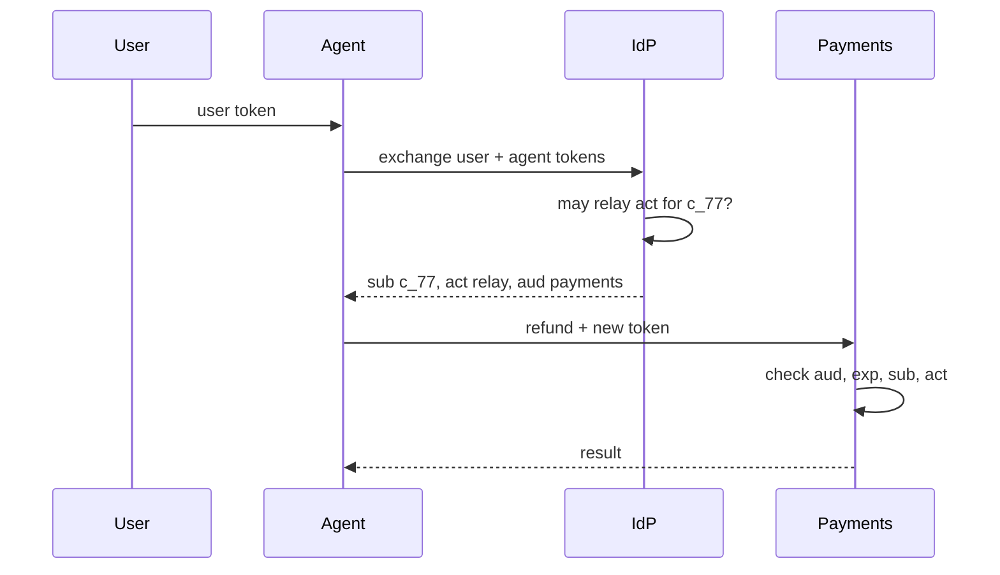

## Who is calling?

Relay is about to call `payments__refund` for customer `c_77`. The payments service has to decide whether to allow it, and later an auditor will ask who did it. There are three honest answers, and a good design keeps all three:

- **The user**: customer `c_77`, who asked for the refund. Proven by a token from the identity provider (Week 4).
- **The agent**: Relay, the software that decided to call the tool. It should have its own identity, its own permissions and its own audit trail.
- **The workload**: the pod or VM running Relay's code right now. Proven by the platform it runs on, not by a secret someone pasted into an environment variable.

Most early agent systems collapse these. Either the agent **runs as the user** (it holds the user's token and forwards it everywhere) or it **runs as a service account** that can do anything for anyone. The first spreads a powerful token to every tool; the second lets a prompt injection act for any customer. This lesson is about keeping the three apart.

```viz
caption: Three identities, three different questions, three different proofs. A tool call should carry the first two, and the platform should prove the third.
<div class="vz-cols" style="--k:3">
  <div class="vz-panel sk c"><h5>User</h5>
    <div class="vz-row"><span class="ch sk c">c_77, role customer</span></div>
    <p><b>Question:</b> for whom?</p>
    <p><b>Proof:</b> a JWT from the IdP, verified against its JWKS</p>
  </div>
  <div class="vz-panel sk m"><h5>Agent</h5>
    <div class="vz-row"><span class="ch sk m">relay</span></div>
    <p><b>Question:</b> which software is acting?</p>
    <p><b>Proof:</b> its own credential: client credentials, or a gateway token</p>
  </div>
  <div class="vz-panel sk"><h5>Workload</h5>
    <div class="vz-row"><span class="ch sk">spiffe://prod.northwind/relay</span></div>
    <p><b>Question:</b> which running process?</p>
    <p><b>Proof:</b> attested by the platform, short-lived, rotated automatically</p>
  </div>
</div>
<div class="vz-row"><span class="ch wide sk g">tool sees: sub = c_77, act.sub = relay</span><span class="ch sk b">never: the user's own token, or a god key</span></div>
```

## Agents as principals

A **principal** is anything a policy can name. Making the agent one means: it has an id (`relay`, `refunds`, `concierge`), its own credential you can rotate and revoke without touching any user, and its own permissions. Policies can then say "the refunds agent may call `payments__refund` up to $200 for a user with the support role", which neither a user identity nor a service account can express alone (Week 8 covers that policy language).

RFC 8693 names the two ways one party can act for another ([section 1.1](https://www.rfc-editor.org/rfc/rfc8693.html#section-1.1)):

| | Impersonation | Delegation |
|---|---|---|
| What the downstream sees | Only the user: the actor is "indistinguishable" from them | The user **and** the actor, who "is an agent for" the user |
| Audit trail | Says the user did it | Says the agent did it for the user |
| Can policy limit the agent? | No, it has all the user's rights | Yes, the agent's own permissions apply too |
| Use for agents | Avoid | Default |

> [!rule] Agents act by delegation, not impersonation. Every downstream call should say both who the user is and which agent is acting, and the effective permission is what **both** are allowed to do.

## Credentials for the agent itself

### OAuth client credentials

When an agent acts on its own behalf (a nightly job that re-indexes the knowledge base, a monitoring agent), there is no user. The agent is an OAuth **confidential client** and gets an access token with the **client credentials** grant: it authenticates to the authorization server and receives a token naming itself.

OAuth 2.1 consolidates OAuth 2.0 and its security best practice. It is still an Internet-Draft ([draft 16, September 2026](https://datatracker.ietf.org/doc/draft-ietf-oauth-v2-1/)), but the direction is settled: it keeps three grants (authorization code, refresh token, client credentials), drops the implicit and password grants, and requires PKCE on the authorization code flow. The MCP specification already builds on it.

Prefer a client credential that is not a shared secret: a private key the client signs with, or, better, a credential the platform issues to the workload (below), so there is nothing long-lived to leak.

### Workload identity

Workload identity answers "which running process is this?" without a static secret.

- **SPIFFE** gives every workload a URI identity of the form `spiffe://trust-domain/path`, for example `spiffe://staging.example.com/payments/mysql` ([SPIFFE ID standard](https://github.com/spiffe/spiffe/blob/main/standards/SPIFFE-ID.md)). The proof is an **SVID**, a "short lived cryptographic identity document" in X.509 or JWT form, fetched from a local Workload API and rotated automatically. **SPIRE** is the open-source implementation that attests workloads (Kubernetes, VMs, bare metal) before issuing them ([SPIFFE overview](https://spiffe.io/docs/latest/spiffe-about/overview/)).
- **Cloud workload identity federation** lets a workload trade a credential from where it runs for a short-lived cloud token. Google Cloud's version "eliminates the maintenance and security burden associated with service account keys", accepts identities from AWS, Microsoft Entra ID, GitHub, GitLab, Kubernetes and any OIDC or SAML 2.0 provider, and "follows the OAuth 2.0 token exchange specification" through its Security Token Service ([Google Cloud docs](https://docs.cloud.google.com/iam/docs/workload-identity-federation)).

Workload identity proves the process; it does not say which agent product or which user. Use it as the agent's client credential, and still carry the user and agent separately on each call.

## Token exchange: carrying the user and the agent together

RFC 8693, [OAuth 2.0 Token Exchange](https://www.rfc-editor.org/rfc/rfc8693.html) (January 2020), defines how a party trades the tokens it holds for a new token aimed at one downstream service. The request to the authorization server's token endpoint uses:

| Parameter | Meaning |
|---|---|
| `grant_type` | `urn:ietf:params:oauth:grant-type:token-exchange` |
| `subject_token` (+ `subject_token_type`) | Who the request is on behalf of: here, the user's token |
| `actor_token` (+ `actor_token_type`) | Who is acting: here, the agent's own token |
| `resource` or `audience` | The one service the new token is for |
| `scope` | The narrower scopes wanted for this call |

The issued token names the user as `sub` and the agent in the **`act`** (actor) claim:

```json
{
  "iss": "https://idp.northwind.example",
  "aud": "https://payments.northwind.example",
  "sub": "c_77",
  "act": { "sub": "relay" },
  "scope": "refunds:create",
  "exp": 1792047869
}
```



Three details from the RFC matter for agents:

- **Chains nest.** If the agent hands work to a sub-agent that exchanges again, the new `act` contains the old one. The outermost `act` is the current actor; nested ones are earlier actors.
- **Only the current actor counts for access control.** Consumers "MUST only consider the token's top-level claims" and the current actor; earlier actors are "informational only". Log the whole chain, decide on the top.
- **`may_act`** in the subject token can say in advance which parties may act for this user, which the authorization server can check before issuing.

### On-behalf-of, as identity providers ship it

Several identity providers had delegation flows before or beside RFC 8693. Microsoft Entra ID's [on-behalf-of flow](https://learn.microsoft.com/en-us/entra/identity-platform/v2-oauth2-on-behalf-of-flow) is the common example: a middle-tier API sends the user's token as `assertion` with `grant_type=urn:ietf:params:oauth:grant-type:jwt-bearer` and `requested_token_use=on_behalf_of`, and gets a token for the downstream API. The incoming token must have the middle tier as its audience, and the issued token carries only delegated scopes: roles "remain attached to the principal (the user) and never to the application". Same idea, different wire format: check what your provider supports before designing around RFC 8693.

## Least privilege, in time and in scope

Every credential should be useful for as little as possible, for as short a time as possible.

```viz
caption: A leaked credential is worth what it can do, multiplied by how long it lasts. A 60-second assertion for one server is about 130,000 times shorter-lived than a 90-day key.
<div class="vz-bars">
  <span>gateway key, 90-day default</span><span class="bar sk"><i class="sk b" style="--w:100%"></i></span><b>129,600 min</b>
  <span>typical access token, about 1 h</span><span class="bar sk"><i class="sk w" style="--w:3%"></i></span><b>about 60 min</b>
  <span>Checkpoint assertion</span><span class="bar sk"><i class="sk g" style="--w:1%"></i></span><b>1 min, one server</b>
</div>
<div class="vz-row"><span class="ch sk b">refunds:* on every API</span><span class="arr sk"></span><span class="ch sk g">refunds:create, aud payments</span></div>
<div class="vz-src">90 days: Switchboard's default key expiry in <a href="https://github.com/Rachneet/ai-system-design-course/blob/main/platform/switchboard/switchboard/admin.py">admin.py</a>. 60 s: Checkpoint's <code>assertion_ttl_s</code>. The hour-long access token is the 3,269 s <code>expires_in</code> in Entra's <a href="https://learn.microsoft.com/en-us/entra/identity-platform/v2-oauth2-on-behalf-of-flow">OBO example</a>; lifetimes vary by provider.</div>
```

- **Scope**: one action, not a family. `refunds:create` rather than `payments:*`.
- **Audience**: one service. RFC 8707's `resource` parameter asks the authorization server to "audience-restrict issued access tokens", so a token for payments is refused by orders ([RFC 8707](https://www.rfc-editor.org/rfc/rfc8707.html)).
- **Lifetime**: minutes, not months. Long-lived keys (gateway keys, service-account keys) need rotation, expiry and fast revocation, and should be the exception.

## The MCP authorization specification

MCP tools are where agents act, so MCP's rules for authorization are worth knowing exactly. The current revision is **2026-07-28** ([authorization](https://modelcontextprotocol.io/specification/latest/basic/authorization), [security considerations](https://modelcontextprotocol.io/specification/2026-07-28/basic/authorization/security-considerations)). Authorization is optional, but when an implementation supports it:

| Requirement | What the spec says |
|---|---|
| Which transports | HTTP-based transports **SHOULD** conform; stdio **SHOULD NOT** and takes credentials from the environment |
| Roles | The MCP server is an OAuth 2.1 resource server; the MCP client is an OAuth 2.1 client |
| Discovery | Servers **MUST** implement Protected Resource Metadata ([RFC 9728](https://www.rfc-editor.org/rfc/rfc9728.html)), served at `/.well-known/oauth-protected-resource` and pointed to by `resource_metadata` in the `WWW-Authenticate` header of a 401; clients **MUST** use it to find the authorization server |
| Registration | Clients get a client ID by Client ID Metadata Documents (**SHOULD**), pre-registration, or Dynamic Client Registration (deprecated, kept for compatibility) |
| PKCE | Clients **MUST** use PKCE with `S256`, and **MUST** refuse to proceed if the server's metadata does not advertise it |
| Resource indicators | Clients **MUST** send `resource` ([RFC 8707](https://www.rfc-editor.org/rfc/rfc8707.html)) naming the MCP server's canonical URI in both the authorization and token requests |
| Audience | Servers **MUST** validate that tokens "were issued specifically for them as the intended audience" and reject others |
| Token passthrough | Servers "**MUST NOT** accept or transit any other tokens"; a server that calls upstream APIs uses a separate token and "**MUST NOT** pass through the token it received" |
| Token handling | `Authorization: Bearer` on every request, never in the query string; short-lived access tokens **SHOULD** be issued |
| Least privilege | Servers **SHOULD** put the needed `scope` in `WWW-Authenticate`; a 403 with `error="insufficient_scope"` triggers step-up authorization for more |

The two rules agent systems break most often are audience validation and the ban on token passthrough. The MCP [security best practices](https://modelcontextprotocol.io/docs/2026-07-28/tutorials/security/security_best_practices) explain why: a server that forwards a token it was handed lets callers bypass the downstream API's own controls, makes the audit trail show the wrong identity, and turns one compromised server into access to every service that accepts the token.

## Checkpoint's design: a signed assertion per call

[Checkpoint](https://github.com/Rachneet/ai-system-design-course/tree/main/platform/checkpoint) is the course's MCP gateway: every agent tool call passes through it (Week 8 covers its Cedar policies and approvals). Its identity design is small enough to read in one sitting ([`identity.py`](https://github.com/Rachneet/ai-system-design-course/blob/main/platform/checkpoint/checkpoint/identity.py), [ADR 0002](https://github.com/Rachneet/ai-system-design-course/blob/main/platform/checkpoint/docs/adr/0002-signed-assertions-not-shared-credentials.md)):

1. **The agent** authenticates with its own token, `ckp_<agent>_<secret>`; only a SHA-256 of the secret is stored. Approver tokens are separate and cannot call tools.
2. **The user** arrives as a JWT in `X-User-Token`, verified against the identity provider's JWKS (RS256 or ES256, `exp` and `sub` required, audience `checkpoint`). A plain header saying "user c_77" is never trusted.
3. **Upstream**, Checkpoint signs a fresh RS256 assertion for each call and sends it in `x-checkpoint-assertion`. The server's own service credential, if it has one, is configured in Checkpoint and sent as `Authorization`. The agent never sees it.

```json
{
  "iss": "checkpoint",
  "aud": "com.northwind/payments",
  "sub": "c_77",
  "act": { "sub": "relay" },
  "tool": "refund",
  "iat": 1792047809,
  "exp": 1792047869,
  "jti": "901b516395d34389"
}
```

When an agent acts with no user (a background job), `sub` is `agent:<id>`, so a server can tell "the agent for nobody" from "the agent for c_77". Servers verify the assertion against Checkpoint's public keys at `/.well-known/jwks.json`.

```viz
caption: Passing tokens along turns every tool server into a place the user's power can leak from. A per-call assertion is useful to one server for one minute, and it names the agent.
<div class="vz-cols">
  <div class="vz-panel sk b"><h5>Token passthrough</h5>
    <div class="vz-row"><span class="ch sk">user token, aud: many</span><span class="arr sk"></span><span class="ch sk">agent</span><span class="arr sk"></span><span class="ch sk b">payments server</span></div>
    <div class="vz-row"><span class="ch sk b">compromised payments server</span><span class="arr sk b"></span><span class="ch sk b">replays it at orders, email</span></div>
    <p>no record that an agent acted; a stolen token works everywhere for its whole life</p>
  </div>
  <div class="vz-panel sk g"><h5>Checkpoint assertion</h5>
    <div class="vz-row"><span class="ch sk">agent token + user JWT</span><span class="arr sk"></span><span class="ch sk c">Checkpoint verifies both</span><span class="arr sk"></span><span class="ch sk g">payments server</span></div>
    <div class="vz-row"><span class="ch sk g">sub c_77, act.sub relay</span><span class="ch sk g">aud payments</span><span class="ch sk g">exp 60 s</span></div>
    <p>orders rejects it: wrong audience. After a minute nobody accepts it</p>
  </div>
</div>
<div class="vz-src">Claims and lifetime from <a href="https://github.com/Rachneet/ai-system-design-course/blob/main/platform/checkpoint/checkpoint/identity.py">checkpoint/identity.py</a> and <a href="https://github.com/Rachneet/ai-system-design-course/blob/main/platform/checkpoint/docs/adr/0002-signed-assertions-not-shared-credentials.md">ADR 0002</a>; the audience rule is the MCP specification's.</div>
```

What a server must check, in this order: signature with a key from the JWKS (look up by `kid`, pin the algorithm to RS256), `iss`, `aud` equal to its own name, `exp`, then `sub`, `act.sub` and `tool` against its own rules. To make the assertion single-use, also remember each `jti` until its `exp` and refuse repeats; Checkpoint issues the `jti`, but only the server can enforce it.

Checkpoint's ADR is honest about the gap: here **Checkpoint** issues the downstream token. The production upgrade is RFC 8693 at the identity provider, so the IdP, which already knows every user, agent and service, issues it. The claim shape (`sub`, `act`, `aud`) stays the same, which is why the design copies it.

## Failure modes

### Confused deputy

Norm Hardy named the [confused deputy](https://css.csail.mit.edu/6.566/2011/readings/confused-deputy.html) in 1988: a compiler with permission to write a billing file was asked by a user to write its debug output to "the billing file", and did, with its own authority. An agent is the ideal deputy to confuse. It holds more authority than any one user, and its instructions come partly from text it read (an email, a web page, a tool result).

| Version | How it goes wrong | Defence |
|---|---|---|
| Agent with a service account | Injected text asks for a refund to another customer; the agent's account can do it | The tool authorises against `sub` (the user), not the agent's own power, and policy checks both |
| MCP proxy with a static client ID | An attacker registers a client, sends the user a link, and a stored consent cookie skips the consent screen, so the code goes to the attacker | Per-client consent at the proxy before forwarding, exact redirect URI match, single-use `state` ([MCP best practices](https://modelcontextprotocol.io/docs/2026-07-28/tutorials/security/security_best_practices)) |
| Tool trusts a header | The agent (or injected text) sets `X-User: c_12` | Identity only from a verified token, never from a plain header or the model |

### Token passthrough

The agent, or an MCP server, forwards the token it received to the next service. Symptoms: downstream logs show the user calling services they never used, and one leaked token opens everything that trusts the issuer. The MCP spec forbids it outright. Defence: audience-bound tokens, and a fresh token or assertion per hop.

### Over-broad scopes

Asking for every scope up front is convenient, and it makes every stolen token a skeleton key. The MCP best practices list the mistakes: publishing every scope in `scopes_supported`, wildcard scopes like `*` or `full-access`, and bundling privileges to avoid prompts. Start with a minimal set and step up on `insufficient_scope`.

### Long-lived keys

Static keys in environment variables outlive the people who created them. Give every key an expiry, a named owner and a revocation path you have tested, and prefer workload identity so the key does not exist at all. Know your revocation lag: a Switchboard key keeps working on other instances for up to the 30-second key cache.

### Signing keys that differ per instance

If `CHECKPOINT_ASSERTION_PRIVATE_KEY` is empty, Checkpoint generates a key at startup, for development only. Run three instances that way and each publishes a different JWKS: a server that cached instance A's keys rejects instance B's assertions, apparently at random. In production, load one key from your secret store, publish it, and rotate by publishing the new key in the JWKS before signing with it.

## Design review questions

> [!interview] A tool server receives a refund request. Show me how it knows which user it is for and which agent is asking, and why it can trust both.

> [!interview] Which credentials in your agent platform live longer than an hour? Who owns each one, and how fast does revocation reach every instance?

> [!interview] Your MCP server calls a third-party API. Which token does it send there, and where did that token come from?

> [!interview] An agent hands work to a sub-agent, which calls a tool. What does the tool's token say, and which identity does policy decide on?

> [!interview] Prompt injection convinces the agent to refund another customer. Which check stops it, and does that check depend on the model behaving?

## Further reading

- [RFC 8693: OAuth 2.0 Token Exchange](https://www.rfc-editor.org/rfc/rfc8693.html), especially section 4.1 on the `act` claim.
- [MCP authorization specification](https://modelcontextprotocol.io/specification/latest/basic/authorization) and [security best practices](https://modelcontextprotocol.io/docs/2026-07-28/tutorials/security/security_best_practices), revision 2026-07-28.
- [RFC 9728: Protected Resource Metadata](https://www.rfc-editor.org/rfc/rfc9728.html) and [RFC 8707: Resource Indicators](https://www.rfc-editor.org/rfc/rfc8707.html).
- [The OAuth 2.1 Authorization Framework](https://datatracker.ietf.org/doc/draft-ietf-oauth-v2-1/), the current draft.
- [SPIFFE overview](https://spiffe.io/docs/latest/spiffe-about/overview/) and Google Cloud [workload identity federation](https://docs.cloud.google.com/iam/docs/workload-identity-federation).
- Norm Hardy, [The Confused Deputy (or why capabilities might have been invented)](https://css.csail.mit.edu/6.566/2011/readings/confused-deputy.html), ACM SIGOPS Operating Systems Review, 1988.
- Checkpoint: [README](https://github.com/Rachneet/ai-system-design-course/tree/main/platform/checkpoint) and [ADR 0002: signed assertions, not shared credentials](https://github.com/Rachneet/ai-system-design-course/blob/main/platform/checkpoint/docs/adr/0002-signed-assertions-not-shared-credentials.md).

```quiz
[
  {"q": "In an RFC 8693 token issued for an agent acting for a user, where does each identity go?", "options": ["Both in sub", "The user in sub, the agent in act.sub", "The agent in sub, the user in act.sub", "The agent in aud"], "answer": 1, "why": "sub is the subject the action is for; act names the current actor, the party acting for that subject."},
  {"q": "A token has a nested act chain: act.sub is sub-agent B, and act.act.sub is agent A. Which actor should access control decide on?", "options": ["A, the first actor", "B, the current (outermost) actor; earlier actors are informational", "Both equally", "Neither, only sub"], "answer": 1, "why": "RFC 8693 says consumers must only consider top-level claims and the current actor; nested actors are for the record."},
  {"q": "Under the MCP authorization specification, may an MCP server forward the access token it received to an upstream API?", "options": ["Yes, if it uses HTTPS", "No: it must not pass the token through, and uses a separate token for the upstream API", "Yes, if the token is short-lived", "Only for stdio servers"], "answer": 1, "why": "The spec forbids token passthrough; tokens must be audience-bound to the server that receives them."},
  {"q": "Why does the MCP spec require clients to send the resource parameter (RFC 8707)?", "options": ["To speed up discovery", "So the authorization server can audience-restrict the token to that one MCP server", "To pick a model", "To enable streaming"], "answer": 1, "why": "A token restricted to one resource is refused elsewhere, which limits the damage of a leak."},
  {"q": "Checkpoint sends the payments server a 60-second assertion instead of the agent's token. What does that buy?", "options": ["Nothing, both work the same", "A leaked assertion works for one server for one minute, and the server sees both user and agent without trusting plain headers", "Faster tool calls", "No need for TLS"], "answer": 1, "why": "That is ADR 0002's reasoning: passing the agent's or user's token would let any server replay it elsewhere."},
  {"q": "An agent with a powerful service account follows injected text and refunds another customer. What is this classic failure called?", "options": ["Token passthrough", "A confused deputy", "Mix-up attack", "Replay"], "answer": 1, "why": "A privileged program is tricked into using its own authority for someone else's purpose, as in Hardy's 1988 compiler story."},
  {"q": "Three Checkpoint instances run without CHECKPOINT_ASSERTION_PRIVATE_KEY. What breaks?", "options": ["Nothing", "Each generates its own signing key, so servers reject assertions from instances whose keys they did not fetch", "Users cannot log in", "Policies stop loading"], "answer": 1, "why": "The generated key is per process and for development only; production loads one key and publishes it in the JWKS."}
]
```
