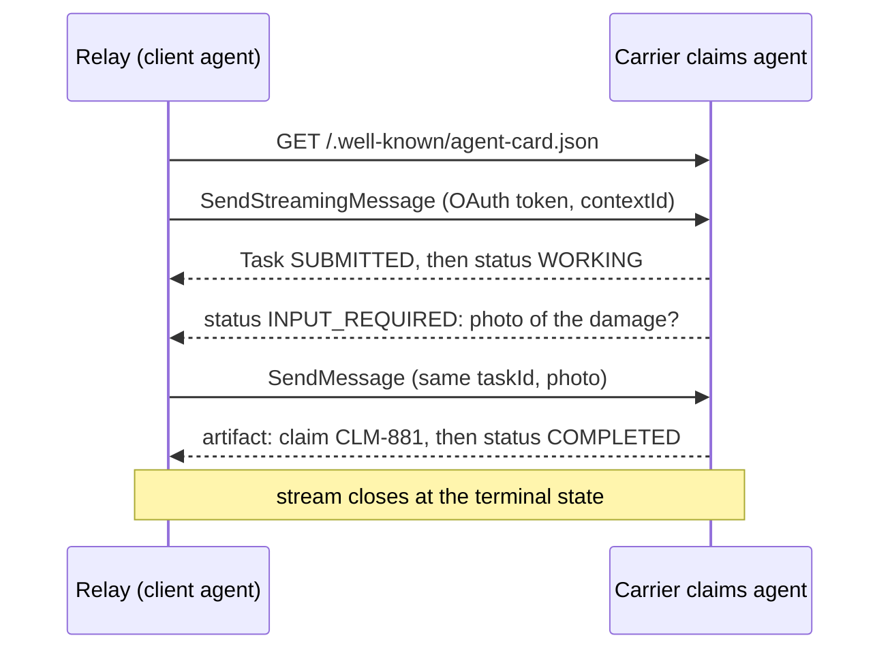

## Why this is a different problem

[Week 1](#w1-agents) covered multi-agent systems inside one codebase: one team owns every prompt, every tool and every trace, and a sub-agent is a function call with a model inside. Inside a company that stops being true quickly. The returns team builds a returns agent, finance builds a refunds agent, IT builds an access agent, and a carrier sells a tracking agent to every retailer it serves. Your agent now calls agents you did not write, cannot read, and do not deploy.

Four things change at that boundary:

1. **You cannot see inside.** You do not know the other agent's prompt, model, tools or memory. You see what it advertises and what it returns.
2. **It is not your trust domain.** Its output is input from a stranger, exactly like a web page or an email.
3. **Authority has to travel.** The other agent needs to know who it is acting for, and that must not mean handing it your user's full credentials.
4. **Cost and latency compound.** Every hop is at least one full agent run, owned and billed by someone else, with its own failure rate.

This lesson takes each in turn: the protocol that makes agents callable across boundaries, when to use it instead of a tool, the orchestration shapes and their failure modes, trust and delegated authority, and the arithmetic of delegation.

## A2A in depth

The [Agent2Agent protocol](https://a2a-protocol.org/latest/specification/) (A2A) is an open standard for one agent to call another without either exposing its internals. Week 1 introduced it; here is how it works. Everything below is checked against the [version 1.0.0 specification](https://a2a-protocol.org/v1.0.0/specification/), the latest release at the time of writing. The specification's own phrase is that agents collaborate "without needing access to each other's internal state, memory, or tools".

### The Agent Card: what an agent says about itself

Every A2A agent publishes an **Agent Card**, a JSON document that describes it. The specification makes eight fields required: `name`, `description`, `supportedInterfaces`, `version`, `capabilities`, `defaultInputModes`, `defaultOutputModes` and `skills`. Each skill needs an `id`, `name`, `description` and `tags`. Each interface names a `url`, a `protocolBinding` (the core ones are `JSONRPC`, `GRPC` and `HTTP+JSON`) and a `protocolVersion`.

Here is a card for a fictional carrier's claims agent that Relay might call:

```json
{
  "name": "Parcel claims agent",
  "description": "Opens and tracks claims for lost or damaged parcels shipped with the carrier.",
  "version": "2.3.0",
  "supportedInterfaces": [
    {"url": "https://agents.carrier.example/a2a/v1", "protocolBinding": "JSONRPC", "protocolVersion": "1.0"}
  ],
  "capabilities": {"streaming": true, "pushNotifications": true, "extendedAgentCard": true},
  "securitySchemes": {
    "carrier_oauth": {
      "oauth2SecurityScheme": {
        "flows": {"clientCredentials": {
          "tokenUrl": "https://auth.carrier.example/oauth/token",
          "scopes": {"claims:write": "Open and update claims"}
        }}
      }
    }
  },
  "securityRequirements": [{"schemes": {"carrier_oauth": {"list": ["claims:write"]}}}],
  "defaultInputModes": ["text/plain", "application/json"],
  "defaultOutputModes": ["application/json"],
  "skills": [
    {"id": "open-claim", "name": "Open a parcel claim",
     "description": "Opens a claim for a lost or damaged parcel given a tracking number and a description.",
     "tags": ["claims", "shipping"]}
  ]
}
```

A security scheme is a union with exactly one of `apiKeySecurityScheme`, `httpAuthSecurityScheme`, `oauth2SecurityScheme`, `openIdConnectSecurityScheme` or `mtlsSecurityScheme`, modelled on the OpenAPI security scheme object. `securityRequirements` says which schemes and scopes a caller must present; a skill may add its own.

**Discovery.** The standard place for a public card is `https://{server_domain}/.well-known/agent-card.json`. Details that should not be public, such as extra skills for partners, go in an **extended card** that the caller fetches with the Get Extended Agent Card operation, which the specification says "MUST require authentication". Inside a company you rarely discover agents by guessing domains: you look them up in a registry. Atlas, the course's registry, accepts A2A cards, checks the required fields from section 4.4 of the specification (`platform/atlas/atlas/kinds.py`), blocks cards with plain HTTP endpoints, and by default blocks agents that declare no `securitySchemes` at all.

**Signed cards.** A card can carry `signatures`: JWS signatures ([RFC 7515](https://www.rfc-editor.org/rfc/rfc7515)) over the card canonicalized with JCS ([RFC 8785](https://www.rfc-editor.org/rfc/rfc8785)). A card fetched over HTTPS proves which server sent it; a signature proves which organisation vouched for it, which matters once cards are copied into registries and caches.

### Tasks and their lifecycle

You talk to an agent by sending a **Message** (role `ROLE_USER` from the caller, `ROLE_AGENT` from the agent) made of parts: text, files or structured data. The agent may answer with a Message directly, for quick interactions, or create a **Task**: a unit of work with an ID, a status, a history and **artifacts** (its outputs). A `contextId` groups related tasks and messages into one conversation; servers may generate it, and callers should treat server-generated values as opaque.

```viz
caption: A task moves forward until it lands in one of four terminal states. Two interrupted states hand control back to the caller, who continues the same task with another message.
<div class="vz-row"><span class="ch sk c">SUBMITTED</span><span class="arr sk c"></span><span class="ch sk c">WORKING</span><span class="arr sk"></span><span class="ch sk g">COMPLETED</span></div>
<div class="vz-cols">
  <div class="vz-panel sk"><h5>Interrupted: caller acts</h5>
    <div class="vz-row"><span class="ch sk ghost">INPUT_REQUIRED</span><span>needs an answer</span></div>
    <div class="vz-row"><span class="ch sk ghost">AUTH_REQUIRED</span><span>needs credentials</span></div>
    <p>send a message with the same taskId; work resumes</p>
  </div>
  <div class="vz-panel sk b"><h5>Terminal: no more messages</h5>
    <div class="vz-row"><span class="ch sk g">COMPLETED</span><span class="ch sk b">FAILED</span></div>
    <div class="vz-row"><span class="ch sk b">CANCELED</span><span class="ch sk b">REJECTED</span></div>
    <p>a follow-up starts a new task in the same contextId</p>
  </div>
</div>
<div class="vz-src">States from the <a href="https://a2a-protocol.org/v1.0.0/specification/">A2A 1.0.0 specification</a>, section 4.1.3, shown without their <code>TASK_STATE_</code> prefix.</div>
```

The states are `TASK_STATE_SUBMITTED`, `WORKING`, `INPUT_REQUIRED`, `AUTH_REQUIRED`, `COMPLETED`, `FAILED`, `CANCELED` and `REJECTED` (all with the `TASK_STATE_` prefix on the wire). Messages sent to a task in a terminal state are refused with an `UnsupportedOperationError`, so a finished task is a fixed record you can audit.

The operations are small: **Send Message**, **Send Streaming Message**, **Get Task**, **List Tasks**, **Cancel Task**, **Subscribe to Task**, four operations to create, get, list and delete push notification configurations, and **Get Extended Agent Card**. Each exists in all three bindings; over JSON-RPC the method names are `SendMessage`, `SendStreamingMessage`, `GetTask` and so on, and over HTTP+JSON they become routes such as `POST /message:send` and `GET /tasks/{id}`.

### Three ways to wait for the result

A task can take seconds or days, and A2A offers three ways to follow it.

1. **Blocking.** By default Send Message waits until the task reaches a terminal or interrupted state. Setting `returnImmediately` in the request configuration returns the task at once instead, and you poll with Get Task.
2. **Streaming.** If the card says `"streaming": true`, Send Streaming Message returns a Server-Sent Events stream. It starts with the Task, then carries `TaskStatusUpdateEvent` and `TaskArtifactUpdateEvent` objects, and closes when the task reaches a terminal state. If the connection drops, Subscribe to Task reattaches.
3. **Push notifications.** If the card says `"pushNotifications": true`, you register a webhook: a `url`, an optional `token`, and `authentication` details. The agent then POSTs updates to it, with no open connection on your side. This is the right shape for tasks that wait on people.



Push notifications turn the agent into an HTTP client of yours, which brings two obligations from section 13.2 of the specification. The agent "SHOULD validate webhook URLs to prevent SSRF" (server-side request forgery): reject private ranges, localhost and link-local addresses, and use allow-lists where possible, because otherwise any caller can make your agent POST into your own network. The receiver "MUST validate webhook authenticity" using the configured credentials, should check the task ID is one it created, and should process notifications idempotently, because duplicates happen.

> [!warn] Blocking is the default, and a blocking call to an agent in another company has no natural upper bound on its duration. Set your own deadline on every call, prefer streaming or push for anything that might wait on a person, and call Cancel Task when your deadline passes so the other side stops spending.

### Security in the protocol

A2A authenticates at the HTTP layer with the schemes the card declares; credentials do not travel inside messages. Section 13.1 adds one rule worth copying into any multi-tenant agent: authorization checks "MUST occur before any database queries or operations that could leak information about the existence of resources outside the caller's authorization scope", and listing tasks must be scoped to the caller even when no filter is given. The protocol leaves the authorization model itself to each agent. It also defines an optional `tenant` field on interfaces and requests, described as an opaque routing identifier, not an isolation control. Lesson 2 of this week covers isolation.

## MCP or A2A?

Both protocols let one program call another across a boundary, and teams argue about which to use. The A2A project's own framing is short: [MCP is for agent-to-tool communication; A2A is for agent-to-agent communication](https://a2a-protocol.org/latest/topics/a2a-and-mcp/). In practice the question is who decides the next step.

```viz
caption: The deciding question is who chooses the next step. With a tool, your model does. With an agent, the other side does, and it may come back with a question.
<div class="vz-cols">
  <div class="vz-panel sk c"><h5>MCP tool: you decide</h5>
    <div class="vz-row"><span class="ch sk c">your model</span><span class="arr sk c"></span><span class="ch sk">get_tracking(id)</span><span class="arr sk"></span><span class="ch sk">JSON result</span></div>
    <p>one call, one schema, usually seconds</p>
    <p>stateless; your loop owns the plan</p>
  </div>
  <div class="vz-panel sk m"><h5>A2A agent: it decides</h5>
    <div class="vz-row"><span class="ch sk c">your model</span><span class="arr sk m"></span><span class="ch sk m">claims agent</span><span class="arr sk m"></span><span class="ch sk m">its own tools</span></div>
    <p>a task with states, questions back, artifacts</p>
    <p>minutes to days; its loop owns the plan</p>
  </div>
</div>
```

> [!rule] Expose a capability as an MCP tool when the caller should decide each step and the call has a fixed schema. Expose it as an A2A agent when the callee must plan, keep state, ask questions back or run for a long time. If in doubt, start with a tool: it is cheaper, faster and easier to test.

The two compose. The carrier's claims agent is an A2A agent to Relay, and internally it uses MCP tools for its own database. Relay's `track_package` is an MCP tool (Lab 5's carrier server) because looking up a tracking number is one deterministic call; opening a disputed claim, which needs photos and a human adjuster, is an agent. Do not wrap a single function in an agent: you add a second model's cost, latency and failure modes to a lookup.

## Orchestration patterns and how they fail

Week 1 named three topologies. Across team boundaries they behave like this:

| Pattern | Shape | Who owns the user | Typical enterprise use |
|---|---|---|---|
| Supervisor | One agent plans, calls specialists, merges their results | The supervisor, throughout | A helpdesk agent that asks the IT, HR and billing agents |
| Handoff | One agent transfers the conversation to another, with a summary | Whoever holds it now | Triage passes a refund dispute to the finance agent |
| Pipeline | A fixed sequence of agents, each consuming the last one's artifact | Nobody: it is a job | Intake, then classification, then fulfilment |

The best evidence on how these fail is [Why Do Multi-Agent LLM Systems Fail?](https://arxiv.org/abs/2503.13657) (Cemri and colleagues; version 3, October 2025). The authors annotated more than 1,600 traces from seven open multi-agent frameworks, including MetaGPT, ChatDev, Magentic-One and OpenManus, and grouped the failures into the **MAST** taxonomy: 14 failure modes in 3 categories, with an inter-annotator agreement (kappa) of 0.88.

```viz
caption: The most common failures are about stopping, repeating and checking, not about the model being too weak. Each one has a protocol-level or platform-level control.
<div class="vz-bars"><span>FM-1.3 step repetition</span><span class="bar sk"><i class="sk b" style="--w:100%"></i></span><b>15.7%</b><span>FM-2.6 reasoning-action mismatch</span><span class="bar sk"><i class="sk b" style="--w:84%"></i></span><b>13.2%</b><span>FM-1.5 unaware of termination</span><span class="bar sk"><i class="sk b" style="--w:79%"></i></span><b>12.4%</b><span>FM-1.1 disobey task specification</span><span class="bar sk"><i class="sk b" style="--w:75%"></i></span><b>11.8%</b><span>FM-3.3 incorrect verification</span><span class="bar sk"><i class="sk b" style="--w:58%"></i></span><b>9.1%</b><span>FM-3.2 no or incomplete verification</span><span class="bar sk"><i class="sk b" style="--w:52%"></i></span><b>8.2%</b><span>FM-2.3 task derailment</span><span class="bar sk"><i class="sk b" style="--w:47%"></i></span><b>7.4%</b></div>
<div class="vz-cols" style="--k:3">
  <div class="vz-panel sk"><h5>System design</h5><p class="big b">44.2%</p><p>five modes</p></div>
  <div class="vz-panel sk"><h5>Inter-agent misalignment</h5><p class="big b">32.4%</p><p>six modes</p></div>
  <div class="vz-panel sk"><h5>Task verification</h5><p class="big b">23.5%</p><p>three modes</p></div>
</div>
<div class="vz-src">Share of observed failures per mode, from Cemri et al., <a href="https://arxiv.org/abs/2503.13657">Why Do Multi-Agent LLM Systems Fail?</a> (v3). Category totals are the sums of their modes.</div>
```

The paper also tried simple fixes. In ChatDev, clearer role specifications raised task success by 9.4%, and adding a high-level check that the result met the task's objective raised it by 15.6%, with the same model and prompt. The authors note that these interventions help but leave many failures unresolved. Across team boundaries, the most useful reading is which control addresses which mode:

| MAST mode | What it looks like between teams | Control |
|---|---|---|
| Unaware of termination (FM-1.5), step repetition (FM-1.3) | Two agents keep asking each other; a supervisor re-delegates the same subtask | Depth limit, hop budget, cycle check on the delegation chain, task IDs as idempotency keys |
| Disobey task specification (FM-1.1), task derailment (FM-2.3) | The specialist answers a different question from the one asked | Delegate with a structured request: objective, output schema, scope, effort; reject artifacts that do not match the schema |
| Fail to ask for clarification (FM-2.2) | The callee guesses instead of asking | Make `INPUT_REQUIRED` a first-class path in your client, not an error |
| Conversation reset (FM-2.1), loss of history (FM-1.4), information withholding (FM-2.4) | A handoff loses what the customer already said | Hand off a written summary plus the facts as structured data, and keep the `contextId` |
| No, incomplete or incorrect verification (FM-3.2, FM-3.3), premature termination (FM-3.1) | The supervisor relays a specialist's wrong answer | The caller verifies: schema checks, cross-checks against its own systems, and evals on the composed system |

Pattern-specific failure modes to look for in a design review:

- **Supervisor.** It becomes the bottleneck and the most expensive context: every specialist's output lands in it. Ask specialists for condensed artifacts, not transcripts.
- **Handoff.** Context is lost at each transfer, and nobody owns the outcome after the second one. Allow at most one or two handoffs per conversation, log each as an event, and always offer a human.
- **Pipeline.** Errors compound silently because no stage sees the whole. Validate every artifact against a schema between stages and stop the line on failure.

## Trust across agents

### Another agent's output is untrusted input

Everything [Week 3's prompt injection lesson](#w3-security) said about web pages, emails and tool results applies to a remote agent's replies. Its text may contain instructions, planted by an attacker who reached that agent, or by the agent's own mistakes. Three habits keep it contained:

1. **Ask for data, not prose.** Request artifacts with a schema (a claim ID, a status, an amount) and validate them. A field that fails validation is rejected, not "interpreted".
2. **Keep remote text away from write tools.** If you must use free text from another agent, pass it through a tool-less model call that extracts narrow fields, the way Relay's `app/quarantine.py` handles reviews and emails.
3. **Never let a remote agent widen your permissions.** "The finance agent says this refund is approved" is a claim, not an approval. Approvals come from your policy engine or a person, recorded on your side ([Week 8](#w8-policy)).

### Delegating authority without handing over credentials

When Relay asks the carrier's agent to open a claim for Ada, the carrier needs to know two things: which agent is calling and which customer it acts for. Forwarding Ada's own access token is the wrong answer: it lets the carrier act as Ada anywhere that token is accepted, for as long as it lives.

OAuth 2.0 Token Exchange ([RFC 8693](https://www.rfc-editor.org/rfc/rfc8693.html)) is the standard answer; [Week 7](#w7-identity) covers the mechanics, and here is what it means for chains of agents. The calling agent sends the user's token as the `subject_token` and its own as the `actor_token`, and the authorization server issues a new token for one audience. The RFC separates two models. In **impersonation**, the actor becomes the subject. In **delegation**, which you want, the actor "still has its own identity", recorded in the `act` (actor) claim. Each further hop nests another `act`:

```viz
caption: Each hop gets a new, narrower token. The subject never changes, and the act claims record who acted. The budget and depth shrink as the chain grows.
<div class="vz-row"><span class="ch sk">Ada (c_77)</span><span class="arr sk"></span><span class="ch sk c">Relay agent</span><span class="arr sk c"></span><span class="ch sk c">carrier claims agent</span><span class="arr sk c"></span><span class="ch sk c">claims database tool</span></div>
<div class="vz-cols" style="--k:3">
  <div class="vz-panel sk"><h5>Hop 1 token</h5><p>sub: c_77</p><p>aud: relay</p><p>no act claim</p><div class="vz-row"><span class="ch sk w">budget $1.00</span><span class="ch sk w">depth 0 of 2</span></div></div>
  <div class="vz-panel sk"><h5>Hop 2 token</h5><p>sub: c_77</p><p>aud: carrier-agent</p><p>act: {sub: relay}</p><div class="vz-row"><span class="ch sk w">budget $0.30</span><span class="ch sk w">depth 1 of 2</span></div></div>
  <div class="vz-panel sk"><h5>Hop 3 token</h5><p>sub: c_77</p><p>aud: claims-db</p><p>act: {sub: carrier-agent, act: {sub: relay}}</p><div class="vz-row"><span class="ch sk w">budget $0.10</span><span class="ch sk w">depth 2 of 2</span></div></div>
</div>
<div class="vz-row"><span class="ch sk b">hop 4 refused: depth limit</span><span class="ch sk b">relay seen in chain: cycle</span></div>
<div class="vz-src">Claim shapes from <a href="https://www.rfc-editor.org/rfc/rfc8693.html">RFC 8693</a>, section 4.1. Budget and depth values are an example policy, not part of the RFC.</div>
```

The RFC is precise about how to read the chain: "the outermost `act` claim represents the current actor", and prior actors "are informational only" for access control. So each hop authorizes on the subject and the current actor, and keeps the full chain for the audit log. Checkpoint, the course's tool gateway, already uses this shape: the assertion it sends to an MCP server has `sub` set to the user, `act.sub` to the agent, an `aud` for that one server and a 60-second lifetime (`platform/checkpoint/checkpoint/identity.py`). It signs the assertion itself rather than calling an identity provider's token exchange endpoint, which its README lists as not built yet.

### Budgets and depth limits stop loops

Agents that can call agents can call each other forever: A asks B for a policy check, B asks A for the order details, A asks B again. MAST's two most common modes, step repetition and not knowing when to stop, are exactly this. Prompts do not fix it; limits enforced in code do. Pass three values down with every delegation and enforce them on both sides:

- **Depth.** The number of hops so far. Refuse to delegate beyond a fixed maximum (two is plenty for most enterprise flows).
- **Budget.** The money (or tokens) left for this request. A child receives at most a share of what its parent has left, and refuses work it cannot afford. Switchboard enforces the hard backstop: every internal agent has its own app key with a monthly budget and per-minute limits, so a runaway agent hits a 429, not your invoice.
- **Deadline.** An absolute time, not a timeout per hop, so that three hops of 30 seconds cannot become 90.

Add a cycle check: if your own agent ID already appears in the incoming chain of `act` claims, refuse. That reads the chain for loop detection, not for granting access, so it is consistent with the RFC.

## The cost and latency of delegation

Delegation buys specialisation and ownership boundaries; it is paid for in tokens, seconds and reliability. Here are the numbers for one Relay turn, at the course's list prices for the large model ($4 per million input tokens, $20 per million output tokens, as in [Week 1](#w1-agents)), before caching. Assume every model call takes 3 seconds; that is an assumption for the example, not a measurement.

| Design | Model calls | Cost per turn | Wall-clock time |
|---|---|---|---|
| One agent: 4 calls of 8,000 in and 400 out | 4 | 4 × (8,000 × $4 + 400 × $20) / 1M = **$0.16** | 4 × 3 s = **12 s** |
| Supervisor (plan and merge, 2 calls of 6,000 in and 400 out) plus 2 specialists in parallel, 4 calls each | 10 | $0.064 + 2 × $0.16 = **$0.384** | 3 + 12 + 3 = **18 s** |
| Handoff chain: triage, then specialist A, then specialist B, then a final reply | 10 | about **$0.384** | 3 + 12 + 12 + 3 = **30 s** |

```viz
caption: The same turn delegated two ways. Splitting the work costs 2.4 times as much either way; running the specialists in parallel keeps the wait to 1.5 times instead of 2.5.
<div class="vz-cols">
  <div class="vz-panel sk"><h5>Cost per turn</h5>
    <div class="vz-bars"><span>one agent</span><span class="bar sk"><i class="sk w" style="--w:42%"></i></span><b>$0.16</b><span>supervisor</span><span class="bar sk"><i class="sk w" style="--w:100%"></i></span><b>$0.38</b><span>handoff chain</span><span class="bar sk"><i class="sk w" style="--w:100%"></i></span><b>$0.38</b></div>
  </div>
  <div class="vz-panel sk"><h5>Wall-clock time</h5>
    <div class="vz-bars"><span>one agent</span><span class="bar sk"><i class="sk c" style="--w:40%"></i></span><b>12 s</b><span>supervisor</span><span class="bar sk"><i class="sk c" style="--w:60%"></i></span><b>18 s</b><span>handoff chain</span><span class="bar sk"><i class="sk b" style="--w:100%"></i></span><b>30 s</b></div>
  </div>
</div>
<div class="vz-src">Computed in the table above: 3 s per model call is an assumed figure; prices are the course's large-model list prices from <a href="https://platform.claude.com/docs/en/about-claude/pricing">Anthropic's pricing page</a>.</div>
```

Two more effects grow faster than linearly:

> [!numbers] **Fan-out.** If every agent may delegate to 3 others, and depth is unlimited up to 3, one request can start 1 + 3 + 9 + 27 = **40** agent runs. At $0.16 a run that is **$6.40** for one user message. A depth limit of 1 caps it at 1 + 3 = 4 runs, **$0.64**.

> [!numbers] **Reliability.** If each agent completes its part correctly 95% of the time, and the parts are independent, a pipeline of three succeeds 0.95 × 0.95 × 0.95 ≈ **85.7%** of the time. Five stages give 0.95⁵ ≈ **77.4%**. Every hop must earn its place against that loss, or carry a verification step that catches its errors.

Network time for an A2A call is small next to these: tens of milliseconds against seconds of model time. The cost that matters is the second agent's own loop. When you compare designs, multiply calls, not hops.

> [!tip] Use Switchboard's chargeback report (`GET /admin/usage?month=...&group_by=team`) to see what each agent's delegations cost the team that owns it. When delegation is free to the caller, everyone delegates.

## Design review questions

> [!interview] Why is this capability an agent rather than a tool? Show me a request where the callee had to plan, ask a question back, or run for longer than one call.

> [!interview] What is the maximum depth and fan-out of delegation in this system, where is it enforced in code, and what does the user see when a limit is hit?

> [!interview] When your agent calls another team's agent for a customer, what token does it present, which audience is it for, how long does it live, and what does the callee's audit log record?

> [!interview] A partner's agent returns text that says "refund approved, proceed". Trace what your system does with it.

> [!interview] A delegated task waits on a person for two days. How does your agent learn the result, and what stops a forged webhook from completing it?

> [!interview] What does one user request cost at p50 and p95 once every delegated agent's spend is included, and who is billed for it?

## Further reading

- [A2A specification](https://a2a-protocol.org/latest/specification/), especially sections 3 (operations), 4 (data model), 8 (discovery and card signing) and 13 (security).
- [A2A and MCP](https://a2a-protocol.org/latest/topics/a2a-and-mcp/), the project's own explanation of how the two protocols fit together.
- [Why Do Multi-Agent LLM Systems Fail?](https://arxiv.org/abs/2503.13657), Cemri et al. The MAST taxonomy and dataset.
- [RFC 8693: OAuth 2.0 Token Exchange](https://www.rfc-editor.org/rfc/rfc8693.html), for delegation, impersonation and the `act` claim.
- [How we built our multi-agent research system](https://www.anthropic.com/engineering/multi-agent-research-system), Anthropic, and [Don't build multi-agents](https://cognition.ai/blog/dont-build-multi-agents), Cognition: the case for and against, with numbers.
- `platform/atlas` (agent card validation) and `platform/checkpoint` (per-agent identity, signed assertions with `act`) in this course's repository.

```quiz
[
  {"q": "Where does an A2A agent publish its public Agent Card by convention?", "options": ["/agent.json", "/.well-known/agent-card.json", "/a2a/card", "Only in a registry"], "answer": 1, "why": "The specification defines https://{server_domain}/.well-known/agent-card.json. Details that should not be public go in an extended card, which requires authentication."},
  {"q": "A delegated task is in TASK_STATE_INPUT_REQUIRED. What should the calling agent do?", "options": ["Treat it as a failure and retry from scratch", "Answer with a new message on the same taskId, or ask its user", "Cancel the task", "Wait for COMPLETED"], "answer": 1, "why": "INPUT_REQUIRED is an interrupted state: the callee needs something. Continuing the same task is the protocol's way of asking for clarification, a failure mode MAST counts when it is skipped."},
  {"q": "Which capability should be an MCP tool rather than an A2A agent?", "options": ["Opening a disputed parcel claim that needs photos and a human adjuster", "Looking up the status of a tracking number", "Negotiating a delivery slot with a customer over several days", "Investigating a payment dispute across three systems"], "answer": 1, "why": "A tracking lookup is one deterministic call with a fixed schema, so the caller's model should decide when to make it. The others need the callee to plan, keep state or wait."},
  {"q": "A token carries act: {sub: carrier-agent, act: {sub: relay}}. Under RFC 8693, who is the current actor?", "options": ["relay", "carrier-agent", "The subject", "Both equally"], "answer": 1, "why": "The outermost act claim is the current actor. Nested actors are informational for access control, though you can still log them and use them to detect cycles."},
  {"q": "Every agent may delegate to 3 others, with delegation allowed to depth 3. How many agent runs can one request start?", "options": ["4", "9", "13", "40"], "answer": 3, "why": "1 + 3 + 9 + 27 = 40. A depth limit of 1 cuts it to 4. Fan-out and depth limits belong in code, not in prompts."},
  {"q": "In the MAST study, what kind of failure was most common?", "options": ["Network errors between agents", "Model refusals", "Failures of stopping, repetition and verification, such as step repetition and not knowing when to terminate", "Tokenizer mismatches"], "answer": 2, "why": "Step repetition (15.7%), reasoning-action mismatch (13.2%) and unawareness of termination conditions (12.4%) lead the list. Limits, schemas and verification steps address them."},
  {"q": "Your agent registers a push notification webhook with a partner's agent. What must your webhook receiver do?", "options": ["Accept any POST that names a known task", "Validate the configured credentials, check the task ID is one you created, and handle duplicates idempotently", "Reply with the task's artifacts", "Disable TLS for speed"], "answer": 1, "why": "Section 13.2 of the specification requires clients to validate webhook authenticity and recommends checking task IDs and idempotent processing, because duplicates can occur."}
]
```
