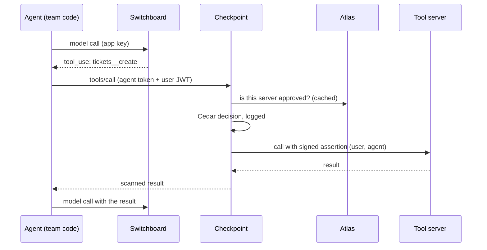

## Why it matters

By the time a company runs its fifth agent, it usually has five ways of calling a model, five places where provider keys live, five home-made eval scripts and no single answer to "which agents can issue refunds?". Each team made sensible local choices. Together they add up to duplicated work, inconsistent controls and an audit nobody can complete.

Platform engineering answers this the same way it did for microservices: a small team builds the shared parts once, as a product, and makes them the easiest way to ship. The CNCF's [platforms white paper](https://tag-app-delivery.cncf.io/whitepapers/platforms/) defines a platform as "an integrated collection of capabilities defined and presented according to the needs of the platform's users", and calls the ready-made route through it a **golden path**: a reusable workflow offered with "an initial project template and documentation". This lesson calls it the **paved path**.

Weeks 7 to 9 built the parts: Switchboard (model gateway), Checkpoint (tool gateway with identity and policy) and Atlas (registry). This lesson is about turning them into something teams choose to use.

## The paved path for agent teams

An agent team should write only what is specific to its problem: the prompts, the tools that touch its own systems, its eval cases and its user experience. Everything else comes from the platform.

```viz
caption: The team writes the top layer. Everything below it is shared, built once and run by the platform team.
<div class="vz-panel sk c"><h5>The agent team writes</h5>
  <div class="vz-row"><span class="ch sk c">prompts</span><span class="ch sk c">domain tools</span><span class="ch sk c">eval cases</span><span class="ch sk c">user experience</span></div>
</div>
<span class="arr d sk"></span>
<div class="vz-panel sk m"><h5>The platform provides</h5>
  <div class="vz-row"><span class="ch wide sk m">templates and golden pipeline: repo, CI, eval gate, deploy</span></div>
  <div class="vz-row"><span class="ch sk m">Switchboard: models, keys, budgets</span><span class="ch sk m">Checkpoint: identity, policy, approvals</span><span class="ch sk m">Atlas: registry, review</span></div>
  <div class="vz-row"><span class="ch sk m">eval runner and judges</span><span class="ch sk m">traces, metrics, dashboards</span><span class="ch sk m">portal and scorecards</span></div>
</div>
<p>the team never holds a provider key or a tool server credential</p>
```

| Capability | What the agent team gets | Reference service |
|---|---|---|
| Model gateway | One endpoint and one key per app, any provider, fallbacks, prompt caching left intact | [Switchboard](https://github.com/Rachneet/ai-system-design-course/tree/main/platform/switchboard) |
| Metering and budgets | Cost per request in a ledger, monthly budgets per org, team and app | Switchboard |
| Agent identity | A token per agent; the user's identity travels with every tool call | [Checkpoint](https://github.com/Rachneet/ai-system-design-course/tree/main/platform/checkpoint) |
| Policy and approvals | Cedar rules per tool and argument; risky calls held for a person; every decision logged | Checkpoint |
| Registry | Publish an MCP server, agent card or skill; automated checks; second-person review | [Atlas](https://github.com/Rachneet/ai-system-design-course/tree/main/platform/atlas) |
| Evals | A runner, calibrated judges, a CI gate and a place to store baselines | Relay's `evals/` packaged as a library |
| Observability | OpenTelemetry traces across agent, gateway and tools; standard dashboards and alerts | Collector config and dashboards from Lab 5 |
| Templates and pipeline | A new agent repository that already passes every check above | This lesson |

One request on the paved path touches all three services, and the agent's code only knows two URLs.



> [!rule] An agent team should be able to ship to staging without ever seeing a provider key, a tool server credential or a policy engine. If they need one, the paved path has a hole.

## Templates and golden pipelines

The template is where the platform becomes real. Running "new agent" in the portal or the command line should produce a repository that builds, deploys to staging and passes its gates on day one, with placeholders where the team's work goes.

```text
helpdesk-it-agent/
  agent/            # the loop, wired to Switchboard and Checkpoint by environment variables
  prompts/system.md
  skills/           # SKILL.md packages, published to Atlas by CI
  agent-card.json   # A2A agent card, published to Atlas by CI
  policy/agent.cedar  # proposed rules for this agent's tools, reviewed by the platform team
  evals/cases/      # 20 starter cases: happy path, refusal, injection, cross-user access
  readiness.yaml    # scorecard checks (below)
  catalog-info.yaml # portal entry
  .github/workflows/  # the golden pipeline, imported, not copied
```

The **golden pipeline** is a shared, versioned workflow that every agent repository imports. Copying it into each repository looks simpler, but then every fix to the pipeline needs fifty pull requests.

```viz
caption: The golden pipeline adds three agent-specific gates to the Week 4 pipeline: an eval gate, a red-team gate and registry review before anything new reaches production.
<div class="vz-row"><span class="ch sk c">lint, unit tests</span><span class="arr sk"></span><span class="ch sk c">eval gate</span><span class="arr sk"></span><span class="ch sk c">red-team gate</span><span class="arr sk"></span><span class="ch sk c">build, scan, SBOM</span></div>
<div class="vz-row"><span class="arr sk"></span><span class="ch sk m">publish to Atlas</span><span class="arr sk"></span><span class="ch sk m">second-person review</span><span class="arr sk"></span><span class="ch sk m">policy PR to Checkpoint</span><span class="arr sk"></span><span class="ch sk g">canary, then 100%</span></div>
<div class="vz-cols" style="--k:3">
  <div class="vz-panel sk"><h5>Every change</h5><p>code, prompt, model pin or skill runs the eval gate</p></div>
  <div class="vz-panel sk"><h5>New tools or skills</h5><p>Atlas checks, then a reviewer who is not the author</p></div>
  <div class="vz-panel sk"><h5>New permissions</h5><p>a Cedar change reviewed by the platform or security team</p></div>
</div>
```

The [CI/CD lesson](#w4-cicd) covers the first half. What is new is that the registry review and the policy change are **pipeline stages**, not tickets in another team's queue. A team proposes a Cedar rule in its own repository; the pipeline opens a pull request against Checkpoint's policy file, and the platform team reviews it like any other code.

## The internal developer portal

A platform people cannot see is a platform people work around. An **internal developer portal** is the front door: one place to find every agent, who owns it, what it may do and whether it is ready.

[Backstage](https://backstage.io/docs/overview/what-is-backstage), created at Spotify and now a CNCF incubating project, is the most common open-source choice. Its core features map onto agent platforms directly:

| Backstage feature | Use for agents |
|---|---|
| [Software Catalog](https://backstage.io/docs/features/software-catalog/) | Every agent, MCP server and skill as an entity, with owner, lifecycle and links to traces and dashboards |
| [Software Templates](https://backstage.io/docs/features/software-templates/) | The "new agent" template above, filled in by a form |
| [TechDocs](https://backstage.io/docs/features/techdocs/) | Design docs, runbooks and ADRs rendered from the repository |
| Plugins | Panels for Switchboard spend, Checkpoint decisions and eval results |

> [!warn] Keep one source of truth for approval. Atlas decides what is approved; the portal **displays** it. If the portal and the registry can disagree about whether a tool server is approved, an auditor will find the case where they did.

A portal entry for an agent might look like this, with Atlas and Switchboard identifiers as annotations so plugins can fetch live data:

```yaml
# catalog-info.yaml
apiVersion: backstage.io/v1alpha1
kind: Component
metadata:
  name: helpdesk-it-agent
  annotations:
    atlas/agent-card: helpdesk/it-agent@1.4.0
    switchboard/app-id: it-desk-prod
spec:
  type: agent          # a custom type; Backstage accepts any string here
  lifecycle: production
  owner: team-it-support
  system: helpdesk-os
```

## Scorecards: production readiness as code

The [readiness lesson](#w6-readiness) gave you a checklist. A checklist in a document is checked once, at launch. A **scorecard** checks the same things continuously, from data the platform already has, and shows the result next to the agent in the portal.

Backstage's open-source [Tech Insights plugin](https://github.com/backstage/community-plugins/tree/main/workspaces/tech-insights) works this way: **fact retrievers** collect facts about each entity on a schedule, **checks** turn facts into pass or fail, and scorecards group checks. Commercial portals offer the same model.

```yaml
# readiness.yaml: each check reads a fact the platform already records
level: production
checks:
  owner_on_call:      {fact: catalog.owner.oncall, is: set}
  traffic_via_gateway: {fact: switchboard.direct_provider_calls_7d, equals: 0}
  tools_via_checkpoint: {fact: checkpoint.unlisted_tool_hosts_7d, equals: 0}
  artifacts_approved: {fact: atlas.unapproved_dependencies, equals: 0}
  eval_gate_green:    {fact: ci.eval_gate.last_main, is: pass}
  red_team_recent:    {fact: ci.red_team.age_days, max: 30}
  budget_set:         {fact: switchboard.app.budget_usd_month, is: set}
  runbook_linked:     {fact: techdocs.runbook, is: set}
  model_pinned:       {fact: repo.models_yaml.uses_alias, equals: false}
```

```viz
caption: Four agents against the same nine checks. The scorecard turns "is it production ready?" from an argument into a row you can read.
<div class="vz-row"><b>it-agent</b><div class="cells" style="--n:9"><i class="sk g"></i><i class="sk g"></i><i class="sk g"></i><i class="sk g"></i><i class="sk g"></i><i class="sk g"></i><i class="sk g"></i><i class="sk g"></i><i class="sk g"></i></div><span class="ch sk g">9 of 9</span></div>
<div class="vz-row"><b>hr-agent</b><div class="cells" style="--n:9"><i class="sk g"></i><i class="sk g"></i><i class="sk g"></i><i class="sk g"></i><i class="sk g"></i><i class="sk b"></i><i class="sk g"></i><i class="sk g"></i><i class="sk g"></i></div><span class="ch sk">8 of 9: red-team stale</span></div>
<div class="vz-row"><b>billing-agent</b><div class="cells" style="--n:9"><i class="sk g"></i><i class="sk b"></i><i class="sk g"></i><i class="sk g"></i><i class="sk g"></i><i class="sk g"></i><i class="sk b"></i><i class="sk g"></i><i class="sk g"></i></div><span class="ch sk b">direct provider calls</span></div>
<div class="vz-row"><b>returns-agent</b><div class="cells" style="--n:9"><i class="sk g"></i><i class="sk g"></i><i class="sk g"></i><i class="sk b"></i><i class="sk g"></i><i class="sk g"></i><i class="sk g"></i><i class="sk b"></i><i class="sk g"></i></div><span class="ch sk">7 of 9</span></div>
<p>columns: owner, gateway, Checkpoint, Atlas, eval gate, red-team, budget, runbook, pinned model</p>
```

Two design choices make scorecards trusted rather than resented:

1. **Every check reads a fact, never a self-declaration.** "Uses the gateway" is not a checkbox the team ticks; it is zero direct calls to provider domains in the egress logs for seven days.
2. **Levels, not a single score.** A prototype needs an owner and the gateway. Production needs everything. A weighted percentage invites teams to collect easy points and skip the hard check.

## How Switchboard, Atlas and Checkpoint form the platform

Each service owns one control point and one record. Together they cover the questions every review asks.

| Question | Answered by | Record |
|---|---|---|
| Which models does this app use, and what does it cost? | Switchboard | `usage_events` ledger, `spend_monthly` |
| Who changed a key, budget or model allow-list? | Switchboard | `admin_audit` |
| What agents, tool servers and skills exist, and who approved each version? | Atlas | artifacts with status, digest, owner team; `audit` |
| Which tool calls happened, for which user, and why were they allowed? | Checkpoint | `decisions` (policies named), `approvals` |

The services do not call each other on the request path except Checkpoint reading Atlas approvals, cached on a TTL. That keeps each one small and independently deployable, and it means one going down has a clear blast radius: Switchboard down stops model calls; Checkpoint down stops tool calls; Atlas down stops new approvals but not running agents.

> [!numbers] Switchboard's README records a p95 of 0.1 ms of gateway time per request after moving limits into memory and batching ledger writes, against 63.9 ms when every request locked shared Postgres rows. A platform component on every request must be measured like this: teams will route around a gateway that adds noticeable latency.

## Adoption: make the right way the easy way

Mandates without a paved path produce **shadow AI**: personal API keys in environment files and direct calls to providers. The order that works is pave first, then measure, then fence.

```viz
caption: Fence only after the paved path is faster than the workaround. Blocking first teaches teams to hide.
<div class="vz-cols" style="--k:3">
  <div class="vz-panel sk g"><h5>1. Pave</h5><p>template, gateway, Checkpoint and registry work end to end; a new agent reaches staging in a day</p></div>
  <div class="vz-panel sk"><h5>2. Measure</h5><p>share of model traffic through the gateway; direct calls to provider domains in egress logs</p></div>
  <div class="vz-panel sk b"><h5>3. Fence</h5><p>egress blocks to provider APIs; provider keys only in the gateway; budgets enforced</p></div>
</div>
<div class="vz-row"><span class="ch sk g">carrot first</span><span class="arr long sk"></span><span class="ch sk b">fence last</span></div>
```

What makes the paved path faster than the workaround:

- **Time to first agent in staging.** Make it the platform team's headline metric. If it takes two weeks of tickets, teams will skip it.
- **Self-service with guard rails.** A team creates its own Switchboard app and key within its team budget, without asking. The platform reviews what is risky (new tool permissions, new skills), not what is routine.
- **Things teams want anyway.** Cost dashboards per app, traces that join model and tool calls, an eval runner that already handles judges and baselines. Governance rides along with features people would ask for.
- **Review queues with an SLA.** Atlas requires a second person to approve. If reviews take a week, the registry becomes the bottleneck everyone blames. Track time to review like any other SLO.

## What not to centralise

Centralise the **control points and the records**: keys, policy enforcement, approvals, audit, metering. Leave the **product decisions** with the teams.

| Centralise | Leave with the team |
|---|---|
| Provider keys and the gateway | Which model, from the allowed list, for which route |
| Policy enforcement and the decision log | Proposing the rules for their own tools |
| Registry review and approval | Writing the skills, tools and agent cards |
| Eval runner, judges' calibration tooling, CI gate | The eval cases and the thresholds for their task |
| Trace pipeline and standard dashboards | Product metrics and their own extra panels |
| Budgets at org and team level | Spending inside their budget |

> [!warn] A platform that wraps provider APIs in its own abstraction hides the features teams need: prompt caching, structured outputs, new tool types. Switchboard's [ADR 0003](https://github.com/Rachneet/ai-system-design-course/blob/main/platform/switchboard/docs/adr/0003-forward-bytes-unchanged.md) forwards request bytes unchanged for exactly this reason. Pass through what you do not need to change.

## Failure modes

| Failure | Symptom | Mitigation |
|---|---|---|
| Platform as bottleneck | Review queues of days; teams wait on the platform for routine changes | Self-service for routine actions, SLAs on reviews, review only what is risky |
| Shadow AI | Provider keys in team repositories; spend that never appears in the ledger | Pave, measure egress, then block direct provider domains |
| Template rot | New agents start from a template two versions behind the pipeline | Import the pipeline instead of copying it; test the template in CI by generating an agent from it |
| Scorecard gaming | Checks that pass on self-declared fields | Every check reads a fact the platform records |
| Abstraction tax | A new provider feature takes months to reach teams | Pass-through by default; normalise only what policy needs |
| Single point of failure | One gateway outage stops every agent | Several instances, readiness probes, and a documented degraded mode per service |

## Design review questions

> [!interview] How long does it take a new team to get an agent into staging on your platform, and which step takes longest?

> [!interview] How do you know what share of model traffic goes through the gateway? What happens to the rest?

> [!interview] Which of your readiness checks are facts the platform records, and which are self-declared?

> [!interview] Name one thing your platform deliberately does not centralise, and why.

> [!interview] If Checkpoint is down for ten minutes, what happens to each agent, and what does the user see?

## Further reading

- [CNCF platforms white paper](https://tag-app-delivery.cncf.io/whitepapers/platforms/): platform attributes, capability domains and golden paths.
- [What is Backstage?](https://backstage.io/docs/overview/what-is-backstage) and its [Software Templates](https://backstage.io/docs/features/software-templates/) documentation.
- [Tech Insights plugin](https://github.com/backstage/community-plugins/tree/main/workspaces/tech-insights): fact retrievers, checks and scorecards in Backstage.
- The READMEs and ADRs of [Switchboard](https://github.com/Rachneet/ai-system-design-course/tree/main/platform/switchboard), [Atlas](https://github.com/Rachneet/ai-system-design-course/tree/main/platform/atlas) and [Checkpoint](https://github.com/Rachneet/ai-system-design-course/tree/main/platform/checkpoint).
- [Production readiness](#w6-readiness), the checklist the scorecard automates.

```quiz
[
  {"q": "What should an agent team write itself on a well-designed paved path?", "options": ["Its own model gateway", "Prompts, domain tools, eval cases and the user experience", "Its own policy engine", "Its own copy of the CI pipeline"], "answer": 1, "why": "The platform owns shared control points; the team owns what is specific to its problem."},
  {"q": "Why should the golden pipeline be imported rather than copied into each repository?", "options": ["Copying is against licence terms", "So one fix to the pipeline reaches every agent without a pull request per repository", "Imported pipelines run faster", "CI systems require it"], "answer": 1, "why": "Copied pipelines drift; a shared, versioned workflow keeps every agent on the same gates."},
  {"q": "Atlas says a tool server is deprecated, but the portal page still shows it as approved. What is the design error?", "options": ["The portal should poll more often", "Two systems both hold the approval state; the portal should only display Atlas's decision", "Deprecation should be removed", "Atlas should read from the portal"], "answer": 1, "why": "Keep one source of truth for approval. The portal is a view, not a second registry."},
  {"q": "Which readiness check is most trustworthy?", "options": ["A checkbox: 'uses the gateway'", "Zero direct calls to provider domains in the egress logs over seven days", "The team lead's sign-off", "A percentage score across all checks"], "answer": 1, "why": "Checks should read facts the platform records, not self-declarations."},
  {"q": "In which order should you roll out a platform to existing teams?", "options": ["Block direct provider access, then build the gateway", "Pave the path, measure adoption, then fence off the workarounds", "Mandate by policy and audit quarterly", "Let each team choose forever"], "answer": 1, "why": "Blocking before the paved path is faster than the workaround drives teams to hide their usage."},
  {"q": "Which of these should stay with the agent team rather than be centralised?", "options": ["Provider API keys", "The decision log for tool calls", "Choosing which allowed model serves which route", "Registry approval"], "answer": 2, "why": "Centralise control points and records; leave product decisions, within the allowed list, to the team that owns the outcome."}
]
```
