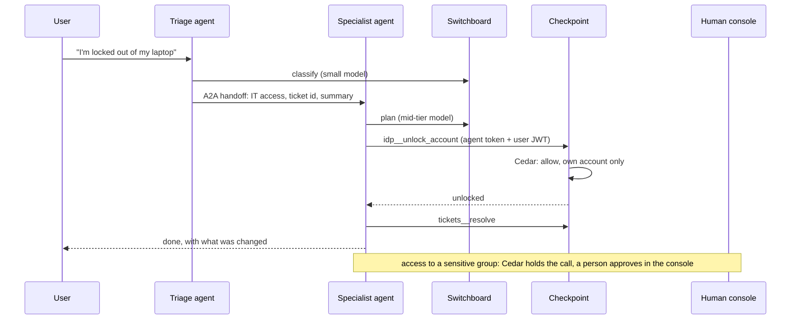

## The brief

Build **Helpdesk OS**: one support platform serving two tenants that must never see each other's data.

- **Employee desk** (internal): IT access (account unlocks, access requests) and HR policy questions for staff, signed in with company SSO.
- **Customer desk** (external): billing and returns for customers of a fictional store, signed in with the store's customer identity.

Specialist agents resolve tickets end to end. Every model call goes through **Switchboard**, every tool call through **Checkpoint**, and every agent, MCP server and skill is approved in **Atlas** before it runs. The [Week 6 capstone](#w6-lab) asked you to ship one trustworthy agent. This one asks you to run several agents for several tenants on a shared platform, and to prove that it is safe, reliable, affordable and auditable.

The bar is the same as before: a live workflow, real numbers, and evidence for every claim.

## Architecture

```viz
caption: Two tenants, five agents, three platform services. Agents hold no provider keys and no tool credentials; every write passes Checkpoint policy.
<div class="vz-cols">
  <div class="vz-panel sk c"><h5>Employee desk</h5><div class="vz-row"><span class="ch sk c">triage</span><span class="ch sk c">IT access</span><span class="ch sk c">HR policy</span></div><p>company SSO</p></div>
  <div class="vz-panel sk c"><h5>Customer desk</h5><div class="vz-row"><span class="ch sk c">triage</span><span class="ch sk c">billing</span><span class="ch sk c">returns</span></div><p>customer identity</p></div>
</div>
<span class="arr d sk"></span>
<div class="vz-cols" style="--k:3">
  <div class="vz-panel sk m"><h5>Switchboard</h5><p>one org per tenant; team per agent; app per environment; budgets</p></div>
  <div class="vz-panel sk m"><h5>Checkpoint</h5><p>agent and user identity; Cedar per tool; approvals; decision log</p></div>
  <div class="vz-panel sk m"><h5>Atlas</h5><p>agent cards, MCP servers, skills; review; versions</p></div>
</div>
<span class="arr d sk"></span>
<div class="vz-row"><span class="ch sk">ticketing MCP</span><span class="ch sk">identity provider MCP</span><span class="ch sk">knowledge base MCP</span><span class="ch sk">orders and billing MCP</span><span class="ch sk">human console</span></div>
```

A ticket's path, from first message to resolution:



## Required components

| # | Component | Minimum |
|---|---|---|
| 1 | **Tenancy** | Two Switchboard orgs; a team per agent; separate apps for production, staging and evals. Tenant isolation in data (row-level security or separate schemas), retrieval filters, memory, caches and keys |
| 2 | **Agents** | Triage per tenant plus four specialists: IT access, HR policy, billing, returns. Each published to Atlas as an A2A agent card, its know-how as Agent Skills |
| 3 | **Handoffs** | A2A or an equivalent typed handoff carrying ticket ID, tenant, user and a summary; a loop and depth limit; a fallback to a person |
| 4 | **MCP servers** | Ticketing, identity provider (unlock, access request), knowledge base, orders and billing. Real or realistic mocks, each registered and approved in Atlas |
| 5 | **Policy** | Cedar rules per tool: unlock only the caller's own account; access to sensitive groups and refunds above a limit need approval; HR agent read-only; no tool crosses tenants |
| 6 | **Human console** | Approval queue (Checkpoint's approvals API), escalation queue with the agent's summary and trace link, and a kill switch per agent |
| 7 | **Identity** | SSO for staff (OIDC), customer sign-in for the customer desk; the user's token reaches Checkpoint on every tool call |
| 8 | **Observability** | One trace per ticket across agents, Switchboard and Checkpoint; dashboards per tenant; alerts with runbooks |
| 9 | **Evals** | A suite per agent, a handoff suite, and a red-team suite per tenant, in CI with gates |
| 10 | **FinOps** | Ticket ID joined to Switchboard usage; cost per resolved ticket per tenant and agent; budgets with alerts |
| 11 | **Governance** | Inventory, risk assessment per agent, AI disclosure in both front ends, retention settings, change log |

Use any model provider through Switchboard. Keep every model choice in one config file so the same suite can run on a second model.

## Phased plan

```viz
caption: Evidence starts in phase 1, not at the end. Each phase ends with acceptance criteria you can show, not describe.
<div class="vz-cols" style="--k:3">
  <div class="vz-panel sk"><h5>0. Design, days 1 to 2</h5><p>design doc, threat model, cost target</p></div>
  <div class="vz-panel sk c"><h5>1. One agent, days 3 to 5</h5><p>unlock end to end; no keys in the agent</p></div>
  <div class="vz-panel sk c"><h5>2. All agents, days 6 to 8</h5><p>handoffs, console, approvals once only</p></div>
  <div class="vz-panel sk c"><h5>3. Security, days 9 to 10</h5><p>red-team per tenant; zero cross-tenant leaks</p></div>
  <div class="vz-panel sk c"><h5>4. Operations, days 11 to 12</h5><p>SLOs under load; cost per resolved ticket</p></div>
  <div class="vz-panel sk g"><h5>5. Evidence, days 13 to 14</h5><p>evidence pack, readiness review, demo</p></div>
</div>
<div class="vz-row"><span class="ch sk c">eval cases grow every phase</span><span>40 by day 5, every suite gated by day 8</span></div>
```

### Phase 0: design (days 1 and 2)

Write the design doc: C4 context and container diagrams, the tenancy model, a STRIDE threat model with cross-tenant leakage as a named threat, ADRs for handoff protocol and tenant isolation, SLOs, and a cost model with your assumptions labelled.

**Accept when:** a peer has run the [architecture review](#w6-review) on it; every tool in the plan has a proposed Cedar rule and a write or read tier; the cost model gives a target cost per resolved ticket per tenant.

### Phase 1: one agent end to end (days 3 to 5)

Provision both tenants in Switchboard, register the identity provider and ticketing MCP servers in Atlas, and ship the employee-desk triage and IT access agents through the whole platform.

**Accept when:**
- An account unlock works from chat to resolved ticket in staging, with one trace showing every model and tool call.
- No provider key and no tool credential exists in the agent's repository or environment; the agent knows only Switchboard and Checkpoint URLs.
- Every tool call appears in Checkpoint's decision log with the policy that allowed it.
- 40 eval cases for the IT access agent, gated in CI.

### Phase 2: all agents, handoffs and the console (days 6 to 8)

Add HR policy, billing and returns, the customer-desk triage, handoffs, and the human console.

**Accept when:**
- Each specialist has at least 50 eval cases, including must-call, must-not-call and end-state checks; the handoff suite has at least 30 cases covering wrong-agent routing and handoff loops.
- A refund above the limit is held, approved in the console by a second person, and executed exactly once with the approved arguments; a modified retry is refused.
- An escalation reaches the console with a summary a person can act on without rereading the conversation.

### Phase 3: security (days 9 and 10)

Red-team each tenant separately, then together.

**Accept when:**
- Each tenant has a red-team suite of at least 30 cases: injection through tickets, emails and knowledge base articles; attempts to unlock someone else's account; social engineering for refunds; data exfiltration through links.
- Cross-tenant suite: at least 20 cases trying to reach the other tenant's data, run with at least 3 trials each. Pass criterion: **zero** leaks in every trial.
- Zero writes executed without a matching allow or approval in the decision log.
- The HR agent cannot reach any write tool, proven by policy tests, not by the prompt.

### Phase 4: operations and FinOps (days 11 and 12)

**Accept when** dashboards and a load test show these targets (set for this brief; justify any change in an ADR):

| SLO | Target |
|---|---|
| Switchboard overhead | under 10 ms p95, excluding provider time |
| Time to first token, chat | under 2 s p95 |
| Availability of the chat endpoints | 99.5% over the test window |
| Approval decision time | under 15 minutes p95 in staffed hours |
| Resolution rate (not reopened within 7 days) | stated per agent, measured on the eval suite and a simulated traffic run |

- Cost per resolved ticket per tenant and per agent, computed from Switchboard's ledger joined to ticket outcomes (add a ticket tag or join through trace IDs), fully loaded with your assumed human costs, compared with the Phase 0 target.
- Budgets per app with burn-rate alerts; a demonstration that a customer-facing app degrades rather than stops.
- One optimisation with a before and after table in cost per resolved ticket, with resolution held.

### Phase 5: evidence and demo (days 13 and 14)

Assemble the evidence pack and pass a [readiness review](#w6-readiness).

**Accept when** the pack contains, each generated from the system rather than typed:
- **Inventory**: every agent, MCP server and skill with owner, version, digest, status and risk tier.
- **Risk assessment per agent**, including why the HR agent is not making decisions about workers (Annex III point 4) and the NIST AI 600-1 risks it addresses ([governance lesson](#w10-governance)).
- **Logs and oversight**: a query that reconstructs one ticket from start to end, including every decision and approval.
- **Change control**: the history of one prompt change and one model change, each with its eval report and reviewer.
- **Retention**: configured periods per table and proof the purge ran.
- **Disclosure**: both front ends tell users they are talking to an AI, with a test that checks it.

## Review rubric

| Area | Excellent (4) | Adequate (2) | Missing (0) |
|---|---|---|---|
| Platform use | All model and tool traffic through Switchboard and Checkpoint; all artifacts approved in Atlas; no credentials in agents | Most traffic through the platform | Direct provider or tool calls |
| Tenancy | Isolation at data, retrieval, memory, cache and keys; zero leaks across all trials | Isolation in data only, tested | Untested |
| Agents and handoffs | Clear specialist boundaries, typed handoffs, loop limits, graceful escalation | Works, some routing errors | One agent pretending to be many |
| Policy and approvals | Least privilege per tool and argument; approvals bound to exact calls; policy tests | Policies exist, partly tested | Permissions in prompts |
| Evals and red-team | Per-agent, handoff and per-tenant suites in CI with gates and pass^k | Suites exist, partly gated | Ad hoc |
| Operations | SLOs met under load, dashboards per tenant, alerts with runbooks | SLOs defined and measured | None |
| FinOps | Cost per resolved ticket per tenant, fully loaded, joined from the ledger; budgets that degrade | Cost per conversation only | No cost numbers |
| Governance | Evidence pack generated from the system | Documents written by hand | None |
| Communication | Clear demo, honest trade-offs, crisp answers | Understandable | Unclear |

A total of 28 or more out of 36 is a strong portfolio project.

## What to present (20 minutes plus 10 minutes of questions)

1. **The problem and the tenants** (1 min).
2. **Live demo** (6 min): an account unlock end to end; a refund held, approved and executed once; a cross-tenant attack that fails; the trace of one ticket; the kill switch.
3. **Architecture** (3 min): one diagram, one ticket walk-through, two ADRs with their "revisit when".
4. **Evidence** (6 min): eval and red-team results per agent and tenant, SLO dashboard, cost per resolved ticket against target, the evidence pack.
5. **Failure modes and trade-offs** (3 min): what can still go wrong, how you would know, what you chose not to build.
6. **What's next** (1 min).

```viz
caption: Twelve of twenty minutes are proof: the live demo and the evidence.
<div class="vz-bars"><span>problem, tenants</span><span class="bar sk"><i class="sk" style="--w:17%"></i></span><b>1 min</b><span>live demo</span><span class="bar sk"><i class="sk g" style="--w:100%"></i></span><b>6 min</b><span>architecture</span><span class="bar sk"><i class="sk" style="--w:50%"></i></span><b>3 min</b><span>evidence</span><span class="bar sk"><i class="sk g" style="--w:100%"></i></span><b>6 min</b><span>failure modes</span><span class="bar sk"><i class="sk" style="--w:50%"></i></span><b>3 min</b><span>what's next</span><span class="bar sk"><i class="sk" style="--w:17%"></i></span><b>1 min</b></div>
```

Record a backup of the demo. Live identity providers and payment mocks fail at the worst moment.

## What is not required

- A production identity provider or real payment system: realistic mocks behind MCP are fine.
- Every component of the reference services' "not built yet" lists. Build what your demo needs (for example the ticket tag in Switchboard's ledger), and record the rest in ADRs.
- A legal opinion. The risk assessments are engineering documents written to help counsel decide.

## Reference reading

- [Platform engineering for agents](#w10-platform), [Governance and regulation](#w10-governance) and [AI FinOps](#w10-finops).
- The [Switchboard](https://github.com/Rachneet/ai-system-design-course/tree/main/platform/switchboard), [Atlas](https://github.com/Rachneet/ai-system-design-course/tree/main/platform/atlas) and [Checkpoint](https://github.com/Rachneet/ai-system-design-course/tree/main/platform/checkpoint) READMEs, ADRs and threat models.
- The [Week 6 capstone](#w6-lab) rubric and [production readiness](#w6-readiness) checklist.
