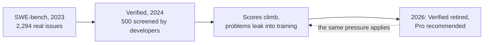

## What you actually want to know

A team adopting a coding agent wants to know four things: does it fix our issues, does it break anything, how much review does its work need, and what does each merged change cost? A public leaderboard answers none of them directly. It measures a model, in someone else's harness, on someone else's code, and that measurement gets worse with time. This lesson covers why, and how to build the measurement you need.

## The SWE-bench story, and what it teaches

**SWE-bench** ([Jimenez et al., 2023](https://arxiv.org/abs/2310.06770)) turned real GitHub issues into tasks: 2,294 problems from 12 popular Python repositories, each with the tests from the pull request that fixed it. An agent gets the repository and the issue, and passes if the hidden tests pass after its change. At publication, the best model resolved 1.96% of them.

**SWE-bench Verified** followed in August 2024, when OpenAI and the SWE-bench authors had professional developers screen the tasks for well-specified issues and fair tests, keeping 500 ([swebench.com](https://swebench.com/verified)). It became the number everyone quoted.

By February 2026, OpenAI had stopped reporting it, citing two problems: tests that reject functionally correct fixes, and evidence that models had seen the problems and their fixes in training. It recommended **SWE-bench Pro** instead ([OpenAI, February 2026](https://openai.com/index/why-we-no-longer-evaluate-swe-bench-verified/)): 1,865 problems from 41 actively maintained repositories, split into a public set, a held-out set and a commercial set from proprietary code ([Deng et al.](https://arxiv.org/abs/2509.16941)).



Three lessons generalise beyond this one benchmark:

- **Public benchmarks decay.** Once a test set is public and important, it ends up in training data, and scores stop measuring generalisation. A held-out or private set slows that down; it does not stop it.
- **Scores are not comparable across harnesses.** Leaderboard entries pair a model with a harness, and most are reported by the vendor. A model that scores higher in its maker's harness may not score higher in yours.
- **Tests are imperfect judges.** A test written for one human fix can reject a different, correct fix, and pass a wrong one that happens to satisfy it.

## What controlled studies say about productivity

Benchmarks measure tasks in isolation. Studies of real developers on real work tell a messier story. METR ran a randomised trial in early 2025: 16 experienced open-source developers, 246 issues from their own repositories, randomly assigned to allow or disallow AI tools. With AI allowed, issues took **19% longer**, while the developers had expected a 24% speed-up and still believed afterwards that they had been about 20% faster ([METR, July 2025](https://metr.org/blog/2025-07-10-early-2025-ai-experienced-os-dev-study/)).

METR's follow-up, with 57 developers and newer tools, estimated that returning developers were 18% faster (confidence interval from 38% faster to 9% slower) and new recruits 4% faster (15% faster to 9% slower). METR itself calls this "an unreliable signal", because many developers now decline to work without AI, which removes exactly the tasks where it helps most; it concludes the true effect is likely larger than measured ([METR, February 2026](https://metr.org/blog/2026-02-24-uplift-update/)).

```viz
caption: What developers believed and what was measured, in METR's early-2025 trial. Perception is not a measurement; neither is a leaderboard.
<div class="vz-bars"><span>expected before</span><span class="bar sk"><i class="sk g" style="--w:63%"></i></span><b>24% faster</b><span>believed after</span><span class="bar sk"><i class="sk g" style="--w:53%"></i></span><b>20% faster</b><span>measured</span><span class="bar sk"><i class="sk b" style="--w:50%"></i></span><b>19% slower</b></div>
<div class="vz-src"><a href="https://metr.org/blog/2025-07-10-early-2025-ai-experienced-os-dev-study/">METR, July 2025</a>: 16 developers, 246 issues, early-2025 tools. METR says these results are out of date; its <a href="https://metr.org/blog/2026-02-24-uplift-update/">February 2026 update</a> finds speed-ups, with wide uncertainty.</div>
```

The lesson for a platform team is not "AI helps" or "AI hurts". It is that the effect depends on the people, the codebase, the tools and the year, and the only number that applies to you is one you measure on your own work.

## Build the suite from your own history

Your repository already contains an eval suite: every merged bug fix whose pull request added a test. Turn each into a task.

1. **Find a fix with a test.** A merged change that fixed an issue and added or changed a test that failed before it.
2. **Snapshot the code before the fix.** That is the task's repository.
3. **Keep the test hidden.** The agent never sees it; it is added after the agent finishes, then run. That is the check.
4. **Keep the issue text as written.** Real issues are vague; your agent will meet vague issues in production.
5. **Prove the task is real.** The hidden test must fail on the snapshot and pass with the original fix. Foundry has a test that checks every task this way, because a task that passes before any change measures nothing.

Run each task several trials and report **pass^k**, not best-of-k, for the same reason as in [Week 3](#w3-regression): a team gets one run per issue, not the best of eight.

> [!rule] Your private suite is the release gate; public leaderboards are background reading. A suite built from your own history cannot have leaked into training data, measures your harness rather than someone else's, and grows by one task every time you find a regression.

## Measure the agent in production, not only offline

Offline evals say whether a change can merge. Production metrics say whether it was worth merging:

| Metric | What it tells you | How to collect it |
|---|---|---|
| Acceptance rate | Share of agent branches a person merges | Factory ledger, by repository and change type |
| Review time per merged change | The human cost the agent shifts onto reviewers | Forge review timestamps |
| Change failure rate | Share of merged agent changes reverted or hotfixed | DORA-style tracking, labelled by provenance trailer |
| Cost per merged change | Model spend divided by merges, by repository | Switchboard usage by `job:` tag, joined to the ledger ([AI FinOps](#w10-finops)) |
| Escape rate | Bugs found later in code the agent wrote | Incident reviews that check provenance |

Provenance (next week) is what makes these joins possible: a commit trailer that names the job turns "was this written by an agent?" into a query.

## Failure modes

| Failure | Result | Defence |
|---|---|---|
| Choosing a model by leaderboard | It underperforms on your code and harness | Your own suite, run with your harness |
| Tasks that already pass | Inflated scores | Prove each task fails before the fix |
| Visible tests | The agent edits the test until it passes | Hidden tests, added after the run; a gate on deleted or weakened tests |
| One trial per task | Flaky results look like progress | Several trials; pass^k |
| Measuring speed by survey | Perceived gains with no measured ones | Ledger and forge data, compared over time |

## Design review questions

> [!interview] A vendor's model leads a public coding leaderboard by five points. What would you need to see before switching your factory to it?

> [!interview] How would you turn last quarter's bug fixes into an eval suite, and how do you know each task is valid?

> [!interview] Your agent's acceptance rate is 80%, but review time per change doubled. Is the agent helping?

## Further reading

- [SWE-bench](https://arxiv.org/abs/2310.06770), [SWE-bench Verified](https://swebench.com/verified) and [SWE-Bench Pro](https://arxiv.org/abs/2509.16941).
- OpenAI, [Why we no longer evaluate SWE-bench Verified](https://openai.com/index/why-we-no-longer-evaluate-swe-bench-verified/) (February 2026).
- METR, [the early-2025 developer study](https://metr.org/blog/2025-07-10-early-2025-ai-experienced-os-dev-study/) and [the February 2026 update](https://metr.org/blog/2026-02-24-uplift-update/).
- Foundry's [ADR 0004: evals from your own history](https://github.com/Rachneet/ai-system-design-course/blob/main/platform/foundry/docs/adr/0004-evals-from-your-own-history.md).

```quiz
[
  {"q": "Why did SWE-bench Verified stop being a trusted measure of frontier coding agents?", "options": ["It was too hard", "Its tests reject some correct fixes, and evidence showed models had seen the problems in training", "It used Java", "It had too few tasks to run"], "answer": 1, "why": "OpenAI cited flawed tests and contamination when it stopped reporting it in February 2026."},
  {"q": "In METR's early-2025 trial, how did developers' beliefs compare with the measurement?", "options": ["They matched", "They believed they were about 20% faster; they took 19% longer", "They believed they were slower but were faster", "There was no measurement"], "answer": 1, "why": "Perception and measurement pointed in opposite directions, which is why surveys are not a substitute for measured outcomes."},
  {"q": "What makes a task built from your own history valid?", "options": ["It has a long issue description", "Its hidden test fails on the code before the fix and passes with the real fix", "It was fixed recently", "The agent can see the test"], "answer": 1, "why": "A task that already passes, or that the real fix does not pass, measures nothing."},
  {"q": "Which production metric reveals the human cost an agent shifts onto a team?", "options": ["Tokens per task", "Review time per merged change", "Number of tools", "Context window size"], "answer": 1, "why": "An agent that produces many acceptable changes can still cost more if each one takes longer to review."}
]
```
