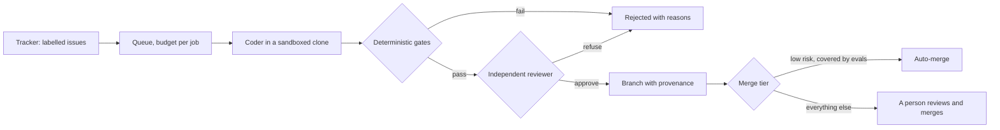

## From one agent to a factory

Last week's harness takes one task and produces one change. A **software factory** runs that at the scale of a team: issues arrive from a tracker, agents work them in parallel, checks decide what is fit to merge, and every change carries a record of how it was made. The hard part is not making agents write more code. It is making sure that more code does not mean more broken code, more review load and more changes nobody can explain.



## Roles: who does what

| Role | Does | Must not |
|---|---|---|
| **Planner** (optional) | Splits a large issue into tasks small enough to review | Write code, or merge |
| **Coder** | Makes the change in a sandboxed clone, runs the tests | See secrets, reach the network, edit its own rules |
| **Gates** | Check the result deterministically | Be skippable by the agent |
| **Reviewer** | Judges the diff against the issue | See the coder's reasoning; run code; merge |
| **Person** | Decides what to build, merges anything not in an auto-merge tier, owns incidents | Be replaced by "the reviewer approved" |

Splitting roles is the separation of duties from [Week 8](#w8-policy) applied to code: the coder cannot approve its own work, and the reviewer cannot change what it reviews.

## Gates first, and deterministic

Gates run on the result in the workspace, not on what the agent says it did. Foundry runs six before any review tokens are spent:

| Gate | Catches | Why it is a gate, not a review comment |
|---|---|---|
| Changed | The agent finished without changing anything | Nothing to review |
| Tests pass | Broken behaviour | Exact, and the agent's claim that "tests pass" is not evidence |
| Size | A 3,000-line diff for a one-line bug | Large diffs are where review fails; split the issue instead |
| Protected paths | Changes to CI, deployment, auth or the agent's own config | Those changes always need a person |
| Tests kept | "Fixed" by deleting or weakening tests | The most common way an optimiser satisfies "make the tests pass" |
| Secrets | A key pasted into code | Once pushed, it must be rotated |

Add your own: type checks, lint, a migration check, licence scanning of new dependencies. Each is cheaper and more reliable than asking a model to notice the same thing.

## An independent reviewer, second

A model reviewer adds judgement the gates cannot: does the change actually address the issue, and does it change anything unrelated? It is only useful if it is independent ([ADR 0002](https://github.com/Rachneet/ai-system-design-course/blob/main/platform/foundry/docs/adr/0002-independent-reviewer-after-deterministic-gates.md)):

- **It sees the issue and the diff, nothing else.** Shown the coder's reasoning, a reviewer tends to accept the story instead of judging the change.
- **Preferably a different model**, so the two do not share blind spots. Switchboard makes that one setting ([AI gateways](#w7-gateways)).
- **A fixed answer format that fails closed.** Foundry requires `{"approve": true|false, "reasons": [...]}`; "Looks good to me!" counts as a refusal.
- **Measured like any judge.** Calibrate it against human reviews, the way [Week 3](#w3-judge) calibrates LLM judges. A reviewer that approves everything is a cost, not a control.

## Merge by risk tier

Not every change deserves the same scrutiny. Make the tiers explicit, and let the factory merge on its own only where evals cover the change type:

| Tier | Example | Merge |
|---|---|---|
| Routine, well covered | Dependency patch bumps with all tests green; lint fixes | Auto-merge after gates and review |
| Ordinary | Bug fixes and small features in covered code | A person merges, with the review attached |
| Sensitive | Auth, payments, data deletion, migrations, CI, infrastructure | Protected paths: agents propose in an issue comment, people write the change |

Foundry defaults to branch-and-wait: every accepted change becomes a branch, and it merges only when `auto_merge` is on for that repository and the merge is a fast-forward ([ADR 0003](https://github.com/Rachneet/ai-system-design-course/blob/main/platform/foundry/docs/adr/0003-branch-and-wait-by-default.md)).

## Provenance: how every change was made

When an agent-written change breaks production six months later, someone will ask which agent wrote it, with which model, from which issue, and what checked it. **Provenance** answers that. SLSA defines it as "the verifiable information about software artifacts describing where, when and how something was produced" ([SLSA provenance](https://slsa.dev/spec/v1.0/provenance)), and its fields map naturally onto a factory job:

| SLSA concept | In a factory job | In Foundry |
|---|---|---|
| Subject (the artifact) | The commit | `commit` in the ledger record |
| Build definition (the inputs) | The issue, the config, the prompt | `issue`, and `Foundry-Prompt: sha256:...` on the commit |
| Run details (who built it, when) | The builder, the models, start and finish | `builder`, `models`, `started`, `finished` |
| By-products | What happened along the way | `transcript`, `gates`, `review`, `tokens` |

Foundry writes it twice: as **commit trailers** (`Foundry-Job`, `Foundry-Coder`, `Foundry-Reviewer`, `Foundry-Prompt`, `Foundry-Gates`), which travel with the code and make "show me every agent-written change in this file" a `git log` query, and as a **ledger record** per job, which holds the full story. Signing the record (an in-toto attestation) is the next step, so that the provenance itself cannot be forged; Foundry lists it under "not built yet".

```viz
caption: Provenance turns an incident question into a query. The trailer travels with the commit; the ledger holds the rest.
<div class="vz-cols">
  <div class="vz-panel sk c"><h5>On the commit</h5><div class="vz-row"><span class="ch sk c">Foundry-Job</span><span class="ch sk c">Coder</span><span class="ch sk c">Reviewer</span></div><div class="vz-row"><span class="ch sk c">Prompt digest</span><span class="ch sk c">Gates</span></div></div>
  <div class="vz-panel sk m"><h5>In the ledger</h5><div class="vz-row"><span class="ch sk m">issue</span><span class="ch sk m">transcript</span><span class="ch sk m">review</span></div><div class="vz-row"><span class="ch sk m">tokens</span><span class="ch sk m">times</span></div></div>
</div>
```

## The economics

A factory pays when the cost of a merged change, including the people's time it consumes, is below what the change is worth. Measure it the way [AI FinOps](#w10-finops) measures cost per resolved ticket:

    cost per merged change = (model spend + review time x reviewer cost + rework) / merged changes

Model spend comes from Switchboard's usage by `job:` tag; review time from the forge; rework from changes reverted or hotfixed, found through provenance. Watch the review term. If agents produce changes faster than people can review them, review becomes the bottleneck and its quality drops, and the factory is just moving cost from writing code to checking it.

## How Foundry maps to the factory

| Part | Foundry |
|---|---|
| Queue | `foundry batch issues.json`; one job per issue, one token budget per job |
| Coder | The harness from [Week 11](#w11-harness), in a throwaway clone |
| Gates | `factory.gates`: changed, tests, size, protected, tests kept, secrets |
| Reviewer | `factory.review`: issue and diff only, fixed JSON, fails closed |
| Merge | Branch `foundry/<job>`; fast-forward only with `auto_merge` and a clean repository |
| Provenance | Commit trailers and a JSON-lines ledger record per job |
| Cost | Switchboard tags `job:<id>:coder` and `job:<id>:reviewer` |

## Failure modes

| Failure | Result | Defence |
|---|---|---|
| Rubber-stamp review | Reviewer approves 99% of changes | Calibrate against people; track approval and revert rates |
| Review bottleneck | Agent branches pile up; review quality drops | Size gate, smaller issues, auto-merge only for covered tiers |
| Optimising the gate | Tests deleted or weakened to pass | Tests-kept gate; tests in protected paths for sensitive code |
| Unexplainable change | Nobody knows why a line exists | Trailers and ledger; the issue linked from the commit |
| Cost creep | Retries and long sessions on hard issues | Budget per job; route hard issues to people early |

## Design review questions

> [!interview] Which change types would you allow to auto-merge in your codebase, and what evidence would you need first?

> [!interview] Your reviewer model approves 97% of the changes that pass the gates. Is that good news?

> [!interview] An agent-written change caused an incident. Walk through how you would find every other change from the same job, model or prompt.

## Further reading

- [SLSA provenance](https://slsa.dev/spec/v1.0/provenance) and [in-toto attestations](https://github.com/in-toto/attestation).
- [Foundry's README](https://github.com/Rachneet/ai-system-design-course/tree/main/platform/foundry), threat model and ADRs.
- [Evaluating coding agents](#w11-evals), for measuring what the factory merges.

```quiz
[
  {"q": "Why do Foundry's gates run before the reviewer model?", "options": ["Gates are slower", "They are exact and cheap, so review tokens are spent only on changes that could merge, and the reviewer never has to catch what a test already catches", "The reviewer needs the gate results", "Gates are optional"], "answer": 1, "why": "Deterministic checks first; judgement second, and only where it can matter."},
  {"q": "What should the reviewer see?", "options": ["The coder's full reasoning", "The issue and the diff only", "The test output only", "Nothing; it should run the code"], "answer": 1, "why": "Independence: shown the coder's story, a reviewer tends to accept it."},
  {"q": "A change edits the CI workflow. What should happen in a factory?", "options": ["Auto-merge if tests pass", "It fails the protected-paths gate; changes to CI need a person", "The reviewer decides", "It is allowed if small"], "answer": 1, "why": "Protected paths cover the things that, if changed, change the factory's own controls."},
  {"q": "What makes 'every agent-written change in this file' a quick query?", "options": ["Code comments", "Provenance trailers on each commit, backed by a ledger record per job", "The reviewer's memory", "Branch names"], "answer": 1, "why": "Trailers travel with the commit, so git log can filter by them; the ledger holds the full story."}
]
```
