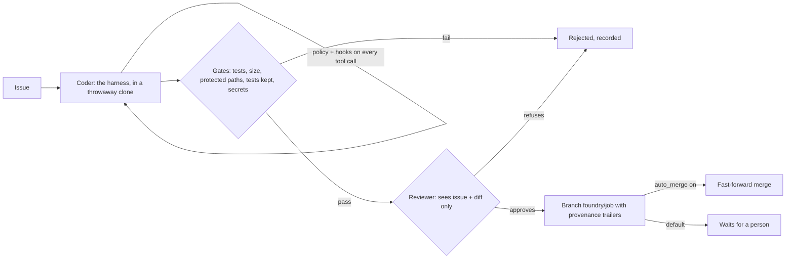

# Foundry: a coding-agent harness and a software factory

Issues in, tested and reviewed branches out, with a record of how each was made. The reference service for weeks 11
and 12 of the [AI System Design Course](../../README.md), built on [Switchboard](../switchboard) for every model call.



| Concern | How |
|---|---|
| Harness | A loop over five tools: `list_files`, `read_file`, `search`, `edit_file` (exact, unique replacement), `run`; `finish` ends it. Results are cut to a fixed size; step limit and token budget per job |
| Context | The repository's `AGENTS.md`, if present, is added to the instructions; issue text and file contents are data |
| Permissions | `deny`, then `ask`, then `allow`, over globs like `run(python -m pytest*)` or `edit(.github/**)`; unmatched calls ask; in unattended runs ask means no |
| Hooks | Commands from the original repository's `foundry.toml` get each call as JSON; exit code 2 blocks it. They run from the original, so an agent cannot edit a hook and then trigger it |
| Sandbox | A throwaway clone; paths contained (symlinks included); no shell; no secrets in the environment; time and output limits; `sandbox_prefix` wraps commands in an OS sandbox for network and filesystem isolation ([ADR 0001](docs/adr/0001-two-layer-sandbox.md)) |
| Gates | Tests pass, diff under the size limit, no protected path changed, no test deleted or test function removed, no secret added; all before any review tokens are spent |
| Review | A second model sees only the issue and the diff, and must answer in a fixed JSON shape ([ADR 0002](docs/adr/0002-independent-reviewer-after-deterministic-gates.md)) |
| Merge | A branch `foundry/<job>`; fast-forward merge only with `auto_merge` and a clean repository; otherwise a person merges ([ADR 0003](docs/adr/0003-branch-and-wait-by-default.md)) |
| Provenance | Commit trailers (`Foundry-Job`, `-Coder`, `-Reviewer`, `-Prompt`, `-Gates`) and a ledger record per job: issue, models, gates, review, tokens, times |
| Cost | Model calls through Switchboard, tagged `job:<id>:coder` and `job:<id>:reviewer`, so cost per merged change comes from Switchboard's ledger |
| Evals | `foundry eval` runs the coder on tasks with hidden tests and reports pass@1 and pass^k ([ADR 0004](docs/adr/0004-evals-from-your-own-history.md)) |

## Run it

```bash
uv sync
export SWITCHBOARD_URL=https://switchboard.internal FOUNDRY_SWITCHBOARD_KEY=sbk_...
uv run foundry --repo ../my-service issue "parse_iso('2026-10-15') raises 'month must be in 1..12'"
uv run foundry --repo ../my-service batch issues.json
uv run foundry eval evals/tasks --trials 3
```

Configure each repository in `foundry.toml`, read from the original repository, never from the agent's copy:

```toml
[foundry]
test = "python -m pytest -q"
coder_model = "foundry-coder"          # Switchboard model names
reviewer_model = "foundry-reviewer"
max_changed_lines = 300
protected = [".github/**", "foundry.toml", "AGENTS.md", "migrations/**"]
allow = ["read(**)", "edit(**)", "run(python -m pytest*)", "run(ruff *)"]
ask = ["run(uv add*)"]
deny = ["edit(.git/**)", "edit(.github/**)", "run(curl*)"]
hooks = ["python scripts/no_new_deps.py"]
sandbox_prefix = ["bwrap", "--dev-bind", "/", "/", "--unshare-net", "--"]  # Linux: no network; add binds to narrow files
```

## Tests

`uv run pytest` runs 14 tests with a scripted model and real git repositories: a bug fixed, tested, reviewed and
branched with provenance; auto-merge only when clean; a deleted test caught by the gates before review; protected
paths denied or caught; reviewer refusal and malformed review; rule order; hooks that run from the original
repository; the sandbox's path, secret, shell, time and output limits; budget and step limits; instructions planted
in a README that get nowhere; the eval runner; and a check that each eval task is real. No model key is needed.

## Engineering docs

- [ADR 0001](docs/adr/0001-two-layer-sandbox.md): a two-layer sandbox
- [ADR 0002](docs/adr/0002-independent-reviewer-after-deterministic-gates.md): an independent reviewer, after deterministic gates
- [ADR 0003](docs/adr/0003-branch-and-wait-by-default.md): branch and wait by default
- [ADR 0004](docs/adr/0004-evals-from-your-own-history.md): evals from your own history
- [Threat model](docs/THREAT_MODEL.md) and [security policy](SECURITY.md)

## Not built yet

A planner role that splits large issues; pull requests on a forge (GitHub, GitLab) instead of local branches;
subagents; context compaction for long sessions; signed provenance (in-toto attestations); tool calls to external
systems through Checkpoint; a tracker integration that pulls issues.
