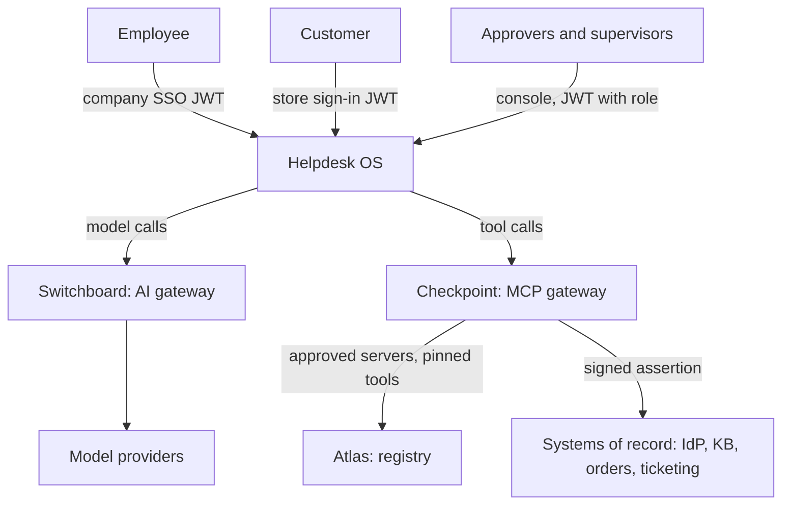

# Helpdesk OS: design

Status: reference implementation, 2026-10-15.

## Context

## Containers

| Container | Responsibility | State |
|---|---|---|
| Helpdesk API and runtime (`helpdesk.main`) | Tickets, the agent loop, handoffs, the console, FinOps and evidence | Postgres: tickets, messages, events, escalations, pending calls, switches, purge runs |
| Systems of record (`helpdesk.servers.main`) | MCP servers for the IdP, KBs, orders and ticketing; mocks of real systems | In memory (a real system owns its own database) |
| Switchboard, Atlas, Checkpoint | Platform services, unchanged except for configuration | Their own schemas |

An agent holds two credentials: a Switchboard key, which grants one model under a budget, and a Checkpoint token,
which grants the tools policy allows for its tenant. It holds no provider key and no tool credential.

## Tenancy model

| Layer | Isolation | Enforced by |
|---|---|---|
| Identity | `tenant` claim in the user JWT; a token without a known tenant is refused | Helpdesk and Checkpoint, independently |
| Agents | Each agent belongs to one tenant; handoff targets must be in the same tenant | Roster validation at start, and again at handoff time |
| Tools | A tenant-bound agent acting for another tenant's user is refused before policy runs; Cedar walls around each tenant's systems | Checkpoint (built in, then policy) |
| Data in systems | Systems scope by the assertion's `tenant` and `sub`; another customer's order is "not found" | Each system |
| Helpdesk data | Forced row-level security on `helpdesk.tenant`, set per transaction; the app role has no `BYPASSRLS` | Postgres |
| Models and spend | Org per tenant, team per agent, app per agent and environment, with a model allow-list and a budget | Switchboard |
| Approvals | Approver tokens and the console are per tenant; approvers see and decide only their tenant's requests | Checkpoint |

## Ticket lifecycle

`open` → (agent replies) `answered` or `resolved` · (a call is held) `waiting_approval` → (approved: the call runs once,
the agent continues; rejected: the user is told) · (escalation, kill switch, budget, model failure, handoff
refusal, step limit) `escalated` → a person replies and resolves. A message within 7 days of resolution reopens the
ticket and marks it reopened, which takes it out of the resolution rate.

## SLOs

The targets come from the brief. They are not yet measured: the load test is listed under "Not built yet".

| SLO | Target | Measured from |
|---|---|---|
| Switchboard overhead | under 10 ms p95 | Switchboard's `Server-Timing` gateway duration |
| Time to first token, chat | under 2 s p95 | Switchboard's TTFB histogram (Helpdesk does not stream yet) |
| Availability of `/v1/tickets` | 99.5% over the window | request success ratio |
| Approval decision time | under 15 minutes p95 in staffed hours | Checkpoint's `requested_at` to `decided_at` |
| Resolution rate | stated per agent | `GET /admin/finops` (resolved and not reopened) |

## Cost model

The formula used by `GET /admin/finops`:

    cost per resolved ticket = (model cost of the month's tickets + escalations x C_e + approvals x C_a) / resolved

The model cost is measured from Switchboard's ledger through the `ticket:<id>:<agent>` tag. `C_e` and `C_a` are
assumed costs of people's time, set in configuration and reported as assumptions.

Worked example, every input an **assumption** to replace with your own prices and traffic. A triage call reads about
1,500 tokens and writes 100. A specialist turn makes 3 to 5 calls of about 3,000 tokens in and 200 out. Take a small
model at 0.25 and 2 USD per million input and output tokens, and a mid-tier model at 3 and 15. Then an unlock costs about
0.0006 USD for triage plus about 0.05 USD for the specialist, so about 0.05 USD in model cost. One escalation at an
assumed 6 USD is worth over a hundred such tickets, so the resolution rate drives cost per resolved ticket far more
than the model price.

## Trade-offs recorded as ADRs

1. [Typed in-process handoffs](adr/0001-typed-in-process-handoffs.md)
2. [Run approved calls with the stored user token](adr/0002-run-approved-calls-with-the-stored-user-token.md)
3. [One user token for two audiences](adr/0003-one-user-token-two-audiences.md)
4. [Red-team with a compromised model](adr/0004-red-team-assumes-a-compromised-model.md)
